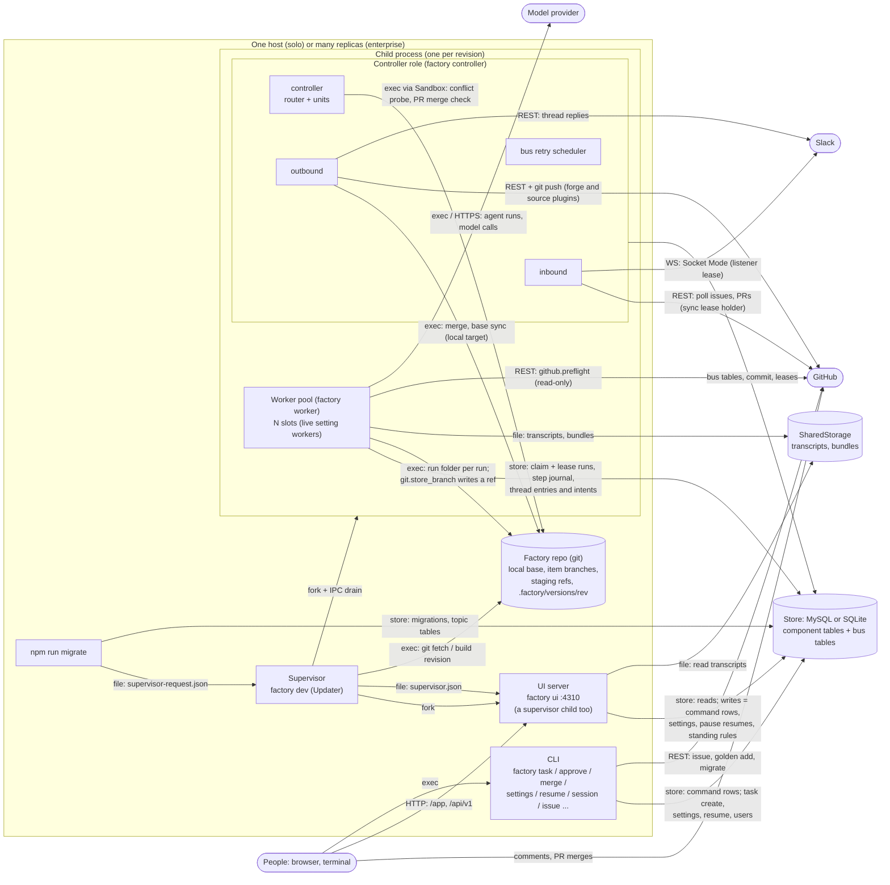
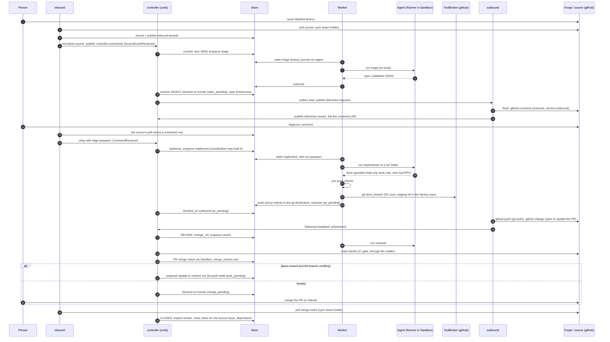
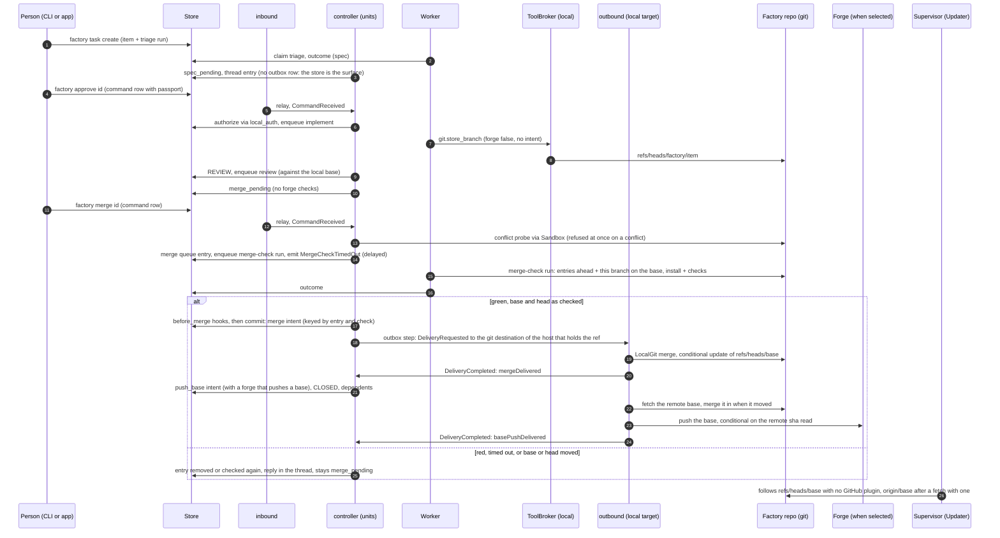
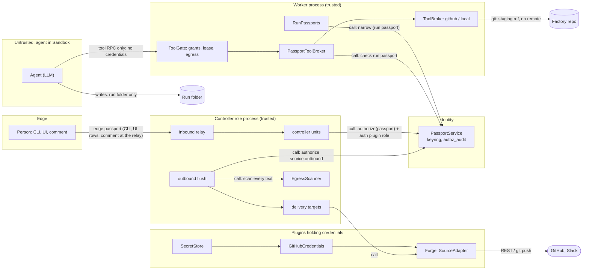

# ARCHITECTURE

A map of the factory for review: every component as a box, and every connection labelled with how the two sides talk. Use it to spot coupling, missing seams and single points of failure, and to propose changes (RFCs).

The detailed decisions behind each part live in [`docs/architecture.md`](docs/architecture.md) (layers, control vs agent plane, scaling, secret isolation), [`docs/design.md`](docs/design.md) (the event-driven structure is `docs/design/10-event-driven.md`) and [`docs/plugins.md`](docs/plugins.md). `PROGRESS.md` says what of RFC 0015 exists and what is still legacy. This file is the overview; when they disagree, the code and the topic files win, and this file should be fixed.

## How components talk (legend)

The factory is split into components under `src/` (inbound, controller, worker, outbound, bus, identity, runtime, state, shared) that talk through **topics on a bus**. The bus is a plugin (`plugins.bus`, default `sql`): its topic tables live in the factory's own database, so there is no broker process to run. Code that RFC 0015 has not rewritten yet (`src/core/`, `src/impl/`, `src/interfaces/`, `src/ui/`, `src/compose.ts`) still talks through the legacy `FactoryStore`; those connections are labelled `store`.

| Kind | Arrow label | What it is | Examples |
|---|---|---|---|
| **Call** | `call` | In-process TypeScript call, through an interface or a component's `index.ts` | inbound → `SourceAdapter.poll()`, worker → `Sandbox.create()`, one unit → another through `ctx.unit(name)` |
| **Bus** | `publish <topic>`, `consume <topic>` | A component publishes in its own transaction into its `<component>_outbox`; its `relay` tick moves the rows to the topic's `bus_<topic>` table; a consumer group reads each partition in order under a lease and dedupes in its `<component>_inbox`. Retries, delayed messages and dead letters are due against the retry scheduler's release horizon (`bus_scheduler`) | `inbound.records`, `controller.commands`, `controller.events`, `deliveries.requests`, `deliveries.results`, `system.alerts` (§3) |
| **Kernel commit** | `commit` | A controller unit's decision is a list of writes (`ControllerWrite`) the router applies through `Kernel.commit` / `commitItem`; each is one keyed or conditional store write | `thread_entry`, `intent`, `emit`, `expire_leases`, a transition at the item's version |
| **Outbound delivery** | `intent`, `deliver` | A producer stores an intent (`outbound_intents` for a thread entry, `outbound_actions` for every other write); outbound batches it per destination and a delivery target writes it to the outside world | spec comment, status label, `push`, `pr`, `close_pr`, `merge`, `push_base`, `file_sub_issue` |
| **Store** | `store` | A legacy `FactoryStore` method: a conditional update, a queue claim with a lease, or a plain read | `worker_runs` (claim + lease + heartbeat), command rows in `inbound_commands`, settings |
| **Lease** | `lease` | One holder at a time across replicas, by conditional update with expiry | run leases, `inbound_sync_leases` (one forge sync per project), `inbound_listener_leases` (one stream connection per source type), outbound batch claims, merge queue landing |
| **HTTP** | `HTTP` | Local JSON API, 127.0.0.1 only | `factory ui` on port 4310: `/app`, `/api/v1/*`, `/api/health` |
| **Tool RPC** | `tool RPC` | MCP over a per-run local socket from the agent to the worker's `ToolGate` | only the read-only broker tools `tool_grants` names (`github.preflight`) |
| **Subprocess** | `exec` | A child process with a fixed argv and environment | `claude -p` (runner), `git`, install and check commands, `caffeinate` |
| **IPC** | `IPC` | Node fork channel between supervisor and child | supervisor → child: `factory:drain`; child → supervisor: `factory:drained`, `factory:error` |
| **Remote** | `REST`, `WS`, `git` | Calls to an external service, only inside one plugin implementation | GitHub REST (conditional GETs, shared budget), `git push` from the factory repo, Slack Socket Mode and Web API, model APIs |
| **File** | `file` | A file one process writes and another reads | `.factory/supervisor.json`, `supervisor-request.json` (`npm run migrate`), transcripts in `SharedStorage`, `<state>/passport.key` |

What is discovered rather than wired by hand: topics (`*.topic.ts`), bus handlers (`*.handler.ts`), controller units (`*.unit.ts`), run kinds (`*.run.ts`), run roles (`*.role.ts`), settings (`*.setting.ts`), hooks (`*.hook.ts`), migrations (`*.migration.ts`), CLI commands (`*.command.ts`) and plugins (`*.plugin.ts`, `*.grant.ts`). The registry (`src/runtime/registry/`) refuses to start on a message type no handler accepts, an event kind no unit takes, or a claimed run kind with no run file.

## 1. Processes

What runs, and how processes reach each other. Every process can be started more than once; they coordinate only through the store (and the bus tables in it).

- **Supervisor** (`src/supervisor.ts`, `Updater` plugin): under `git-worktree` it builds each new base commit into `.factory/versions/<rev>` (from `origin/<base>`, or the local `refs/heads/<base>` when no GitHub plugin is selected), forks a child from it with `SF_CODE_VERSION` set to that revision, then asks the old child to drain over IPC (start-then-drain). It also runs `factory ui` as a child and swaps it on each revision. It writes `supervisor.json` and reads `supervisor-request.json` from `npm run migrate`; with `updater.auto_migrate` it applies pending steps itself. Under `none` it runs the roles in-process.
- **Controller role** (`src/runtime/roles/controller-role.ts`): one process runs four components, each on its own TickGenerator (`plugins.ticks`): inbound (`intake`, `consume`, `records`, `relay`), the controller (`consume`, `relay`, and the units' `decide` schedule each `tick_ms`), outbound (`consume`, `outbound-flush`, `relay`) and the bus's retry scheduler. It owns the forge sync lease and hands it to inbound (fences cursor moves) and to the sync unit and outbound (only the holder writes the synced type). Never runs an agent.
- **Worker pool** (`src/worker/`: `pool.ts`, `runner.ts`, one folder per run kind under `runs/`): claims runs from `worker_runs` through the store, hands each to the ExecutionEngine (`plugins.engine`, default `journal`), runs its kind's steps, and writes the outcome. Its comments are thread entries and its pushes and PRs are outbound intents, written through the store. Never decides a transition.
- **UI server** (`src/ui/`): reads the store; its writes are app command requests (rows in `inbound_commands`, applied by the controller like any command), settings (through the same `runSettings` as the CLI), pause resumes and standing rules, each audited.
- **CLI** (`src/main.ts` finds each command in `src/cli/handlers/<command>/<command>.command.ts`): `task create` writes a local item and its triage run; item commands (`approve`, `retry`, `revise`, `reject`, `resolve`, `merge`) become `inbound_commands` rows carrying the actor's passport, for any item, local or GitHub.

Solo default: one `factory dev` process tree on one machine, SQLite or MySQL, every schedule of every component in one process, no replica id. Enterprise setting: several replicas on one MySQL store, each with a replica id; leases, claim tokens and conditional updates keep each message, run, batch and landing with one holder, and `npm run migrate` creates every discovered topic's tables so the runtime MySQL user needs no DDL.

## 2. Components and interfaces

The components under `src/` (RFC 0015) and the plugin interfaces they still reach through `src/interfaces/`. Plugin implementations are chosen by name in `factory.config.json` and built only through the registry (`src/plugins.ts`, one `*.plugin.ts` descriptor each, found anywhere under `src/`); `src/compose.ts` wires them. **Bold** = the selection in this repo's checked-in `factory.config.json` (the forge is derived from `github-issues`).

```mermaid
graph TB
  subgraph COMP["Components (src/)"]
    direction LR
    INB["inbound<br/>intake (polls, stream relay, command relay),<br/>normalize-source handler"]
    CTL["controller<br/>router, 23 units, Kernel (reader, commit),<br/>actors (WorkItem, MergeQueue), handlers"]
    WRK["worker<br/>pool, runner, run kinds, roles,<br/>engine (step journal), run passports"]
    OUT["outbound<br/>intents, aggregator (batching),<br/>flush, delivery targets"]
    BUS["bus<br/>EventBus, inbox/outbox, relay,<br/>retry scheduler, dead letters"]
    IDN["identity<br/>passports, keyring, profiles, audit"]
    RT["runtime<br/>registry (discovery), roles,<br/>settings catalog, hooks"]
    STATE["state<br/>SqlDriver, migrations, backup,<br/>rehearse, schema snapshot"]
  end

  subgraph AGENT["Agent plane plugins"]
    RUN["AgentRunner<br/><b>claude-code</b>, openai-compatible"]
    LLMP["LLMProvider<br/><b>claude-cli</b>, openai-compatible"]
    SBX["Sandbox<br/><b>noop</b> (git worktree)"]
    CAP["CapabilitySearch<br/><b>bm25</b>, list-all"]
    TDB["TestDatabase<br/><b>none</b>, mysql-local"]
  end

  subgraph SYNC["Sync plugins"]
    SRC["SourceAdapter<br/><b>github-issues</b>, <b>local</b>, slack"]
    FORGE["Forge (optional)<br/><b>github</b> (derived); none = local only"]
  end

  subgraph GUARDS["Guards: switchable, never disabled"]
    BRK["ToolBroker (G2)<br/><b>github</b>, local (local items)"]
    EGR["EgressScanner (G5)<br/><b>pattern</b>"]
    SEC["SecretStore (G1)<br/><b>env-file</b>"]
  end

  subgraph IDP["Identity plugins"]
    AUTH["AuthProvider<br/><b>github</b>, local, none"]
    GRT["GrantSource<br/><b>github-permission</b>, static"]
    GHC["GitHubCredentials<br/><b>app</b>, token"]
  end

  subgraph INFRA["Infrastructure plugins"]
    STO["FactoryStore (legacy)<br/><b>mysql</b>, sqlite"]
    EB["EventBus<br/><b>sql</b>"]
    TK["TickGenerator<br/><b>time-based</b>, manual"]
    ENG["ExecutionEngine<br/><b>journal</b>"]
    SHS["SharedStorage<br/><b>fs</b>"]
    CLK["Clock<br/><b>system</b>"]
    AWK["KeepAwake<br/><b>caffeinate</b> (macOS), none"]
    UPD["Updater<br/><b>git-worktree</b>, none"]
    NET["NetworkProbe<br/><b>http</b>"]
  end

  INB -- "publish inbound.records,<br/>controller.commands" --> BUS
  BUS -- "consume controller.commands,<br/>controller.events, deliveries.results,<br/>system.alerts" --> CTL
  CTL -- "publish deliveries.requests,<br/>controller.events" --> BUS
  BUS -- "consume deliveries.requests" --> OUT
  OUT -- "publish deliveries.results" --> BUS
  INB -- "call: poll, subscribe" --> SRC
  INB -- "call: poll" --> FORGE
  INB -- "call: commandPassport" --> IDN
  CTL -- "commit; store (ratcheted units)" --> STO
  CTL -- "call (reader): PR checks" --> FORGE
  CTL -- "call: authorize under a passport" --> IDN
  CTL -- "call: before_merge hooks" --> RT
  CTL -- "call: conflict probe, PR merge check" --> SBX
  WRK -- "store: claim + lease, outcome,<br/>thread entries, intents" --> STO
  WRK -- "call: step, heartbeat" --> ENG
  WRK -- "call" --> SBX
  WRK -- "call" --> RUN
  WRK -- "call: git.store_branch, preflight<br/>(under a run passport)" --> BRK
  WRK -- "call: narrow (run passport)" --> IDN
  WRK -- "call: before_run hooks" --> RT
  WRK -- call --> TDB
  WRK -- call --> AWK
  WRK -- "file: transcripts" --> SHS
  RUN -- "exec: agent loop in sandbox" --> SBX
  RUN -- "tool RPC (MCP socket): granted read-only tools" --> BRK
  RUN -- call --> CAP
  OUT -- "deliver: comments, labels, closes" --> SRC
  OUT -- "deliver: push, pr, close_pr, push_base" --> FORGE
  OUT -- "deliver: merge, base sync (local target)" --> SBX
  OUT -- "call: scan every text" --> EGR
  OUT -- "call: authorize (service:outbound)" --> IDN
  CTL -- "call: triage helpers, improve drafts" --> LLMP
  CTL -- "call: network pause" --> NET
  BRK -- "call: branch scan" --> EGR
  IDN -- "call: role half" --> AUTH
  AUTH -- call --> GRT
  SRC -- "call: GitHub client" --> GHC
  FORGE -- "call: GitHub client" --> GHC
  GRT -- "call: GitHub client" --> GHC
  BRK -- "call: GitHub client" --> GHC
  GHC -- call --> SEC
  BUS -- "store: bus tables" --> EB
  STATE -. "migrations, SqlDriver" .-> STO
  COMP -. "time" .-> TK
  TK -. "time" .-> CLK
```

| Component | Folder | Role | Talks to others by |
|---|---|---|---|
| inbound | `src/inbound/` | The only caller of a source's or the forge's poll. Stores each record (`inbound_raw_records`) or relays each command row (`inbound_commands`) with an `InboundReceived` in the transaction that moves its cursor; the `normalize-source` handler turns it into the controller's message. Prunes old records | publish `inbound.records`, `controller.commands`; sync lease; stream listeners under the listener lease |
| controller | `src/controller/` | Decides. The router (`router/`) hands each event kind to the one unit that accepts it and runs the units' tick steps in order; 23 units under `units/<unit>/<unit>.unit.ts`; state tables for `WorkItem` and `MergeQueue` (`actors/`); handlers `legacy-controller`, `delivery-results`, `unit-messages`, `dead-letter-alarm` | consume `controller.commands`, `controller.events`, `deliveries.results`, `system.alerts`; Kernel commit; intents; publish `controller.events`, `deliveries.requests` (the outbox step) |
| worker | `src/worker/` | Runs. Claims a run, adopts it into the engine (lease fencing, heartbeat, named timeouts, `code_version`), drives its kind (`runs/<kind>/<kind>.run.ts`: triage, implement, review, update, resolve, improve, merge-check), each agent step's prompt and tools from its role (`roles/<kind>.role.ts`) | store (claim, journal `worker_run_steps`, outcome, thread entries, intents); calls to the plugins |
| outbound | `src/outbound/` | Writes to the outside world. `announce` turns unannounced intents into one `DeliveryRequested` per destination; the `aggregate` handler batches per destination (`outbound.batching`); the `outbound-flush` tick sends each destination's oldest due batch, scanned (G5), under `service:outbound`, through a target: `github-push`, `github-change`, `github-issue`, `github-comment`, `github-labels`, `slack-thread`, `local`, `source` | consume `deliveries.requests`; publish `deliveries.results`; deliver through the forge, the source adapters and the factory repo |
| bus | `src/bus/` | `EventBus`, `Inbox`, `Relay`, `RetryScheduler`; the `sql` plugin (`plugins/sql/`): per-topic tables made from each topic descriptor, partition cursors under leases, retries, delayed messages, dead letters (announced on `system.alerts`) | store (bus tables) in the publisher's or consumer's transaction |
| identity | `src/identity/` | Passports: authenticate at the edge, `narrow` for runs, `authorize`, `check` offline (HMAC chain, expiry, revocations), revoke, audit every decision in `authz_audit`; display names (`identity_profiles`) | call (its `index.ts` only) |
| runtime | `src/runtime/` | Discovery (`registry/`), the controller role (`roles/`), the settings catalog and levels (`settings/`), hooks (`hooks/`, fail closed, audited), run roles loader (`run-roles/`), the component consumer | call |
| state | `src/state/` | `SqlDriver`, timestamped migrations after the frozen baseline, backup and verify, rename by copy, rehearse, contract migrations, schema snapshots | call |
| shared | `src/shared/` | The kernel every component may import: envelope, `defineTopic`, `defineHandler`, `defineSetting`, `defineRole`, `defineHook`, ticks, time; no I/O | call |

| Plugin interface | Role | Talks to the outside by |
|---|---|---|
| `SourceAdapter` | Brings work items and comment commands in; outbound writes thread messages, labels and closes back through it. Polled or streamed; a list, one adapter per source type | GitHub REST poll with conditional GETs and cursors (sync lease holder only); Slack Socket Mode under a listener lease and the Web API; local: store rows only |
| `Forge` | Optional. Where PRs live: PR events and checks (read), and outbound's `pushBranch`, `openPr`, `closePr`, `setPrStatus`, `postPrComment`, `pushBase`. Derived from `github-issues` when `plugins.forge` is left out; none selected = local only. The factory never merges a PR itself | GitHub REST; `git push` from the factory repo with the token only in the child's env |
| `FactoryStore` | Legacy. Items, runs, leases, state changes, thread, commands, settings, pauses, alerts; shrinks as components take their tables | SQL (MySQL for many nodes, SQLite for one machine and tests) |
| `EventBus` | The bus (`plugins.bus`) | SQL in the store's database (`sql`) |
| `TickGenerator` | Every schedule of every component (`plugins.ticks`) | none |
| `ExecutionEngine` | Journaled steps of a run (`plugins.engine`) | `worker_run_steps` |
| `AgentRunner` | One tool-using agent loop for a step; a list is a fallback chain | `claude -p` subprocess, or an OpenAI-compatible HTTP API |
| `LLMProvider` | Single model calls without tools (triage helpers, improve drafts); a list is a fallback chain | Claude CLI or an OpenAI-compatible API |
| `Sandbox` | Where the agent's files and commands live; also the controller's conflict probe and PR merge check, and the `local` target's merge and base sync | Git worktree on the host today; container sandboxes later |
| `ToolBroker` (G2) | A run's credentialed tools, outside the sandbox: `git.store_branch` (the run's HEAD to a ref of the factory repo; no remote, no credential) and the read-only `github.preflight`. Wrapped by `PassportToolBroker`, which checks the run passport on every call | GitHub REST (preflight only); local git |
| `EgressScanner` (G5) | Scans every text before it leaves (stored branches, tool results, outbound texts, alerts, UI fields) | none (pure) |
| `SecretStore` (G1) | Holds credentials; only plugin implementations read it | `~/.config/software-factory/.env` |
| `GitHubCredentials` | Mints the GitHub token for the GitHub client (App installation token or PAT). A required kind, even with no GitHub plugin (RFC 0011) | GitHub App API |
| `AuthProvider` | The role half of a command decision, per origin (`auth` for forge comments, `local_auth` for CLI and UI); Identity checks the passport half | GitHub permissions through grants; local users and roles in the store |
| `GrantSource` | Roles a subject holds (`permissions.grants`) | GitHub collaborator permission; `static` from config |
| `CapabilitySearch` | Finds docs and skills for an agent (finding is not permission) | none (local index) |
| `TestDatabase` | A throwaway database for pre-push checks | local MySQL |
| `SharedStorage` | Run transcripts and step bundles | local filesystem |
| `KeepAwake` | Keeps the host awake during a run | `caffeinate` |
| `Updater` | Keeps the running factory on the latest base commit; drains children, optional unattended migrations | git, npm build, process fork |
| `NetworkProbe` | Decides when a `network` claim pause ends | HEAD requests to the selected plugins' endpoints |
| `Clock` | Time, injected for tests; components get time from ticks | none |

## 3. Message flows (the bus topics)

```mermaid
graph LR
  subgraph EDGE["Edges"]
    GHI(["GitHub poll"])
    SLI(["Slack stream"])
    CMDS(["CLI / UI / comment<br/>command rows"])
  end
  INT["inbound intake"]
  NS["inbound: normalize-source"]
  LC["controller: legacy-controller"]
  UM["controller: unit-messages"]
  DR["controller: delivery-results"]
  DLA["controller: dead-letter-alarm"]
  UNITS["controller units<br/>(router)"]
  OBX["controller: outbox step<br/>(announce)"]
  AGG["outbound: aggregate"]
  FL["outbound: flush + targets"]
  SB["bus: sql plugin<br/>(dead-letter)"]
  WK["worker"]
  ITS[("outbound_intents,<br/>outbound_actions")]
  ALERT[("controller_alerts")]

  GHI -- "call: poll" --> INT
  SLI -- "store: inbound_raw_records<br/>(listener lease)" --> INT
  CMDS -- "store: inbound_commands" --> INT
  INT -- "publish inbound.records<br/>InboundReceived" --> NS
  NS -- "publish controller.commands<br/>CommandReceived, SourceEventReceived" --> LC
  LC -- "call: consumeCommand, consumeEvent" --> UNITS
  UNITS -- "commit: emit (delayed)<br/>publish controller.events MergeCheckTimedOut" --> UM
  UM -- "call: receive" --> UNITS
  UNITS -- "commit: thread_entry, intent" --> ITS
  WK -- "store: thread entries, push / pr intents" --> ITS
  ITS -- "read unannounced" --> OBX
  OBX -- "publish deliveries.requests<br/>DeliveryRequested" --> AGG
  AGG -- "store: outbound_batches" --> FL
  FL -- "publish deliveries.results<br/>DeliveryCompleted" --> DR
  DR -- "call: outbox.delivered" --> UNITS
  SB -- "publish system.alerts<br/>DeadLettered" --> DLA
  DLA -- "store: dead_letter alert" --> ALERT
```

Each topic is one `src/<owner>/topics/<name>.topic.ts`. Who publishes and who consumes each:

| Topic (owner) | Messages | Published by | Consumed by (handler) | Partitioning, retention |
|---|---|---|---|---|
| `inbound.records` (inbound) | `InboundReceived{record_id, kind}` | inbound intake: each polled record (`intake` tick, with the fenced cursor move), each stream record after its cursor, each command row after the `commands` cursor (a comment command's edge passport is minted here) | inbound `normalize-source` | partitioned by stream (source type, `local` for CLI and UI); 7 days |
| `controller.commands` (controller) | `CommandReceived{command_id}`, `SourceEventReceived{record_id, kind}` | inbound `normalize-source`, in its consumer's transaction | controller `legacy-controller` → the role's `consumeCommand` (the `commands` unit) or `consumeEvent` (the unit that takes the event kind) | partitioned by stream; 30 days; backoff 1 s to 60 s, 1,000 attempts (about 16 h) before a dead letter |
| `controller.events` (controller) | `MergeCheckTimedOut{entry_id, run_key}` | the `merge-queue` unit, delayed until the check's time limit (`Kernel.emit`) | controller `unit-messages` → the unit that names the type (`merge-queue`) | partitioned; 30 days |
| `deliveries.requests` (outbound) | `DeliveryRequested{commit_id, commit_count, destination, intent_ids, reply}` | the controller's outbox step (`announce`), for every intent not announced yet, the worker's included | outbound `aggregate` (joins a batch of the destination) | partitioned by destination (`<kind>:<ref>`); 7 days |
| `deliveries.results` (outbound) | `DeliveryCompleted{batch_id, destination, intent_ids}` | outbound's flush, in the transaction that marks the batch sent | controller `delivery-results` → `outbox.delivered`: links a thread entry's URL, `closes.prClosed`, `run-results.prDelivered` / `pushDelivered`, `merge-queue.mergeDelivered`, `local-merge.basePushDelivered` | partitioned by destination; 7 days |
| `system.alerts` (bus) | `DeadLettered` | the sql bus, in the transaction that dead-letters a message | controller `dead-letter-alarm` (a `dead_letter` alert Needs you shows) | fan-out, partitioned by alert pattern; 90 days |

- **Every state change** is a conditional update with a version check (`Kernel.commitItem`, or the legacy store for ratcheted units), so two controllers can't apply the same transition twice; every transition is checked against the `WorkItem` state table.
- **Runs are not on the bus yet.** The controller enqueues rows in `worker_runs`; workers claim them through the store's `claimRun` (coordination, claim pauses, one branch writer per item, a lease token), and the controller's `run-results` unit reads finished, unacknowledged runs. The controller's `reaper` unit is the one takeover path: it requeues an expired run and the next claim resumes it from the journal.
- **Commands** from every origin become rows in `inbound_commands`: the CLI and the UI write them with the actor's passport; the `github-issues` source writes a comment command during its poll. Inbound relays them in seq order and the `commands` unit decides each under its passport.
- **Intents** reach outbound only through the controller's outbox step, the worker's too: the worker records thread entries and `push`/`pr` actions through the store, and the next outbox step announces them.
- **Destinations.** A thread entry or action goes to `<source type>:<id>`; a run's push and PR, a merge queue landing and its base push go to a `git` destination that names the host whose factory repo holds the ref and the branch, so one destination's intents keep their order and only that host's outbound flushes them. Solo default: one process, which flushes every `git` destination. Enterprise setting: each replica flushes only its own host's.
- **One forge sync per project**: only the `inbound_sync_leases` holder polls GitHub and writes the synced type; outbound's flush skips destinations this process cannot write now, so they wait for one that can.

Tables by owner (the full list is the generated `schema/sqlite.sql` and `schema/mysql.sql`):

| Owner | Tables |
|---|---|
| bus | `bus_topics`, `bus_scheduler`; per topic `bus_<topic>`, `_cursors`, `_retries`, `_dead_letters` (`inbound_records`, `controller_commands`, `controller_events`, `deliveries_requests`, `deliveries_results`, `system_alerts`); per component `<component>_outbox` and `<component>_inbox` (inbound, controller, outbound) |
| inbound | `inbound_raw_records`, `inbound_commands` (CLI, UI and comment commands), `inbound_cursors`, `inbound_sync_leases`, `inbound_listener_leases`, `inbound_sequence_locks` |
| controller | `controller_work_items`, `controller_state_changes`, `controller_verdicts`, `controller_handoffs`, `controller_dependency_edges`, `controller_file_conflicts`, `controller_unreviewed_merges`, `controller_item_thread`, `controller_claim_decisions`, `controller_budget_checkpoints`, `controller_merge_checks`, `controller_merge_queues`, `controller_merge_queue_entries`, `controller_alerts`, `controller_alert_patterns`, `controller_improve_reports`, `controller_filed_patterns`, `controller_standing_rules`, `controller_standing_proposals` |
| worker | `worker_runs`, `worker_run_attempts`, `worker_run_steps`, `worker_claim_locks`, `worker_claim_pauses`, `worker_pauses`, `worker_processes`, `worker_host_sleeps` |
| outbound | `outbound_intents`, `outbound_actions`, `outbound_requests`, `outbound_batches`, `outbound_batch_intents`, `outbound_deliveries`, `outbound_label_states`, `outbound_forge_budget`; `outbound_base_pushes` has no reader or writer left (dropped by a contract migration) |
| identity | `identity_passports`, `identity_revocations`, `authz_audit`, `identity_profiles`, `identity_local_users`, `identity_user_links`, `identity_link_codes` |
| runtime | `runtime_settings_overrides`, `runtime_settings_changes`, `runtime_child_restarts`, `runtime_hook_decisions`, `runtime_schema_migrations`; `schema_migrations` (SQLite's frozen baseline) |
| archived | `legacy_*` (the old names of M1's renames and M4's command tables), dropped only by `npm run migrate -- --contract` |

## 4. A GitHub item, end to end

## 5. A local item, end to end (local route)

A local item takes the local broker and the local sandbox whatever plugins are selected (`routeFor` in `src/core/worker-deps.ts`). It merges only through the merge queue (the `merge-queue` unit), and the landing and the base push are outbound deliveries made by the `local` target.

Solo default: `merge_queue.depth` 1, one process holds the factory repo and flushes the landing and the push itself; with no forge there is no push. Enterprise setting: speculative depth N (`merge_queue.depth`, PR only); the queue row serializes landings across replicas, the landing is made in the factory repo of the host whose destination it names, and the branches of local items must be in that repo.

## 6. Trust boundaries

- **G1** Agents never see a secret. The agent process gets an allowlisted environment; credentials live in the `SecretStore` and are read only inside plugin implementations (`GitHubCredentials`, the forge, the source adapters), which run in the controller role process for outbound's writes and in the worker process for the broker's preflight.
- **G2** A run's credentialed tools sit outside the sandbox. The broker stores the run's branch in the factory repo (`git.store_branch`, no remote, no credential) and answers the read-only preflight; the push, the PR, comments, labels and closes are outbound deliveries through the forge and source plugins. `tests/architecture/forge-writes.test.ts` ratchets every forge or source write outside `src/outbound/`.
- **G3, G4** The sandbox's file view and the harness deny rules keep the secret file out of reach (details in `docs/architecture.md` §5).
- **G5** Every text is egress-scanned before it leaves: the stored branch (broker), tool results (`ToolGate`), every outbound text at the flush (a flagged text is delivered once as a withheld notice), alert details and UI fields.
- **G6** The canary test plants a secret and checks that a run cannot find it or is stopped by G5.
- **Passports** (RFC 0015 M9). A person's command carries an edge passport: the CLI and UI write it on the command row, inbound mints one for a comment command at the relay. The controller decides a command under its passport (Identity checks chain, expiry, revocation and caveats; the origin's auth plugin decides the role) and auto mode under `service:controller`. A run gets a narrowed run passport at its start, held in the worker process by run id; `PassportToolBroker` checks it on every broker call. Outbound delivers under `service:outbound`, `use_tool` per target; a denial retries the batch. Every decision is a row in `authz_audit`. Solo: the signing key is `<state>/passport.key` (0600, on `deny_paths`); enterprise: `SF_PASSPORT_KEY` through the SecretStore is not wired yet.
- **Gates.** Floors (paths that force tier 4) and the protected paths (`PROTECTED_PATHS` in `src/core/standing.ts`: the controller, hooks, roles, broker, tools and every component's `settings/`) decide when a person must merge. Hooks may only veto after the guards allowed an action, and fail closed. Guards can be switched to another implementation, never turned off.

## 7. Review notes: where the architecture could improve

Open proposals and pressure points, for the reviewer to weigh. The RFCs are the owner's design proposals, kept outside this repository; the numbers and titles below are their references. Each "today" is checked against the code at the commit that last changed this file.

| Area | Today | Proposal |
|---|---|---|
| Maintenance | No regular GC, DRY or deprecation pass; done as manual sweeps | RFC 0001: Maintenance loop (garbage collection, DRY, deprecation) |
| Sandbox dependencies | `noop`: a host worktree that can resolve `node_modules` from the owner's main checkout | RFC 0002: Sandboxes get dependencies from the lockfile, not the main checkout |
| Coordination | An open PR waiting on a person still holds overlapping queued runs; `hold_policy` can time out a cost hold, but the default keeps it | RFC 0004: PRs waiting on a human don't hold other runs |
| Self-update | A schema step stops the supervisor until `npm run migrate`, unless `updater.auto_migrate` (default false) is set | RFC 0005: Additive migrations don't stall an unattended factory |
| Human waits | Some `blocked_reason` values list no command that moves the item | RFC 0007: Every human wait has a way forward |
| Triage scope | A missed caller or test file fails implement with `spec_conflict` and a second approval | RFC 0008: Triage scopes the blast radius |
| Merge safety | Local changes land through the merge queue on a checked merged result; a GitHub PR's `test` check can still be stale against a newer main | RFC 0009: Test the merged result before merging |
| Local first | Still on the core path: plugin defaults pick `github-issues`, the `github` broker, `github-permission` and `token` (their descriptors' `default: true`); `GitHubCredentials` is a required kind; "is this item local" is the broker's tool list (`hasTool(broker, "github.preflight")` in the review run, the implement run and the session); `update` and `resolve` fail an item with no `change_ref` (`no_pr`). Resolved since the RFC 0011 audit: the base push reaches origin (a `push_base` delivery), and no behaviour keys on `github.push_branch` (gone) | RFC 0011: Local-first audit: is the forge plugin off the core path? |
| Dashboard | The app shows the facts but the owner can't act from it everywhere | RFC 0012: Dashboard enhancements for the overnight owner |
| Sandbox isolation | `noop`: a host worktree; writes limited by the runner's rules | Container sandboxes; toolchain caches read-only, modelled on frontier harnesses (#334) |
| One process, four components | The controller role wires inbound, the controller, outbound and the retry scheduler into one process (`controller-role.ts`); outbound cannot be scaled or restarted apart from the decisions | A process role per component (`runtime/roles/<role>/` in RFC 0015 §6.1), so each scales and restarts on its own |
| Runs off the bus | Workers claim from `worker_runs` through the store's `claimRun`; the worker has no outbox or inbox and publishes nothing; its intents wait for the controller's next outbox step to be announced; no topic is `competing`, so `requires` / `capabilities` are unused | A `runs.requests` competing topic with worker capabilities (PROGRESS.md "Next" 2) |
| Units not pure yet | `unit-purity` ratchet: 24 entries in 10 units (`alarms`, `closes`, `coordination`, `improve`, `intake`, `local-merge`, `model-probe`, `phases`, `pr-events`, `sync`) still reach the store, sources, forge, sandbox, LLM or network themselves. A decision's writes are applied in order but not in one transaction, and `legacy-controller` writes its inbox row after the effect, so no controller message is exactly-once | Split the rest into load/decide; a store call that commits a decision's writes with the inbox row (M5 follow-up) |
| Forge writes outside outbound | `forge-writes` ratchet: empty (sub-issue filing moved to outbound's `file_sub_issue`, 2026-11-09). `factory issue` (`src/issue-cmd.ts`) posts to GitHub REST directly through the client, which the ratchet's patterns do not see | Decide whether operator commands go through outbound |
| Legacy seams | `dependency-direction` ratchet: 298 `component-imports-legacy` entries (controller 118, worker 81, cli 72, inbound 11, outbound 9, runtime 7): components still import `src/core/` helpers and `src/interfaces/` types. The legacy `FactoryStore` still writes component tables for them (the worker's thread entries and intents through `recordItemMessage` / `recordRunIntent`; outbound claims and finishes its thread intents through `claimDelivery` / `finishDelivery`), and the `github-issues` source writes `inbound_commands` and `controller_item_thread` during its poll | Move each helper into its component as its milestone rewrites it (RFC 0015 M2 re-plan); the list only shrinks |
| Clock reads | `no-clock` ratchet: legacy files still read the clock or set timers, and five units read `clock.now()` (`run-results`, `coordination`, `model-probe`, `commands`, `improve`) | Time from ticks only |
| Golden cases | `rule-of-two` ratchet: the `triage`, `implement` and `resolve` roles have no golden case; auto mode does not call `ruleOfTwoRefusal` yet (owner decision) | Golden cases per role; wire the Rule of Two into auto mode |
| Gate list | `src/outbound/` (every forge write and its G5 scan) and `src/identity/` (passports) are not on `PROTECTED_PATHS` and not under a floor in `factory.config.json`, except their `settings/` folders; `hotspot_paths` still names the removed `src/core/controller.ts` and `src/core/worker.ts` | Owner decision: add them to the gate list or floors; pick the hotspot replacement |
| Enterprise identity | The passport key is a file in the state folder; `SF_PASSPORT_KEY` through the SecretStore is not wired; `factory session` stores its branch through a broker with no passport | PROGRESS.md "Next" 5 |
| Dead letters | A dead letter raises an alarm, but no CLI replays it (`SqlRetryScheduler.replay` exists) and the router does not mark the actor `blocked_on: dead_letter` | `factory dead-letters replay` (PROGRESS.md "Next" 2) |
| Contract drops | 43 `legacy_*` tables and `outbound_base_pushes` stay until `npm run migrate -- --contract` (14 days after their migrations; not applied) | Owner runs the contract migrations |
