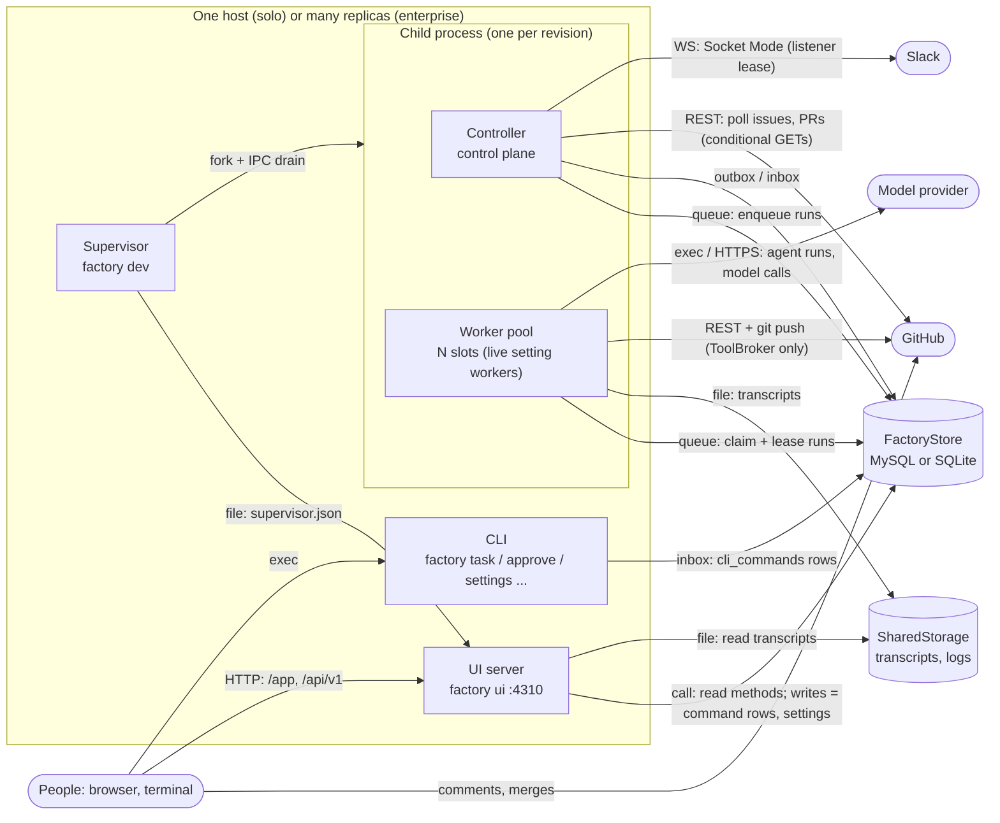
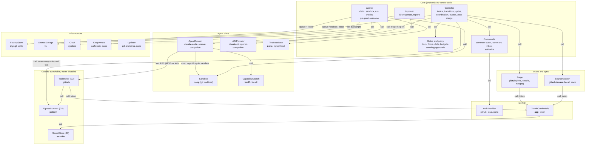
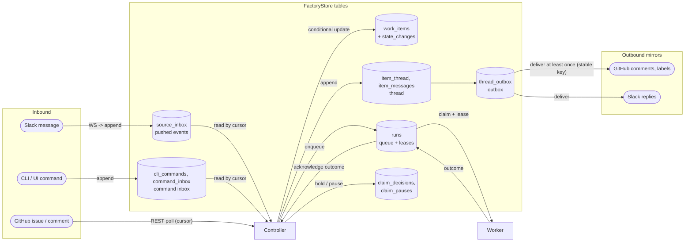
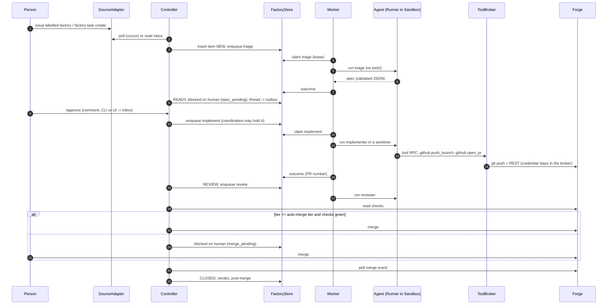
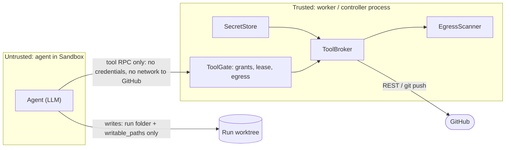

# ARCHITECTURE

A map of the factory for review: every abstracted component as a box, and every connection labelled with how the two sides talk. Use it to spot coupling, missing seams and single points of failure, and to propose changes (RFCs).

The detailed decisions behind each part live in [`docs/architecture.md`](docs/architecture.md) (layers, control vs agent plane, scaling, secret isolation), [`docs/design.md`](docs/design.md) and [`docs/plugins.md`](docs/plugins.md). This file is the overview; when they disagree, the code and the topic files win, and this file should be fixed.

## How components talk (legend)

The factory has **no message broker**. Every asynchronous, pub-sub-like flow is a table in the `FactoryStore` that one side appends to and the other side polls, with a cursor or a lease. That keeps every process stateless and safe to run twice (CLAUDE.md: no in-process state another replica needs).

| Kind | Arrow label | What it is | Examples |
|---|---|---|---|
| **Call** | `call` | In-process TypeScript call through an interface | Controller → `SourceAdapter.poll()`, worker → `Sandbox.create()` |
| **Queue** | `queue` | Store table used as a work queue: insert, then claim with a lease (conditional update), heartbeat, release | `runs` (controller enqueues, workers claim) |
| **Outbox / inbox** | `outbox`, `inbox` | Store tables as pub-sub: append-only rows, read by cursor, delivered at least once, made idempotent by a stable key | thread outbox (`thread_outbox`), command inbox (`cli_commands`, `command_inbox`), pushed events (`source_inbox`) |
| **Lease** | `lease` | One holder at a time across replicas, by conditional update with expiry | run leases, listener leases (one Slack socket per source) |
| **HTTP** | `HTTP` | Local JSON API, 127.0.0.1 only | `factory ui` on port 4310: `/api/v1/*`, `/api/health` |
| **Tool RPC** | `tool RPC` | MCP over a per-run local socket from the agent to the worker's tool gate | agent → `ToolBroker` (`github.open_pr`, `github.push_branch`) |
| **Subprocess** | `exec` | A child process with a fixed argv and environment | `claude -p` (runner), `git`, test commands, `caffeinate` |
| **IPC** | `IPC` | Node fork channel between supervisor and child | supervisor → child: `drain` on a new revision |
| **Remote** | `REST`, `WS` | Calls to an external service, only inside one implementation | GitHub REST (conditional GETs), Slack Socket Mode (WebSocket), model APIs |
| **File** | `file` | A file one process writes and another reads | `.factory/supervisor.json`, config, transcripts in `SharedStorage` |

## 1. Processes

What runs, and how processes reach each other. Every process can be started more than once; they coordinate only through the store.

- **Supervisor** (`src/supervisor.ts`, `Updater` plugin): under `git-worktree` it builds each new base-branch commit into `.factory/versions/<rev>`, forks a child from it, then asks the old child to drain over IPC (start-then-drain). It waits for `npm run migrate` when a schema step is pending (`migration_pending` in `supervisor.json`). Under `none` it runs controller and worker in-process.
- **Controller** (`src/core/controller.ts`): deterministic. Intake, transitions, gates, coordination holds, outbox delivery, post-merge. Never runs an agent.
- **Worker pool** (`src/core/worker-pool.ts`, `worker.ts`): claims runs, builds a sandbox, runs the agent, writes the outcome. Never decides a transition.
- **UI server** (`src/ui/`): reads the store; its only writes are command rows (the same inbox the CLI uses), settings and pause resumes, each audited.
- **CLI** (`src/main.ts`): local commands become inbox rows; the controller applies them like comments.

## 2. Components and interfaces

Each box is an interface in `src/interfaces/` with its implementations in `src/impl/<kind>/`, chosen by name in `factory.config.json` and built only through the registry (`src/plugins.ts`, one `*.plugin.ts` descriptor each). Core (`src/core/`) imports only interfaces. **Bold** = the current local selection.

| Interface | Role | Talks to the outside by |
|---|---|---|
| `SourceAdapter` | Brings work items and comment commands in; mirrors thread messages out. Polled (`PollSource`) or streamed (`StreamSource`) | GitHub REST poll with conditional GETs and cursors; Slack Socket Mode under a listener lease; local: store rows only |
| `Forge` | Where changes (PRs) live: PR events, checks, merge, close | GitHub REST |
| `FactoryStore` | The single source of truth: items, runs, leases, state changes, threads, inboxes, settings, audit | SQL (MySQL for many nodes, SQLite for one machine and tests) |
| `AgentRunner` | One tool-using agent loop for a run | `claude -p` subprocess, or an OpenAI-compatible HTTP API |
| `LLMProvider` | Single model calls without tools (triage helpers, improver) | Claude CLI or an OpenAI-compatible API, with a fallback chain |
| `Sandbox` | Where the agent's files and commands live | Git worktree on the host today; container sandboxes later |
| `ToolBroker` (G2) | The only place credentialed actions happen (push, open PR, comment) | GitHub REST and `git push`, in the worker process, outside the sandbox |
| `EgressScanner` (G5) | Scans every agent output before it leaves (commits, PR text, comments, logs) | none (pure) |
| `SecretStore` (G1) | Holds credentials; only tool implementations read it | `~/.config/software-factory/.env` |
| `GitHubCredentials` | Mints the GitHub token for tools (App installation token or PAT) | GitHub App API |
| `AuthProvider` | Decides who may run which command, per command origin | GitHub permissions; local users and roles in the store |
| `CapabilitySearch` | Finds docs and skills for an agent (finding is not permission) | none (local index) |
| `TestDatabase` | A throwaway database for pre-push checks | local MySQL |
| `SharedStorage` | Transcripts and logs | local filesystem |
| `KeepAwake` | Keeps the host awake during a run | `caffeinate` |
| `Updater` | Keeps the running factory on the latest base commit | git, npm build, process fork |
| `Clock` | Time, injected for tests | none |

## 3. Message flows (the store as the bus)

- **Every state change** is a conditional update with a version check, so two controllers can't apply the same transition twice.
- **Runs** are the only work queue. A worker claims with a lease token, renews it on each heartbeat, and every tool call fences on that token. An expired lease is reaped and the run requeued.
- **Commands** from every origin (GitHub comment, Slack, CLI, UI) become the same comment event and pass the same `authorize` check.
- **Thread messages** go into the outbox first. Each configured sync plugin delivers its own rows; an outage or a rate limit only delays the outbox (local first).
- **Coordination**: before a claim, the controller records why a run is held (`claim_decisions`: which PR or running item holds it, and the cost) or that claims are paused (`claim_pauses`: model stall, forge auth, GitHub rate limit).

## 4. One work item, end to end

## 5. Trust boundaries

- Agents never see a secret (G1). Credentialed actions go only through the broker (G2). Every output is egress-scanned (G5). Agents propose; the control plane decides.
- Floors (paths that force tier 4) and the check list (`src/core/checks.ts`) decide when a person must merge. Guards can be switched to another implementation, never turned off.

## 6. Review notes: where the architecture could improve

Open proposals and known pressure points, for the reviewer to weigh. The RFCs are the owner's design proposals, kept outside this repository; the numbers below are their references. An accepted RFC becomes factory issues.

| Area | Today | Proposal |
|---|---|---|
| Source of truth | Source, forge and broker are three GitHub-shaped interfaces; some GitHub words remain in core | RFC 0003: one local ledger, plugins as bridges (`Bridge`: pull, push, budget, health) |
| Coordination | A PR waiting on a person holds queued runs that overlap it; slots go idle | RFC 0004: human waits don't hold runs |
| Self-update | Every schema step stops the supervisor until a person runs `npm run migrate` | RFC 0005: apply additive migrations unattended |
| Owner merges | Owner-only PRs are refreshed on every main move and go stale | RFC 0006: park them in an owner merge queue |
| Maintenance | No regular GC, DRY or deprecation pass | RFC 0001: maintenance loop |
| Sandbox | `noop`: a host worktree; writes limited by the runner's rules | Container sandboxes; toolchain caches read-only, modelled on frontier harnesses (#334) |
| Bus | Store tables polled on a tick | Fine at today's scale; a push channel (e.g. LISTEN/NOTIFY or a broker) only if poll latency or store load becomes the bottleneck |
