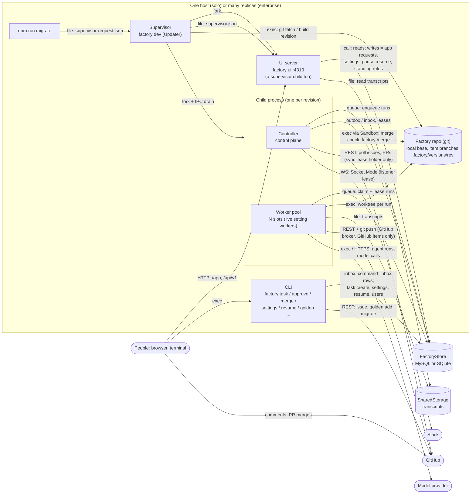
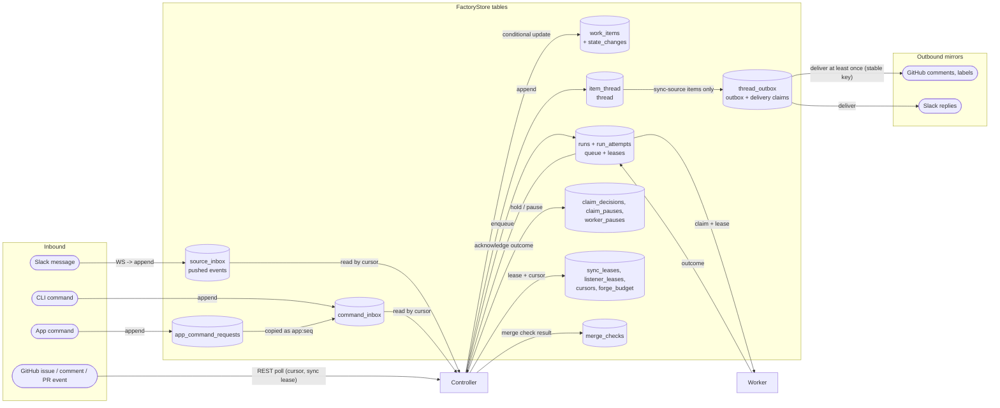
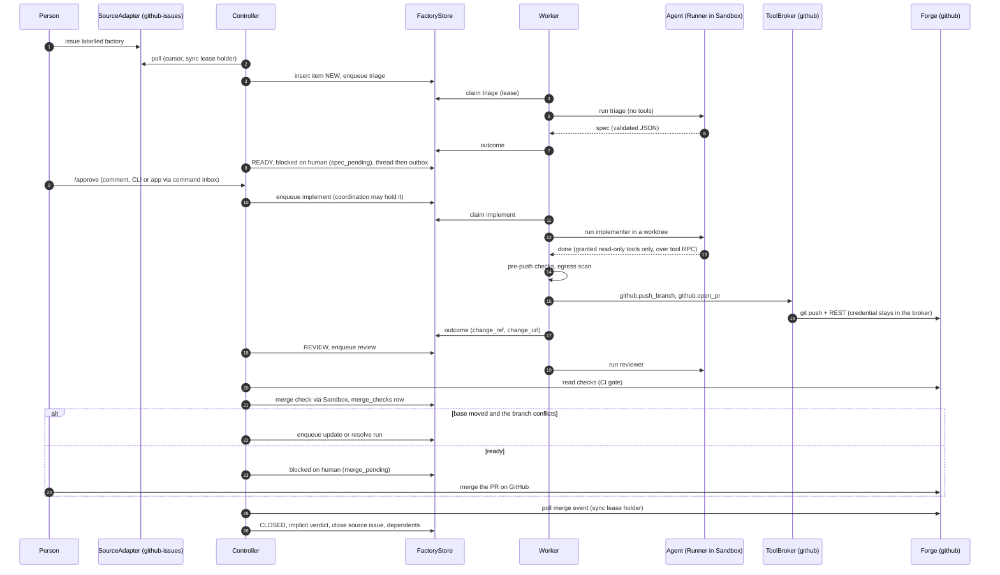
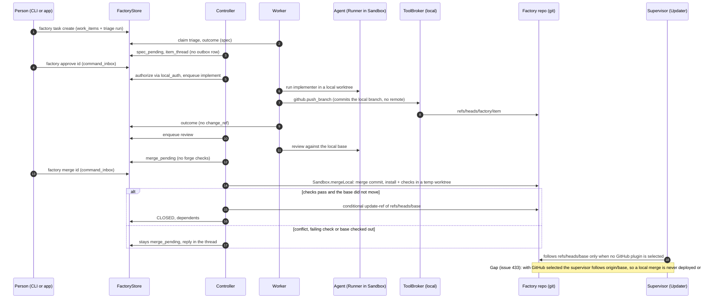
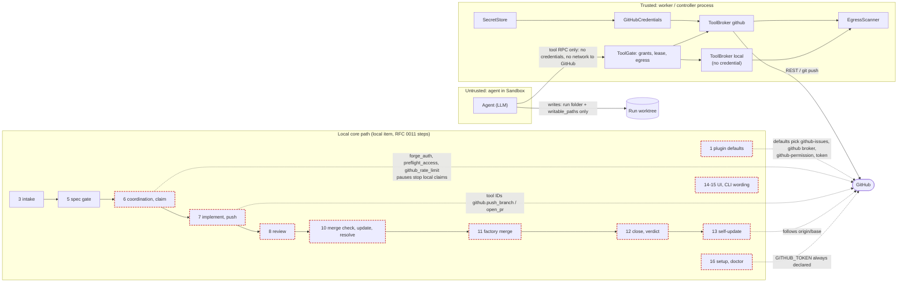

# ARCHITECTURE

A map of the factory for review: every abstracted component as a box, and every connection labelled with how the two sides talk. Use it to spot coupling, missing seams and single points of failure, and to propose changes (RFCs).

The detailed decisions behind each part live in [`docs/architecture.md`](docs/architecture.md) (layers, control vs agent plane, scaling, secret isolation), [`docs/design.md`](docs/design.md) and [`docs/plugins.md`](docs/plugins.md). This file is the overview; when they disagree, the code and the topic files win, and this file should be fixed.

## How components talk (legend)

The factory has **no message broker**. Every asynchronous, pub-sub-like flow is a table in the `FactoryStore` that one side appends to and the other side polls, with a cursor or a lease. That keeps every process stateless and safe to run twice (AGENTS.md: no in-process state another replica needs).

| Kind | Arrow label | What it is | Examples |
|---|---|---|---|
| **Call** | `call` | In-process TypeScript call through an interface | Controller → `SourceAdapter.poll()`, worker → `Sandbox.create()` |
| **Queue** | `queue` | Store table used as a work queue: insert, then claim with a lease (conditional update), heartbeat, release | `runs` (controller enqueues, workers claim; `run_attempts` records each claim) |
| **Outbox / inbox** | `outbox`, `inbox` | Store tables as pub-sub: append-only rows, read by cursor, delivered at least once, made idempotent by a stable key | thread outbox (`item_thread` → `thread_outbox`), command inbox (`command_inbox`, fed by the CLI and by `app_command_requests`), pushed events (`source_inbox`) |
| **Lease** | `lease` | One holder at a time across replicas, by conditional update with expiry | run leases, `listener_leases` (one Slack socket per source), `sync_leases` (one GitHub sync per project), outbox delivery claims |
| **HTTP** | `HTTP` | Local JSON API, 127.0.0.1 only | `factory ui` on port 4310: `/app`, `/api/v1/*`, `/api/health` |
| **Tool RPC** | `tool RPC` | MCP over a per-run local socket from the agent to the worker's `ToolGate` | only the read-only broker tools `tool_grants` names (e.g. `github.preflight`) |
| **Subprocess** | `exec` | A child process with a fixed argv and environment | `claude -p` (runner), `git`, install and check commands, `caffeinate` |
| **IPC** | `IPC` | Node fork channel between supervisor and child | supervisor → child: `factory:drain`; child → supervisor: `factory:drained`, `factory:error` |
| **Remote** | `REST`, `WS` | Calls to an external service, only inside one implementation | GitHub REST (conditional GETs, shared `forge_budget`), Slack Socket Mode (WebSocket), model APIs |
| **File** | `file` | A file one process writes and another reads | `.factory/supervisor.json` (status, restarts), `supervisor-request.json` (`npm run migrate`), transcripts in `SharedStorage`, `golden/cases/` |

## 1. Processes

What runs, and how processes reach each other. Every process can be started more than once; they coordinate only through the store.

- **Supervisor** (`src/supervisor.ts`, `Updater` plugin): under `git-worktree` it builds each new base commit into `.factory/versions/<rev>` (from `origin/<base>`, or the local `refs/heads/<base>` when no GitHub plugin is selected), forks a child from it, then asks the old child to drain over IPC (start-then-drain). It also runs `factory ui` as a child and swaps it on each revision. It writes `supervisor.json` (revision, `migration_pending`, restarts) and reads `supervisor-request.json` from `npm run migrate`; with `updater.auto_migrate` it applies pending steps itself. Under `none` it runs controller and worker in-process.
- **Controller** (`src/core/controller.ts`): deterministic, one tick of steps: commands, intake and sync (GitHub steps only on the `sync_leases` holder), outbox, runs, coordination, checks, merge check, phases, alarms, improve, reaper, model and network probes. Never runs an agent.
- **Worker pool** (`src/core/worker-pool.ts`, `worker.ts`): claims runs, builds a sandbox, runs the agent, runs the pre-push checks, pushes through the broker, writes the outcome. Picks the route per item (`routeFor`): local items take the local broker and sandbox. Never decides a transition.
- **UI server** (`src/ui/`): reads the store; its writes are app command requests (applied by the controller like any command), settings (through the same `runSettings` as the CLI), pause resumes and standing rules, each audited.
- **CLI** (`src/main.ts`, `src/core/local-cli.ts`): `task create` writes a local item and its triage run; item commands (`approve`, `retry`, `revise`, `reject`, `resolve`, `merge`) become `command_inbox` rows for any item, local or GitHub; the controller applies them like comments.

## 2. Components and interfaces

```mermaid
graph TB
  subgraph CORE["Core (src/core): no vendor code"]
    direction LR
    CTL["Controller<br/>intake, sync, transitions, gates,<br/>coordination, outbox, checks"]
    WRK["Worker<br/>routeFor, claim, sandbox, run,<br/>pre-push, push, outcome"]
    GATE["Gates and policy<br/>tiers, floors, dials, budgets,<br/>standing approvals, settings"]
    CMD["Commands<br/>comment-event, command inbox,<br/>authorize"]
    LM["Local merge + merge check<br/>factory merge, mergeability"]
    OPS["Alarms, improver, probes"]
  end

  subgraph INTAKE["Intake and sync"]
    SRC["SourceAdapter<br/><b>github-issues</b>, <b>local</b>, slack"]
    FORGE["Forge (optional)<br/><b>github</b>; none = local only"]
  end

  subgraph AGENT["Agent plane"]
    RUN["AgentRunner<br/><b>claude-code</b>, openai-compatible"]
    LLMP["LLMProvider<br/><b>claude-cli</b>, openai-compatible"]
    SBX["Sandbox<br/><b>noop</b> (git worktree)"]
    CAP["CapabilitySearch<br/><b>bm25</b>, list-all"]
    TDB["TestDatabase<br/><b>none</b>, mysql-local"]
  end

  subgraph GUARDS["Guards: switchable, never disabled"]
    BRK["ToolBroker (G2)<br/><b>github</b>, <b>local</b> (local items)"]
    EGR["EgressScanner (G5)<br/><b>pattern</b>"]
    SEC["SecretStore (G1)<br/><b>env-file</b>"]
  end

  subgraph IDENT["Identity"]
    AUTH["AuthProvider<br/><b>github</b>, <b>local</b> (CLI, UI), none"]
    GRT["GrantSource<br/><b>github-permission</b>, static"]
    GHC["GitHubCredentials<br/><b>app</b>, token"]
  end

  subgraph INFRA["Infrastructure"]
    STO["FactoryStore<br/><b>mysql</b>, sqlite"]
    SHS["SharedStorage<br/><b>fs</b>"]
    CLK["Clock<br/><b>system</b>"]
    AWK["KeepAwake<br/><b>caffeinate</b> (macOS), none"]
    UPD["Updater<br/><b>git-worktree</b>, none"]
    NET["NetworkProbe<br/><b>http</b>"]
  end

  CTL -- call --> SRC
  CTL -- call --> FORGE
  CTL -- call --> GATE
  CTL -- call --> CMD
  CTL -- call --> LM
  CTL -- call --> OPS
  CMD -- call --> AUTH
  AUTH -- call --> GRT
  LM -- "call: mergeLocal, mergeCheck" --> SBX
  CTL -- "queue / outbox / inbox / leases" --> STO
  WRK -- "queue + lease" --> STO
  WRK -- call --> SBX
  WRK -- call --> RUN
  WRK -- "call: push_branch, open_pr" --> BRK
  WRK -- call --> TDB
  WRK -- call --> AWK
  WRK -- "file: transcripts" --> SHS
  RUN -- "exec: agent loop in sandbox" --> SBX
  RUN -- "tool RPC (MCP socket): granted read-only tools" --> BRK
  RUN -- call --> CAP
  OPS -- "call: improve drafts" --> LLMP
  OPS -- "call: network pause" --> NET
  CTL -- "call: triage helpers" --> LLMP
  BRK -- call --> EGR
  BRK -- "call: token" --> GHC
  GHC -- call --> SEC
  SRC -- "call: GitHub client" --> GHC
  FORGE -- "call: GitHub client" --> GHC
  GRT -- "call: GitHub client" --> GHC
  CTL -- "call: scan every outbound text" --> EGR
  CORE -. "time" .-> CLK
```

Each box is an interface in `src/interfaces/` with its implementations in `src/impl/<kind>/` (every GitHub implementation under `src/impl/github/`), chosen by name in `factory.config.json` and built only through the registry (`src/plugins.ts`, one `*.plugin.ts` descriptor each; grants are `*.grant.ts`). `src/compose.ts` wires them. Core (`src/core/`) imports only interfaces. **Bold** = the selection in this repo's checked-in `factory.config.json`.

| Interface | Role | Talks to the outside by |
|---|---|---|
| `SourceAdapter` | Brings work items and comment commands in; mirrors thread messages out. Polled (`PollSource`) or streamed (`StreamSource`); a list, one adapter per source type | GitHub REST poll with conditional GETs and cursors (sync lease holder only); Slack Socket Mode under a listener lease; local: store rows only |
| `Forge` | Optional. Where PRs live: PR events, checks, files, comments, close. Derived from `github-issues` when `plugins.forge` is left out (`withForgeDefault`); none selected = local only. The factory never merges a PR itself (`auto_merge_max_tier` must be 0) | GitHub REST |
| `FactoryStore` | The single source of truth: items, runs, leases, state changes, thread, inboxes, settings, pauses, alerts, audit | SQL (MySQL for many nodes, SQLite for one machine and tests) |
| `AgentRunner` | One tool-using agent loop for a run; a list is a fallback chain (`FallbackRunner`) | `claude -p` subprocess, or an OpenAI-compatible HTTP API |
| `LLMProvider` | Single model calls without tools (triage helpers, improve drafts); a list is a fallback chain | Claude CLI or an OpenAI-compatible API |
| `Sandbox` | Where the agent's files and commands live; also the controller's merge check and local merge | Git worktree on the host today; container sandboxes later |
| `ToolBroker` (G2) | The only place credentialed actions happen (push, open PR, preflight, comment). The `local` broker serves local items with one tool, `github.push_branch`, that pushes to no remote | GitHub REST and `git push`, in the worker process, outside the sandbox; local: none |
| `EgressScanner` (G5) | Scans every agent output before it leaves (commits, PR text, comments, logs, alerts) | none (pure) |
| `SecretStore` (G1) | Holds credentials; only tool implementations read it | `~/.config/software-factory/.env` |
| `GitHubCredentials` | Mints the GitHub token for the GitHub client (App installation token or PAT). A required kind today, even with no GitHub plugin (RFC 0011) | GitHub App API |
| `AuthProvider` | Decides who may run which command, per command origin (`auth` for GitHub comments, `local_auth` for CLI and UI) | GitHub permissions through grants; local users and roles in the store |
| `GrantSource` | Roles a subject holds (`permissions.grants`), asked by the auth plugin | GitHub collaborator permission; `static` from config |
| `CapabilitySearch` | Finds docs and skills for an agent (finding is not permission) | none (local index) |
| `TestDatabase` | A throwaway database for pre-push checks | local MySQL |
| `SharedStorage` | Run transcripts | local filesystem |
| `KeepAwake` | Keeps the host awake during a run | `caffeinate` |
| `Updater` | Keeps the running factory on the latest base commit; drains children, optional unattended migrations | git, npm build, process fork |
| `NetworkProbe` | Decides when a `network` claim pause ends | HEAD requests to the selected plugins' endpoints |
| `Clock` | Time, injected for tests | none |

## 3. Message flows (the store as the bus)

- **Every state change** is a conditional update with a version check, so two controllers can't apply the same transition twice.
- **Runs** are the only work queue (kinds: triage, implement, review, update, resolve, manual, interactive, improve). A worker claims with a lease token, renews it on each heartbeat, and every tool call fences on that token. An expired lease is reaped and the run requeued.
- **Commands** from every origin (GitHub comment, Slack, CLI, app) become the same comment event and pass the same `authorize` check. A CLI command on a GitHub item is mirrored to the issue (`command_inbox.mirror`).
- **Thread messages** go into `item_thread` first. A local item's thread is its record; for a sync-source item each configured plugin delivers its own `thread_outbox` rows, and an outage or a rate limit only delays the outbox (local first).
- **One GitHub sync per project**: only the `sync_leases` holder polls GitHub, delivers GitHub outbox rows and stores the shared `forge_budget`; other replicas skip those steps.
- **Coordination**: before a claim, the controller records why a run is held (`claim_decisions`: which PR or running item holds it, the cost, `held_since` for `hold_policy`) or that claims are paused (`claim_pauses`: `rate_limit`, `forge_auth`, `preflight_access`, `github_rate_limit`, `model_stall`, `network`).

The other tables, by role:

| Role | Tables |
|---|---|
| Items and history | `work_items`, `state_changes`, `verdicts`, `handoffs`, `dependency_edges`, `file_conflicts`, `unreviewed_merges` |
| Runs and workers | `runs`, `run_attempts`, `budget_checkpoints`, `claim_locks`, `worker_processes`, `worker_pauses`, `host_sleeps` |
| Sync records (GitHub) | `posted_comments`, `label_states`, `forge_budget`, `sync_leases`, `cursors` |
| Identity | `local_users`, `user_links`, `link_codes` |
| Settings and gates | `settings_overrides`, `settings_changes`, `standing_rules`, `standing_proposals` |
| Operations | `alerts`, `alert_patterns`, `child_restarts`, `improve_reports`, `filed_patterns`, `merge_checks`, `schema_migrations` |
| Legacy, no reader or writer | `cli_commands`, `item_messages` (copied into `command_inbox` and `item_thread` by migration 24) |

## 4. A GitHub item, end to end

## 5. A local item, end to end (local route)

Since #427 a local item takes the local broker, a local sandbox and the local merge whatever plugins are selected (`routeFor` in `src/core/worker.ts`, `Plugins.localRoute` in `src/compose.ts`). No forge, no remote.

## 6. Trust boundaries and local-first gaps

- Agents never see a secret (G1). Credentialed actions go only through the broker (G2), called by the worker after the agent stops; the agent reaches the broker only for read-only tools that `tool_grants` names. Every output is egress-scanned (G5). Agents propose; the control plane decides.
- Floors (paths that force tier 4) and the check list (`src/core/checks.ts`) decide when a person must merge. Guards can be switched to another implementation, never turned off.
- **Local first, measured (RFC 0011, audited at `61a575b`).** With no sync plugin, 9 of 16 core steps are local-only (56%); with GitHub selected, 5 of 16 for a local item (31%). Red dashed boxes are steps that still touch or depend on the forge:

| Step | Where the core path still touches the forge | RFC 0011 fix |
|---|---|---|
| 1 Plugin defaults | With no `plugins` / `permissions`, defaults pick `github-issues`, the `github` broker, `github-permission` and `token`; `GitHubCredentials` is a required kind; `withForgeDefault` and `GITHUB_PLUGINS` in `src/compose.ts` name GitHub plugins | F2 |
| 6 Coordination, claim | `forge_auth`, `preflight_access` and `github_rate_limit` claim pauses stop implement and review claims for every item, local ones too; `Depends on` parses only `owner/repo#N` | F1, F8 |
| 7-8 Implement, review | Behaviour is chosen by GitHub tool IDs (`github.push_branch` in the local broker, `hasTool(broker, "github.open_pr")`); "is this item local" has several definitions | F5, F10 |
| 10 Merge check, update, resolve | The merge check reads only items with a `change_ref`; `update` and `resolve` refuse a local item (`no_pr`) | F5, F6 |
| 11, 13 Merge, self-update | `factory merge` is refused while the base is checked out; with GitHub selected the merge never reaches `origin` and the supervisor follows `origin/<base>` | F4 (#433) |
| 12 Close, verdict | `/verdict` is refused on a locally merged item | F7 |
| 14-15 UI, CLI | "merge the PR" text, a hard-coded `https://<label>/pull/<n>` URL, no app merge action; `issue`, `golden add` and `migrate` build a GitHub client | F7 |
| 16 Setup, doctor | `GITHUB_TOKEN` is always declared, so doctor fails and setup asks for a token with no GitHub plugin | F3 |

## 7. Review notes: where the architecture could improve

Open proposals and known pressure points, for the reviewer to weigh. The RFCs are the owner's design proposals, kept outside this repository; the numbers and titles below are their references. An accepted RFC becomes factory issues or local tasks.

| Area | Today | Proposal |
|---|---|---|
| Maintenance | No regular GC, DRY or deprecation pass; done as manual sweeps | RFC 0001: Maintenance loop (garbage collection, DRY, deprecation) |
| Sandbox dependencies | `noop`: a host worktree that can resolve `node_modules` from the owner's main checkout | RFC 0002: Sandboxes get dependencies from the lockfile, not the main checkout |
| Source of truth | Source, forge and broker are three GitHub-shaped interfaces; "local" is the absence of a forge (`forge === null`), not a forge implementation | RFC 0003: One local ledger, plugins as bridges |
| Coordination | An open PR waiting on a person still holds overlapping queued runs; `hold_policy` can time out a cost hold, but the default keeps it | RFC 0004: PRs waiting on a human don't hold other runs |
| Self-update | A schema step stops the supervisor until `npm run migrate`, unless `updater.auto_migrate` (default false) is set | RFC 0005: Additive migrations don't stall an unattended factory |
| Owner merges | Owner-only PRs are refreshed on every main move and go stale | RFC 0006: An owner merge queue that does not go stale |
| Human waits | Some `blocked_reason` values list no command that moves the item | RFC 0007: Every human wait has a way forward |
| Triage scope | A missed caller or test file fails implement with `spec_conflict` and a second approval | RFC 0008: Triage scopes the blast radius |
| Merge safety | The local merge runs checks on the merge commit; a GitHub PR's `test` check can be stale against a newer main | RFC 0009: Test the merged result before merging |
| Code health | Duplicated blocks, features kept beside their replacement, an unread config key and column, legacy tables (`cli_commands`, `item_messages`) | RFC 0010: Small DRY refactors and three deprecations (sweep 2026-11-08) |
| Local first | 56% (solo) / 31% (GitHub selected) of core steps are local-only; see §6 | RFC 0011: Local-first audit: is the forge plugin off the core path? |
| Dashboard | The app shows the facts but the owner can't act from it: command buttons off by default, no merge action | RFC 0012: Dashboard enhancements for the overnight owner |
| Sandbox isolation | `noop`: a host worktree; writes limited by the runner's rules | Container sandboxes; toolchain caches read-only, modelled on frontier harnesses (#334) |
| Bus | Store tables polled on a tick | Fine at today's scale; a push channel (e.g. LISTEN/NOTIFY or a broker) only if poll latency or store load becomes the bottleneck |
