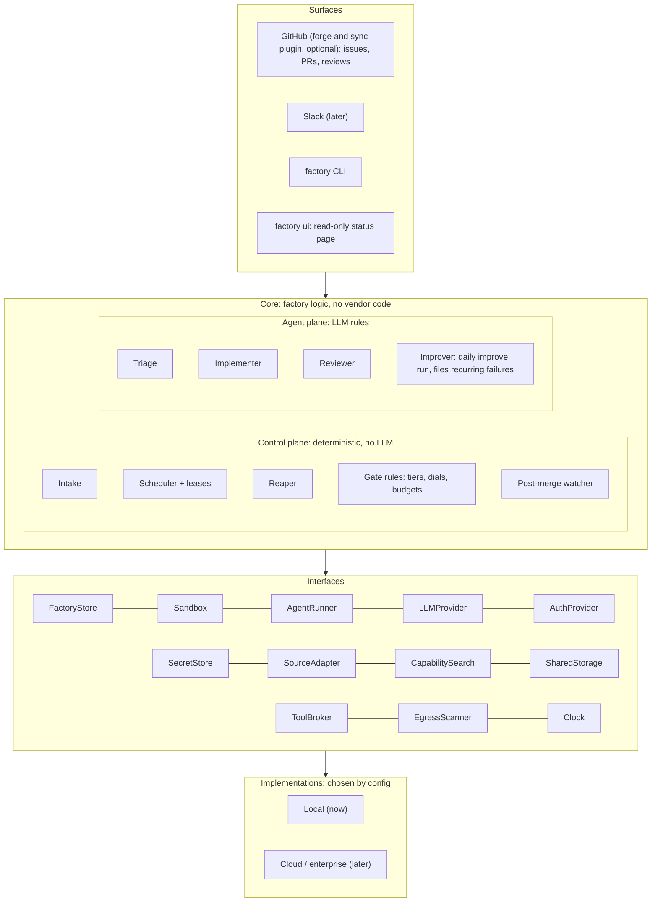
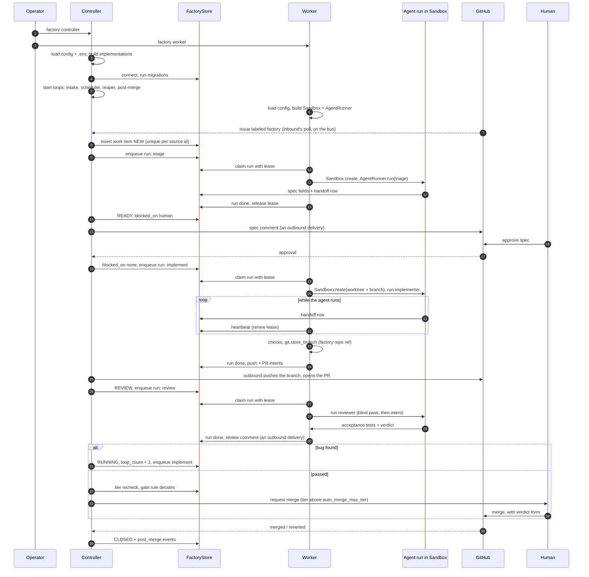
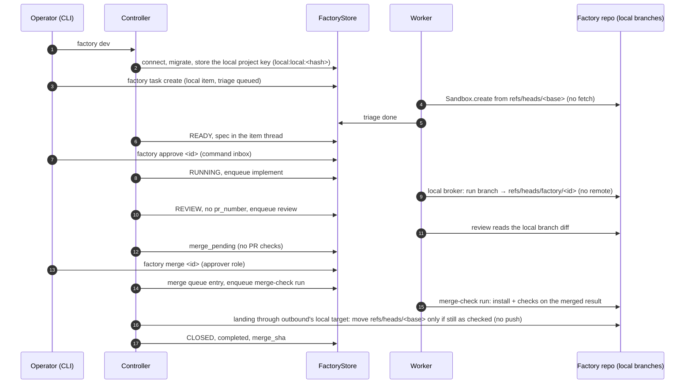
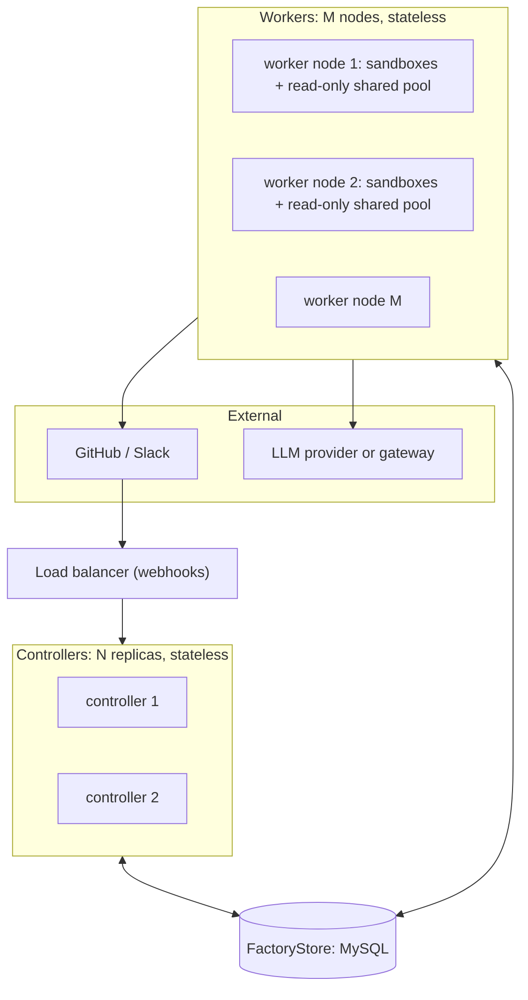
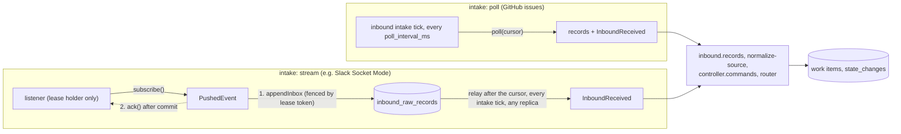
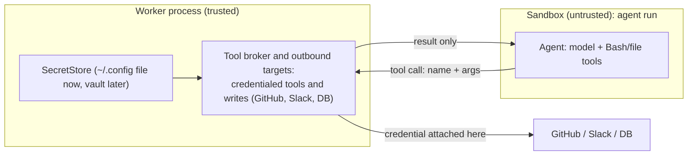

# Architecture

Four views of one system:
- the layers and their abstractions
- the control plane vs agent plane split
- what happens from startup through one work item
- how it scales horizontally

Details of each decision live in [`design.md`](design.md).

## 1. Layers

Every dependency points downward. Core code talks only to interfaces, never to a vendor or a concrete backend. Implementations are chosen once, at startup, from config (the composition root).



**GitHub is a plugin, not core.** It is a forge plugin (`plugins.forge`: where a change is reviewed and merged) and a sync plugin (`plugins.source`: issues and comments copied to and from the store), like Slack and Jira. With no forge selected the factory runs local: intake, specs, gate commands, branches, review and merge all work from the store and the local repository, and the prompts name the forge as `local` (`{{forge}}`, filled at load). Core code never assumes a forge is there.

| Interface | Local implementation (now) | Cloud / enterprise implementation (later) |
|---|---|---|
| `FactoryStore` | `SqlFactoryStore` (all store logic, once) over a `SqlDriver`: `MysqlDriver` (default, any number of nodes), `SqliteDriver` (one machine, tests) | `MysqlDriver` on managed MySQL (RDS / Cloud SQL) |
| `Sandbox` | `NoOpSandbox`: a clone per run on the host (with no GitHub plugin: the local base branch, no origin fetch) | Docker → gVisor / Kata / Firecracker, hosted sandboxes |
| `AgentRunner` | `ClaudeCodeRunner`: `claude -p` | API-based runner |
| `LLMProvider` | Anthropic via the Claude Code CLI (subscription) | Anthropic API, Bedrock, Vertex, company ML gateway |
| `AuthProvider` | NoAuth | SSO / OIDC, GitHub permissions, policy engine |
| `SecretStore` | `~/.config/software-factory/.env` (outside the repo) | Vault / cloud secret manager |
| `SourceAdapter` | GitHub issues via REST / `gh` | Slack, GitLab |
| `CapabilitySearch` | List everything (`list-all`); BM25 over `docs/` and `skills/` markdown (`bm25`) | vector, hybrid |
| `SharedStorage` | Local filesystem | PV / PVC |
| `ToolBroker` (G2) | In the worker process: `git.store_branch` stores the run's HEAD in the factory repo (`github`: a staging ref outbound pushes from; `local`: the run's branch as a local branch, no remote) and the read-only `github.preflight`. Pushes, PRs and comments are outbound deliveries through the forge and source plugins (RFC 0015 M7) | same, per tool |
| `EgressScanner` (G5) | Known secret values + patterns | + a managed secret scanner |
| `Clock` | `SystemClock` (tests: `FakeClock`) | `SystemClock` |

Code layout (RFC 0015, moving): components in `src/inbound/`, `src/controller/`, `src/worker/`, `src/outbound/`, `src/bus/`, `src/identity/`, `src/runtime/`, `src/state/` and `src/shared/` (map: `ARCHITECTURE.md`); legacy interfaces in `src/interfaces/`, shared legacy logic in `src/core/`, implementations in `src/impl/`, wiring in `src/compose.ts`, the status page in `src/ui/`. Why something is an interface: testability, infrastructure, or environment (see `AGENTS.md`).

**Status page (`factory ui`, `src/ui/`).** A surface like the CLI, not a plugin interface: it has no `docs/plugins.md` entry and no registry name. It reads `FactoryStore` only, through its read methods (`listWorkItemsWhere`, `countWorkItemsByStage`, `listRunsByStatus`, `listRunsFinishedWithin`, `getWorkItem`, `listStateChanges`, `listRuns`), and never calls a method that writes. `buildUiParts` in `src/compose.ts` builds the configured clock, `SecretStore`, `FactoryStore` and `EgressScanner` through `Plugins`, not `build()`, so no controller, worker, source or runner starts. It loads the secret file because the MySQL store needs `MYSQL_PASSWORD` and the scanner needs the known secret values; those values stay in the store and scanner and never reach a page. Every value is HTML-escaped, and every free-text field is egress-scanned first and withheld whole on a finding (design §9). `node:http` only, bound to 127.0.0.1 (no host option), GET and HEAD only, Host header must be `127.0.0.1` or `localhost`. Like every other process it holds no state another replica needs, so any number can run.

## 2. Control plane vs agent plane

This one distinction shapes everything else.

| | Control plane | Agent plane |
|---|---|---|
| What | Intake, scheduler, reaper, gate rules, post-merge watcher | Triage, implementer, reviewer, improver |
| Logic | Deterministic code: same input, same output | LLM judgment: can be wrong |
| Lifetime | Long-running | Ephemeral: one run per work item per stage |
| Where it runs | Controller process | Worker process, inside a `Sandbox` |
| State | Reads and writes the `FactoryStore` only | Holds nothing. Reads pointers, writes handoff rows and commits, then exits |
| Merge, lower a tier, grant access? | Enforces the rules for these | Never |

Agents propose. The control plane decides by rule or hands the decision to a human.

## 3. Startup and one work item



The controller never runs an agent and the worker never decides a transition. They meet only in the store: the controller **enqueues runs**, workers **claim runs**.

**With no GitHub plugin selected** (`docs/design/05-sources.md`, Local startup), the same flow runs on the machine alone: no GitHub credential is read, no repository lookup or origin fetch is made, and no PR exists.



## 4. Horizontal scalability

Designed in from day one, even though Phase 1 runs one controller and one worker on a laptop.



Scale workers for throughput. Scale controllers for availability.

**Rules that make this safe**

| Rule | Why |
|---|---|
| Controllers and workers are stateless. All state is in `FactoryStore` (plus commits on GitHub) | Any replica can die or be added at any time |
| Every state transition is a conditional update: `UPDATE ... WHERE id = ? AND version = ?` | Two replicas acting on the same item: one wins, the other gets 0 rows and moves on |
| Leases carry a fencing token that increases on every claim; every write by a worker checks it | A worker that paused past its lease (GC, laptop sleep) can't overwrite the run's new owner |
| Work is pulled, not pushed: workers claim runs in one transaction under the `worker_claim_locks` row (one branch writer per item, below) + a lease | Adding a worker adds capacity with no coordinator; a dead worker's lease expires and the run is reclaimed |
| Intake is idempotent: unique key on `(source_type, source_id)` | Several controllers polling, or a webhook delivered twice, create one work item |
| Periodic loops (reaper, post-merge, dial) are idempotent or take a short leader lease in the store | Running them on N replicas does no harm |
| A worker's worktree is disposable. The branch on GitHub plus handoff rows are the truth | A run resumes on any node, not only the one that started it |
| Shared limits live in the store: LLM concurrency, token budgets, per-repo run caps | N workers can't overrun a provider rate limit or a budget, because they count against the same rows |
| Webhooks are verified, acknowledged fast, and written to the store before any work | Retries from GitHub are safe; slow processing never times out a webhook |
| SQLite is local-only. More than one node requires the MySQL `FactoryStore` | SQLite has one writer on one machine; `store` in `factory.config.json` makes the swap a config change |

**Workers per process.** `workers` in `factory.config.json` (an integer of 1 or more, default 1; any other value fails at startup) is how many worker loops one `factory dev` or `factory worker` process runs (`WorkerPool`, `src/worker/pool.ts`). `max_workers` (an integer of at least `workers`; absent: `workers`) is how many slots the process has, so `factory settings set workers <n>` changes the count live up to it (`docs/design/08-settings.md`). Each loop claims through the store on its own, has its own id `<host>:<pid>:<n>` (the lease owner) and gets a fresh worktree per run. The loops share one `KeepAwake`, counted: held when the first run starts, released when the last one ends. A drain stops every loop from claiming; the drain is acknowledged only after every in-flight run is done. Each loop's index n reaches the agent and the run's gate and check commands as `SF_WORKER_INDEX`, so parallel runs on one host can choose their own ports or test database, and its share of the host's CPUs as `SF_TEST_WORKERS` (CPUs over claiming slots, at least 1; `docs/design/05-coordination.md`, Parallel workers). The index is unique only within one process.

**One branch writer per item (changed 2026-11-01; before: the overlap rule also held back an implement-type run while another item whose `allowed_paths` overlapped had one running, and since nearly every spec lists `docs/design.md` or a whole folder, one running implement run held back most of the queue whatever `workers` said).** Implement-type runs (`implement`, which also covers a review fix, and `update`) change an item's branch, so an item never has two of them running at once. Whether items whose paths overlap run side by side is no longer decided by the overlap alone: since 2026-11-03 the claim also applies the coordination rules below, and the conflicts that still follow are handled at merge (sync before push, the update run, `/resolve`; design §4–§5). The claim checks this inside its store transaction: it takes the one row in `worker_claim_locks` first (`FOR UPDATE` on MySQL; SQLite's `BEGIN IMMEDIATE` already serializes), reads the items with a running implement-type run, then walks the queued runs in claim order (kind rank: review, triage, update, implement, resolve; then `created_at`, then insertion order; design §5 Parallel workers) and claims the first eligible one, skipping an implement-type run whose item already has one running. A skipped run stays queued, holds up nothing behind it, and is claimed once its item's run finishes. Triage and review runs are never skipped. Because only a claim moves a run to `running` and every claim holds the lock row, two claimers on any number of processes or hosts can never both start a branch-writing run for one item. The cost is that claims are serialized, which is cheap next to an agent run.

**Coordination: dependencies and a cost threshold (new 2026-11-03; before: the one-branch-writer rule above was the only scheduling rule, so a dependent item could start before the work it needs merged, open PRs held nothing, and a file that conflicted again and again weighed the same as any other).** Inside the same claim transaction, after the one-branch-writer check, a queued `implement` run is skipped (it stays queued) while (1) its item waits on a dependency: `blocked_on: dependency`, or a stored edge (`controller_dependency_edges`) whose state is not `merged` and whose work item, if the factory has one, has not closed `completed` with a merge sha; or (2) its item has no PR yet and its **coordination cost** against a holder is at or above `max_coordination_cost` (default 2.5). The cost is the sum of the weights of the paths both change (the scope gate's coverage rule): 1.0 per path, 1.0 + 0.5 per recorded conflict from two conflicts on (at most 4.0, from `controller_file_conflicts`), and the fixed `hotspot_weight` (3.0) for `hotspot_paths`. Holders are items with an implement-type run running, items with an open PR (its stored `pr_files`; a PR from before falls back to `allowed_paths`), and other claimable queued implement runs. A run held only by queued runs is claimed in claim order (the deadlock rule: the oldest of a group that holds each other goes first). Every cost decision is stored per run (`controller_claim_decisions`), rewritten only when it changes; `/approve` marks it approved and the next claim takes the run. Triage, review, update and resolve runs, and implement runs of items that already have a PR (review fixes), are never held by these rules. The claim reads only the store: the controller writes edges and their states outside the claim lock (on intake, on each poll, and at once when a dependency's PR merges or closes), and the worker records a conflict at each base merge that conflicts (sync before push, update, resolve), keyed by item and base sha. Pure logic in `src/core/coordination.ts`; decision: design §5.

**Scaling knobs:** workers per process (`workers`), number of worker processes and nodes, warm sandbox pool size, controller replicas, LLM concurrency cap.


### Intake: poll and push

A source's `intake` says how its events arrive (`SourceAdapter` is a union, `src/interfaces/source-adapter.ts`). Both paths end in the same place since RFC 0015 M4: inbound (`src/inbound/intake.ts`) stores each record in `inbound_raw_records` and publishes an `InboundReceived` on `inbound.records` in the transaction that moves its cursor; the `normalize-source` handler turns it into a `SourceEventReceived` on `controller.commands`, and the controller's router hands it to the unit that takes its kind. So an event is handled the same way whichever path brought it.



- **Poll.** Inbound calls `poll(cursor)` every `poll_interval_ms` and stores the records, their messages and the move of the cursor `intake:<source type>` in one transaction (the synced type fenced by the sync lease).
- **Push: the inbox.** Each pushed event is written to the store table `inbound_raw_records` (seq, source type, `dedupe_key`, the event as JSON, received time) **before** it is acknowledged to the source. `ack()` runs only after that write commits; a duplicate `dedupe_key` (unique per source type) is a no-op and is acked too; a failed write is not acked, so the source redelivers it. Inbound on any replica relays the rows after the cursor `inbox:<source type>` (every intake tick): it publishes their `InboundReceived` and moves the cursor conditionally in one transaction, so a row is announced once. A crash at any point loses nothing: before the commit the source still holds the event, after it the inbox does. Handling is idempotent, so two replicas reading the same rows at once is safe.
- **Push: the listener lease.** A source should have one connection, not one per replica. The table `inbound_listener_leases` (one row per source type: owner, token, expiry) decides who connects; every change to it is a conditional update. Each replica's controller runs a listener (`src/core/listener.ts`) that tries to take the lease every `heartbeat_ms`; only the holder subscribes, and it renews every `heartbeat_ms` for `lease_ms`. Each take bumps the token, and the inbox write checks the token in the same transaction, so a listener that lost the lease cannot write. If the holder dies (stops renewing past expiry), another replica takes the lease and connects; a holder that cannot renew for `lease_ms` closes its own connection. The two can overlap briefly (the takeover and the self-close fall due at the same time, and a sleeping host notices late); that is harmless, because the old holder's inbox writes are refused and its unacked events are redelivered to the new one. On shutdown the holder releases the lease so another replica takes over at once.
- **Ordering.** Appends of one source type lock its lease row, so they commit one at a time in seq order and a reader never moves its cursor past a row that commits later. Seqs are never reused (SQLite `AUTOINCREMENT`, InnoDB's persisted counter).
- **Reconnects.** When the stream ends or fails, the listener reconnects with exponential backoff (1 s doubling to 60 s; it starts over after a connection that stored an event). It logs once per state change (lease taken, waiting, connected, disconnected, lease lost), not once per retry.
- **Retention.** On its `records` tick, inbound deletes inbox rows that are older than `inbox_retention_days` (default 14) **and** at or below the source's inbox cursor. A source with no cursor keeps every row.
- **Slack is a stream plugin** (issue #109). The `slack` source (`src/impl/source/slack.plugin.ts`) is the first real stream source: one Socket Mode WebSocket, opened only by the lease holder, each envelope stored and then acked through the path above. Its dedupe key is Slack's `event_id` (a button press: team, user and `action_ts`), and intake is idempotent on the item's source id `slack:<team>:<channel>:<thread ts>`, so a mention Slack delivers as two events, or a redelivery after a reconnect, is one item and one transition. Its tokens stay inside the plugin (read from the `SecretStore` at the point of use); every message it posts is egress-scanned first. Off unless `plugins.source` lists it.
- **Routing by source type.** With several sources (`plugins.source` a list), each item's comments, 👀, status and close go to the adapter whose `type` is the item's `source.type`, so a Slack item is answered in its thread and a GitHub item on its issue. A PR's status always goes to `github_issue`, and PR merge, close and unmergeable events come only from it, so a Slack item's PR is implemented, reviewed and merged through the GitHub path unchanged. Commands from every source run the same command table and the same `AuthProvider` check.
- Out of scope so far: webhook HTTP endpoints (they would write to the same inbox).

## 5. Secret isolation

**Rule:** agents never read secrets. Only tools do. An agent sees a tool's *result*, never the credential the tool used.



**Guards (each one hard, layered so one failure isn't a leak):**

| # | Guard | Stops |
|---|---|---|
| G1 | Secrets are loaded only by the worker process via `SecretStore`. The agent process gets an **allowlisted** environment (no secrets), never the worker's env. The only config-declared entries are `toolchain.env` (2026-11-08): startup refuses a key that looks like a credential (`FORBIDDEN_ENV`) or that the factory sets itself (`PATH`, `HOME`, `TMPDIR`, `CLAUDE_*`, `ANTHROPIC_*`, `GIT_*`, `SF_*`), and a value the configured egress scanner flags (a known secret value or a secret pattern); the error names the entry, never the value | `env`, `printenv`, `process.env` inside the agent |
| G2 | Credentialed actions happen **outside** the sandbox, where credentials are attached: a run's tools are served by the broker (`git.store_branch`, the read-only `github.preflight`), and the push, PR, comments, labels and closes are outbound deliveries through the forge and source plugins (RFC 0015 M7; `tests/architecture/forge-writes.test.ts`) | The agent needing a token at all |
| G3 | The sandbox's filesystem view excludes secret files: run folders never contain `.env` (gitignored), and the secret file lives outside any path the sandbox mounts | `cat ~/…/.env`, path guessing |
| G4 | Harness-level deny rules on secret paths for the agent's file and shell tools | Defense in depth while G3 is weak (`NoOpSandbox`) |
| G5 | Egress scan: every agent output (commits, PR text, comments, handoff rows, logs) is checked for known secret values and secret patterns before it leaves; a hit fails the run (in a transcript, which only goes to storage, a pattern hit alone keeps the transcript out of storage instead: `docs/design/05-sandbox.md`) | A leak that got past G1–G4 reaching GitHub or the store |
| G6 | Tests: a canary secret is planted; a test agent is told to find and print it; the run must fail to find it, or be stopped by G5 | Regressions in G1–G5 |

**Run folder rule (2026-11-01):** an agent may write only to its own run folder, never to the owner's checkout or its `.git`. Every run gets its own clone with its own git folder inside the run folder (`NoOpSandbox`: objects borrowed from the factory repo through an alternates link), so the agent's branches, index, `HEAD`, refs, config and hooks stay in that folder. No run gets a writable path outside it (`AgentRunSpec.writable_paths` is empty for implement runs). The clone's `core.hooksPath` is an empty, read-only folder beside the run folders, outside every agent writable path. Trusted code treats the run folder's git state as agent-written: the worker and the brokers run git there with `TRUSTED_GIT_ENV` (no hooks, no fsmonitor, no signing program, no replace refs or grafts). After an agent exits, the worker checks that the git folder is still the clone's own and removes every config key that is not plain data (`untrustedGitConfig`), and the broker refuses to store a branch from a folder that still has one. The trusted values come from the factory repo, never from the run folder: the base commit the gates and the broker's scan diff from (the factory repo's `origin/<base>`, `SandboxHandle.base_sha`), and the remote outbound's push goes to (the factory repo's `origin` URL, not the run folder's `origin`; since RFC 0015 M7 the push leaves from the factory repo, where `git.store_branch` stored the run's commit). Any later sandbox follows the same rule.

**Toolchain caches are read-only (2026-11-08, issue #334; decision in `docs/design/05-sandbox.md`):** a project may declare a `toolchain` block in `factory.config.json` (a PR-only key; on a shared store it comes only from the checked-in file). Its `caches` are folders the agent may **read and never write**: the Claude Code harness puts them in `sandbox.filesystem.allowRead` and `denyWrite` and adds an `Edit(//<cache>/**)` deny rule, never `allowWrite`; the shared file tools let Read, Glob and Grep read under them and refuse Write and Edit there. A cache that is, lies inside or holds a `deny_paths` entry (the secret file's folder, the owner's `~/.ssh`, `~/.gitconfig` and the rest) fails startup and is a doctor FAIL, so the read denylist always wins and the cache list never reopens a secret. The agent's writes do not widen: each run's toolchain homes (`npm_config_cache`, `CARGO_HOME`, `PIP_CACHE_DIR`, `GRADLE_USER_HOME`) point into its own TMPDIR. The agent still has no network; the worker fills the caches before the agent with `warm_command` (default `repo.install_command`), run with the worker's own env and the network but no credential or test database. No block: none of this, and every run is as before.

**`.env.example`, the one exception (2026-11-02):** file tools deny `.env` and every `.env.*` file, wherever it is, with one exact-name exception: `.env.example`. It lists the secret names the plugins declare (`tests/secret-names.test.ts`) and must hold **no values**, only `NAME=` lines, blanks and `#` comments. Agents may read and edit it so they can keep it in sync with the code. The shared guard (`src/core/tools/guard.ts`) allows that exact name only: `.env.example.local` or `.env.EXAMPLE` stay denied, a `.env.example` symlink is checked by the name it resolves to (one pointing at `.env` is refused), and a hard-linked `.env.example` is refused. The value check (`envExampleValueLines`) runs in two places: both brokers run it on every `.env.example` in HEAD's tree before `git.store_branch` stores the branch (the step before outbound's push) and refuse with `egress_blocked` (also for a committed `.env.example` symlink), and `tests/secret-names.test.ts` runs it on the repository's own file. It runs on the store path rather than in the egress scanner because the scanner sees text without file names. The scanner's known-value rule still applies to the whole diff.

**Declared secret names:** a `SecretStore` loads and scans only the secret names the selected plugins declare in `src/plugins.ts` (no closed list), so a new plugin brings its own secret without touching guarded code, and plain settings in the same file are never treated as secrets.

**Secret file location:** `${XDG_CONFIG_HOME:-~/.config}/software-factory/.env`, never inside the repository (setup: `docs/setup.md`). With `NoOpSandbox` the agent runs as the host user, so G3 relies on Claude Code's OS-level sandbox denying that directory (below). A container sandbox later makes G3 hard independently of the harness.

**Runners without a built-in harness (2026-11-01):** a runner that has no harness of its own (for example one that calls a model API directly) does not rebuild G4. It gets the guards from the shared tools in `src/core/tools`: it builds the run's policy with `guardPolicy` from the `AgentRunSpec` (`deny_paths`, `writable_paths`, `env_allowlist`, the workdir) and runs every file tool call through `ToolSpec.run`, never reading a file itself. A refused path comes back to the model as a tool result (`{ok:false, error}`), not as an exception, and the denied file's contents never reach the output or the transcript. `tests/scripted-runner.test.ts` proves this with a test-only runner driven by a scripted fake LLM. Bash is not path-checked by those tools, so such a runner still needs an OS-level sandbox for G3.

**Granted broker tools (2026-11-07):** an agent run may call broker tools that `tool_grants` in `factory.config.json` grants to its run kind (for example `{"triage": ["github.preflight"]}`); absent, every run gets an empty grant list. Startup checks every grant against the broker's own list and fails on an unknown run kind, an unknown tool or a tool whose descriptor is not `read_only`, so only tools that change nothing can be granted. The Claude Code runner exposes them through a bridge: a stdio MCP server the `claude` process starts, which lists the run's granted tools and forwards each call over a Unix socket the runner opens in the worker process for that run. The worker side of the socket (`ToolGate`) decides everything. How each guard holds:
- **G1:** the agent's environment is built exactly as without grants (`buildAgentEnv`); the bridge's MCP config holds only `node`, the bridge script and the socket path, with an empty env, and the harness starts it with its scrubbed subprocess env. The socket path is not a credential: every request on it passes the gate.
- **G2:** the bridge holds no credential and calls nothing itself. Each call goes to `ToolBroker.call` in the worker process with the run's run id, work item id and lease token, so the broker attaches any credential and fences on the lease as for the worker's own calls.
- **G3/G4:** unchanged. The bridge adds no file access; Bash and the file tools keep their deny rules.
- **G5:** the gate runs the `EgressScanner` (channel `tool_result`) on every result before it returns; a hit returns an `egress_blocked` error to the agent and the content never reaches it or the transcript. The transcript is still scanned before storage.
- **Grant and lease checks:** the gate refuses any tool name the run was not granted, or that is not read-only, without calling the broker, whoever sends the request (the bridge or anything else that reaches the socket). A run whose lease was lost (its signal aborted) gets `lease_lost` and the tool does not run; the broker's own token check covers the rest.
- **G6:** `tests/tool-bridge.test.ts` checks the refusals, the lease, the scan and that neither the agent env nor the bridge config holds a credential; the canary still covers G1 to G5 for the run.

A runner that cannot expose tools (`AgentRunner.exposes_tools` absent or false) refuses a run with grants with an error naming them; the worker checks this first, and startup fails when config grants tools to such a runner.

**The agent harness's own credential** (the token `claude -p` needs to call the model) is the one secret the agent process must hold. It is passed to the harness only, scrubbed from the environment of the harness's tool subprocesses, and covered by G5.

### Harness controls for `ClaudeCodeRunner` (Claude Code docs, checked 2026-10-31)

The runner writes a per-run Claude Code settings file into the agent's run directory:

```jsonc
{
  "env": { "CLAUDE_CODE_SUBPROCESS_ENV_SCRUB": "1",            // G1: strip credentials from Bash, hooks, stdio MCP children
           "npm_config_update_notifier": "false" },           // npm's update check would ask the (denied) registry
  "permissions": {
    "deny": [                                                    // G4: file tools + recognized Bash file commands
      "Read(~/.config/software-factory/**)",
      // .env and every .env.* except .env.example, for Read and for Edit (Edit rules also cover Write):
      "Read(**/.env)", "Read(**/.env.)", "Read(**/.env.?)", "Read(**/.env.??)", /* … up to 6 */ "Read(**/.env.??????)",
      "Read(**/.env.????????*)",                                 // suffix of 8 or more characters
      // a 7-character suffix that is not `example`: one glob per letter, with a class of every character but it
      "Read(**/.env.[ -.0-DF-df-\uffff]??????)", "Read(**/.env.?[ -.0-WY-wy-\uffff]?????)", /* … */
      "Read(**/.env.??????[ -.0-DF-df-\uffff])",
      "Edit(**/.env)", /* … the same globs as Edit(…) */
    ],
    "blockReadsOutsideWorkingDirectories": true
  },
  "sandbox": {                                                   // G3 at OS level, even under NoOpSandbox
    "enabled": true,
    "filesystem": { "denyRead": ["~/.config/software-factory", "~/.ssh", "~/.aws"],
                    // only with a toolchain block (2026-11-08): read, never write, the declared caches
                    "allowRead": ["~/.gradle/caches"], "denyWrite": ["~/.gradle/caches"] },
    "network": { "allowLocalBinding": true },                    // localhost only, for tests that start a server; no allowedDomains
    "credentials": { "envVars": [{ "name": "GITHUB_TOKEN", "mode": "deny" }, { "name": "GH_TOKEN", "mode": "deny" }] }
  }
}
```

What the docs say, and the gaps the canary test (G6) must cover:
- `Read(...)` deny rules cover the file tools and Bash commands Claude Code recognizes (`cat`, `head`, `tail`, `sed`, `tee`, redirections), **not** `grep -r` or scripts that open files themselves. OS-level `sandbox.filesystem.denyRead` covers Bash and its children but **not** the Read tool, so both are needed.
- `CLAUDE_CODE_SUBPROCESS_ENV_SCRUB=1` keeps the harness's own credential for model calls and strips credentials from subprocesses. `GITHUB_TOKEN` / `GH_TOKEN` are **not** stripped by it (hence the `credentials.envVars` deny, and G1 never passes them in). Whether `CLAUDE_CODE_OAUTH_TOKEN` is stripped is not stated explicitly: G6 checks it with `env` inside a run.
- `.env.example` cannot be opened with an allow rule on top of `Read(**/.env.*)`: deny beats allow. So the `.env` deny globs leave it out. Claude Code (2.1.316) matches these globs with the `ignore` package, case-insensitively. It has no negated character class (`[!x]` and `[^x]` match `!` or `^` literally), but it passes `[a-z]` ranges through to the regex. So a suffix of 0–6 characters or of 8 or more is denied by length, and a 7-character suffix (the length of `example`) is denied when it differs from `example` at any position: one glob per position, whose class holds every character but that letter (both cases), `/` and control characters (`allCharsBut` in `claude-code-runner.ts`). Checked against the matcher in the installed binary: `.env`, `.env.local`, `.env.foobarx`, `.env.examplf`, `.env.examples` are denied, `.env.example` is not. What these rules leave out: `.env.example` in other cases (`.env.EXAMPLE`, the same name to this matcher and on a case-insensitive disk) and 7-character suffixes holding a control character. Runners that use the shared tools refuse both.
- `network.allowLocalBinding` (2026-11-07, `docs/design/05-sandbox.md`): on macOS it lets sandboxed commands bind and accept on any local port and connect to localhost on any port. No host is allowed, so every other destination stays denied. A run can therefore reach local services: MySQL needs a login, and the files holding the factory's logins are in `deny_paths`; the local UI pages are read-only and egress-scanned, and its settings API refuses writes without its CSRF token; any other local service on the host is reachable as it is to the host user.
- Exact keys and semantics: verify against the installed Claude Code version when implementing (the subprocess scrub list changed in v2.1.251).

## History

- **The improver is built** (2026-11-08, issue #308). Before: the agent-plane box read "Improver (Phase 3)". Now the daily improve run groups failed runs, drafts a cause and fix per group with one plain model call (no agent, no sandbox), and the controller files each new group as an item through the source, or comments on the open item filed for it (design §7).
- **Toolchain caches are read-only** (2026-11-08, issue #334). Changes G1 (before: the agent env held only the fixed entries, the git identity and the slot env; nothing in config could add one) and §5's file access (before: the agent could read only its workdir and `writable_paths`, so a Gradle, Maven or Cargo build found an empty home-level cache and could not download).
