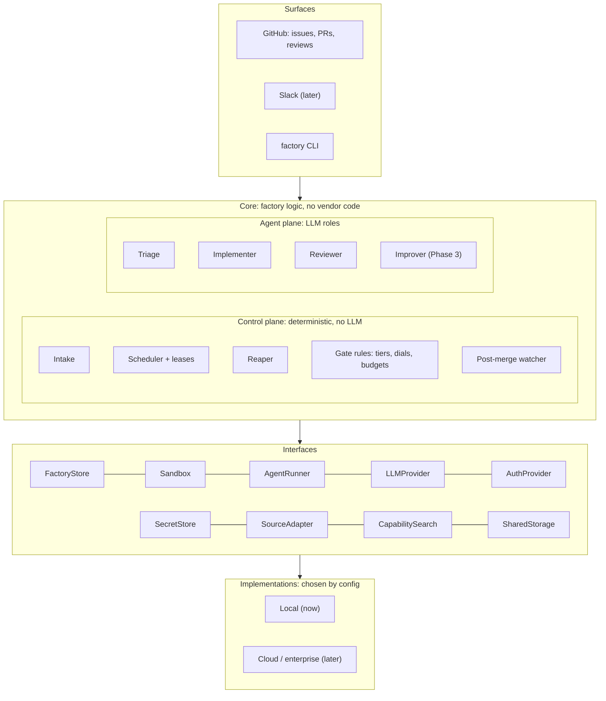
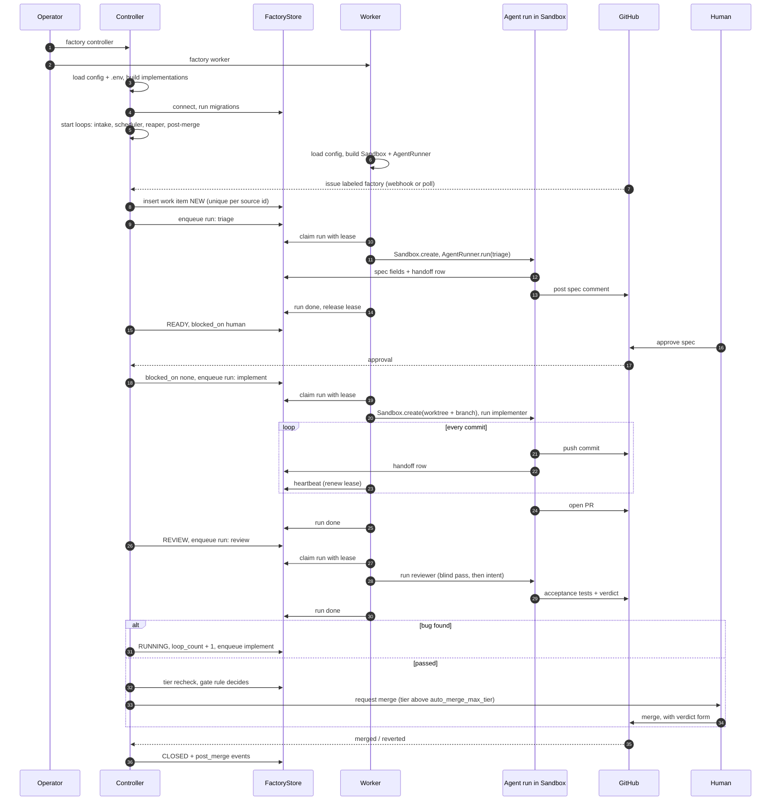
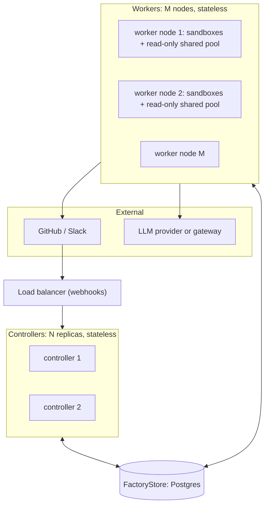

# Architecture

Four views of one system:
- the layers and their abstractions
- the control plane vs agent plane split
- what happens from startup through one work item
- how it scales horizontally

Details of each decision live in [`design.md`](design.md).

## 1. Layers

Every dependency points downward. Core code talks only to interfaces, never to a vendor or a concrete backend. Implementations are chosen once, at startup, from config (the composition root).

| Interface | Local implementation (now) | Cloud / enterprise implementation (later) |
|---|---|---|
| `FactoryStore` | SQLite (single node only) | Postgres (required for more than one node) |
| `Sandbox` | `NoOpSandbox`: git worktree on the host | Docker → gVisor / Kata / Firecracker, hosted sandboxes |
| `AgentRunner` | `ClaudeCodeRunner`: `claude -p` | API-based runner |
| `LLMProvider` | Anthropic via the Claude Code CLI (subscription) | Anthropic API, Bedrock, Vertex, company ML gateway |
| `AuthProvider` | NoAuth | SSO / OIDC, GitHub permissions, policy engine |
| `SecretStore` | `.env` | Vault / cloud secret manager |
| `SourceAdapter` | GitHub issues via REST / `gh` | Slack, GitLab |
| `CapabilitySearch` | List everything | BM25, vector, hybrid |
| `SharedStorage` | Local filesystem | PV / PVC |

## 2. Control plane vs agent plane

This one distinction shapes everything else.

| | Control plane | Agent plane |
|---|---|---|
| What | Intake, scheduler, reaper, gate rules, post-merge watcher | Triage, implementer, reviewer, improver |
| Logic | Deterministic code: same input, same output | LLM judgment: can be wrong |
| Lifetime | Long-running | Ephemeral: one run per work item per stage |
| Where it runs | Controller process | Worker process, inside a `Sandbox` |
| State | Reads and writes the `FactoryStore` only | Holds nothing. Reads pointers, writes handoff rows and commits, then exits |
| Merge, lower a tier, grant access? | Enforces the rules for these | Never |

Agents propose. The control plane decides by rule or hands the decision to a human.

## 3. Startup and one work item

The controller never runs an agent and the worker never decides a transition. They meet only in the store: the controller **enqueues runs**, workers **claim runs**.

## 4. Horizontal scalability

Designed in from day one, even though Phase 1 runs one controller and one worker on a laptop.

Scale workers for throughput. Scale controllers for availability.

**Rules that make this safe**

| Rule | Why |
|---|---|
| Controllers and workers are stateless. All state is in `FactoryStore` (plus commits on GitHub) | Any replica can die or be added at any time |
| Every state transition is a conditional update: `UPDATE ... WHERE id = ? AND version = ?` | Two replicas acting on the same item: one wins, the other gets 0 rows and moves on |
| Work is pulled, not pushed: workers claim runs with `SELECT ... FOR UPDATE SKIP LOCKED` + a lease | Adding a worker adds capacity with no coordinator; a dead worker's lease expires and the run is reclaimed |
| Intake is idempotent: unique key on `(source_type, source_id)` | Several controllers polling, or a webhook delivered twice, create one work item |
| Periodic loops (reaper, post-merge, dial) are idempotent or take a short leader lease in the store | Running them on N replicas does no harm |
| A worker's worktree is disposable. The branch on GitHub plus handoff rows are the truth | A run resumes on any node, not only the one that started it |
| Shared limits live in the store: LLM concurrency, token budgets, per-repo run caps | N workers can't overrun a provider rate limit or a budget, because they count against the same rows |
| Webhooks are verified, acknowledged fast, and written to the store before any work | Retries from GitHub are safe; slow processing never times out a webhook |
| SQLite is local-only. More than one node requires the Postgres `FactoryStore` | SQLite has one writer on one machine; the interface makes the swap a config change |

**Scaling knobs:** workers per node (`max_concurrent_runs`), number of worker nodes, warm sandbox pool size, controller replicas, LLM concurrency cap.
