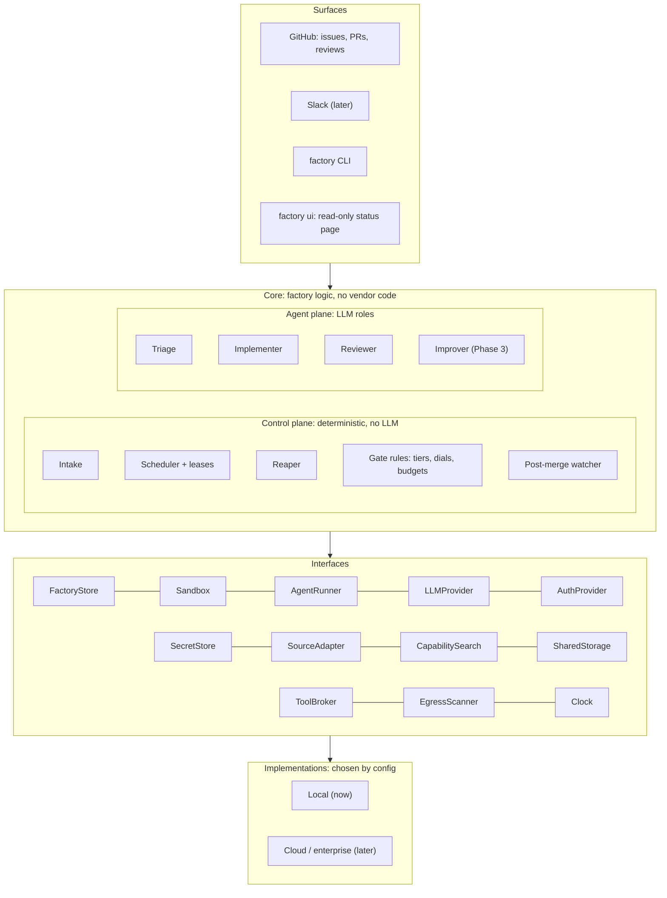
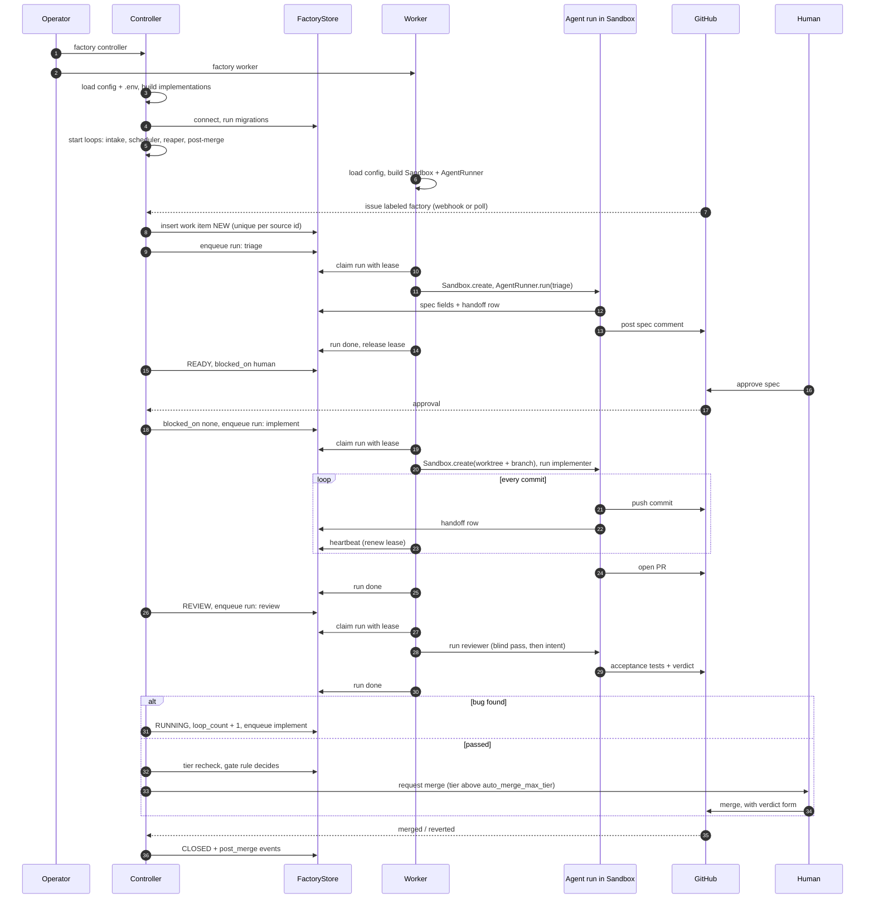
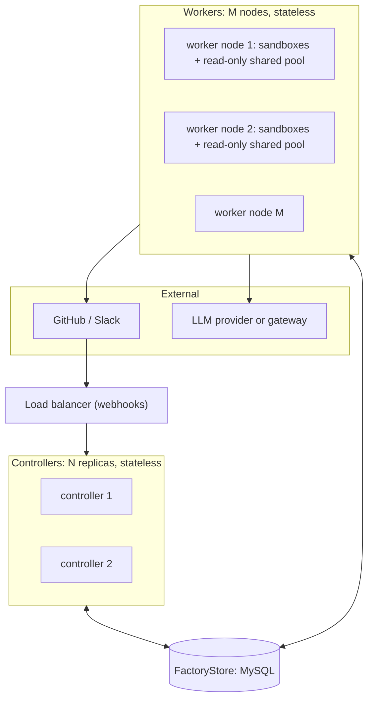
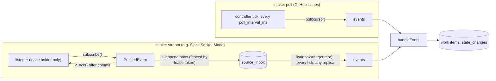
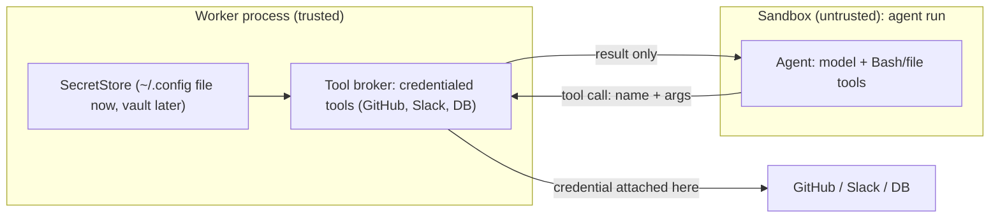

# Architecture

Four views of one system:
- the layers and their abstractions
- the control plane vs agent plane split
- what happens from startup through one work item
- how it scales horizontally

Details of each decision live in [`design.md`](design.md).

## 1. Layers

Every dependency points downward. Core code talks only to interfaces, never to a vendor or a concrete backend. Implementations are chosen once, at startup, from config (the composition root).



| Interface | Local implementation (now) | Cloud / enterprise implementation (later) |
|---|---|---|
| `FactoryStore` | `SqlFactoryStore` (all store logic, once) over a `SqlDriver`: `MysqlDriver` (default, any number of nodes), `SqliteDriver` (one machine, tests) | `MysqlDriver` on managed MySQL (RDS / Cloud SQL) |
| `Sandbox` | `NoOpSandbox`: git worktree on the host | Docker → gVisor / Kata / Firecracker, hosted sandboxes |
| `AgentRunner` | `ClaudeCodeRunner`: `claude -p` | API-based runner |
| `LLMProvider` | Anthropic via the Claude Code CLI (subscription) | Anthropic API, Bedrock, Vertex, company ML gateway |
| `AuthProvider` | NoAuth | SSO / OIDC, GitHub permissions, policy engine |
| `SecretStore` | `~/.config/software-factory/.env` (outside the repo) | Vault / cloud secret manager |
| `SourceAdapter` | GitHub issues via REST / `gh` | Slack, GitLab |
| `CapabilitySearch` | List everything (`list-all`); BM25 over `docs/` and `skills/` markdown (`bm25`) | vector, hybrid |
| `SharedStorage` | Local filesystem | PV / PVC |
| `ToolBroker` (G2) | GitHub REST + `git push` in the worker process | same, per tool |
| `EgressScanner` (G5) | Known secret values + patterns | + a managed secret scanner |
| `Clock` | `SystemClock` (tests: `FakeClock`) | `SystemClock` |

Code layout: interfaces in `src/interfaces/`, control and agent-plane logic in `src/core/`, implementations in `src/impl/`, wiring in `src/compose.ts`, the status page in `src/ui/`. Why something is an interface: testability, infrastructure, or environment (see `AGENTS.md`).

**Status page (`factory ui`, `src/ui/`).** A surface like the CLI, not a plugin interface: it has no `docs/plugins.md` entry and no registry name. It reads `FactoryStore` only, through its read methods (`listWorkItemsWhere`, `countWorkItemsByStage`, `listRunsByStatus`, `listRunsFinishedWithin`, `getWorkItem`, `listStateChanges`, `listRuns`), and never calls a method that writes. `buildUiParts` in `src/compose.ts` builds the configured clock, `SecretStore`, `FactoryStore` and `EgressScanner` through `Plugins`, not `build()`, so no controller, worker, source or runner starts. It loads the secret file because the MySQL store needs `MYSQL_PASSWORD` and the scanner needs the known secret values; those values stay in the store and scanner and never reach a page. Every value is HTML-escaped, and every free-text field is egress-scanned first and withheld whole on a finding (design §9). `node:http` only, bound to 127.0.0.1 (no host option), GET and HEAD only, Host header must be `127.0.0.1` or `localhost`. Like every other process it holds no state another replica needs, so any number can run.

## 2. Control plane vs agent plane

This one distinction shapes everything else.

| | Control plane | Agent plane |
|---|---|---|
| What | Intake, scheduler, reaper, gate rules, post-merge watcher | Triage, implementer, reviewer, improver |
| Logic | Deterministic code: same input, same output | LLM judgment: can be wrong |
| Lifetime | Long-running | Ephemeral: one run per work item per stage |
| Where it runs | Controller process | Worker process, inside a `Sandbox` |
| State | Reads and writes the `FactoryStore` only | Holds nothing. Reads pointers, writes handoff rows and commits, then exits |
| Merge, lower a tier, grant access? | Enforces the rules for these | Never |

Agents propose. The control plane decides by rule or hands the decision to a human.

## 3. Startup and one work item



The controller never runs an agent and the worker never decides a transition. They meet only in the store: the controller **enqueues runs**, workers **claim runs**.

## 4. Horizontal scalability

Designed in from day one, even though Phase 1 runs one controller and one worker on a laptop.



Scale workers for throughput. Scale controllers for availability.

**Rules that make this safe**

| Rule | Why |
|---|---|
| Controllers and workers are stateless. All state is in `FactoryStore` (plus commits on GitHub) | Any replica can die or be added at any time |
| Every state transition is a conditional update: `UPDATE ... WHERE id = ? AND version = ?` | Two replicas acting on the same item: one wins, the other gets 0 rows and moves on |
| Leases carry a fencing token that increases on every claim; every write by a worker checks it | A worker that paused past its lease (GC, laptop sleep) can't overwrite the run's new owner |
| Work is pulled, not pushed: workers claim runs in one transaction under the `claim_locks` row (one branch writer per item, below) + a lease | Adding a worker adds capacity with no coordinator; a dead worker's lease expires and the run is reclaimed |
| Intake is idempotent: unique key on `(source_type, source_id)` | Several controllers polling, or a webhook delivered twice, create one work item |
| Periodic loops (reaper, post-merge, dial) are idempotent or take a short leader lease in the store | Running them on N replicas does no harm |
| A worker's worktree is disposable. The branch on GitHub plus handoff rows are the truth | A run resumes on any node, not only the one that started it |
| Shared limits live in the store: LLM concurrency, token budgets, per-repo run caps | N workers can't overrun a provider rate limit or a budget, because they count against the same rows |
| Webhooks are verified, acknowledged fast, and written to the store before any work | Retries from GitHub are safe; slow processing never times out a webhook |
| SQLite is local-only. More than one node requires the MySQL `FactoryStore` | SQLite has one writer on one machine; `store` in `factory.config.json` makes the swap a config change |

**Workers per process.** `workers` in `factory.config.json` (an integer of 1 or more, default 1; any other value fails at startup) is how many worker loops one `factory dev` or `factory worker` process runs (`WorkerPool`, `src/core/worker-pool.ts`). Each loop claims through the store on its own, has its own id `<host>:<pid>:<n>` (the lease owner) and gets a fresh worktree per run. The loops share one `KeepAwake`, counted: held when the first run starts, released when the last one ends. A drain stops every loop from claiming; the drain is acknowledged only after every in-flight run is done. Each loop's index n reaches the agent and the update run's test command as `SF_WORKER_INDEX`, so parallel runs on one host can choose their own ports or test database. The index is unique only within one process.

**One branch writer per item (changed 2026-11-01; before: the overlap rule also held back an implement-type run while another item whose `allowed_paths` overlapped had one running, and since nearly every spec lists `docs/design.md` or a whole folder, one running implement run held back most of the queue whatever `workers` said).** Implement-type runs (`implement`, which also covers a review fix, and `update`) change an item's branch, so an item never has two of them running at once. Items whose paths overlap do run side by side; the conflicts that follow are handled at merge (sync before push, the update run, `/resolve`; design §4–§5). The claim checks this inside its store transaction: it takes the one row in `claim_locks` first (`FOR UPDATE` on MySQL; SQLite's `BEGIN IMMEDIATE` already serializes), reads the items with a running implement-type run, then walks the queued runs oldest first and claims the first eligible one, skipping an implement-type run whose item already has one running. A skipped run stays queued, holds up nothing behind it, and is claimed once its item's run finishes. Triage and review runs are never skipped. Because only a claim moves a run to `running` and every claim holds the lock row, two claimers on any number of processes or hosts can never both start a branch-writing run for one item. The cost is that claims are serialized, which is cheap next to an agent run.

**Scaling knobs:** workers per process (`workers`), number of worker processes and nodes, warm sandbox pool size, controller replicas, LLM concurrency cap.


### Intake: poll and push

A source's `intake` says how its events arrive (`SourceAdapter` is a union, `src/interfaces/source-adapter.ts`). Both paths end in the same `Controller.handleEvent`, so an event is handled the same way whichever path brought it.



- **Poll.** Unchanged: the controller calls `poll(cursor)` every `poll_interval_ms` and moves the cursor `intake:<source type>` with `advanceCursor`.
- **Push: the inbox.** Each pushed event is written to the store table `source_inbox` (seq, source type, `dedupe_key`, the event as JSON, received time) **before** it is acknowledged to the source. `ack()` runs only after that write commits; a duplicate `dedupe_key` (unique per source type) is a no-op and is acked too; a failed write is not acked, so the source redelivers it. Every controller replica reads the inbox rows after the cursor `inbox:<source type>` (every tick, since it is a store read), handles each through `handleEvent`, and moves the cursor with `advanceCursor`. A crash at any point loses nothing: before the commit the source still holds the event, after it the inbox does. Handling is idempotent, so two replicas reading the same rows at once is safe.
- **Push: the listener lease.** A source should have one connection, not one per replica. The table `listener_leases` (one row per source type: owner, token, expiry) decides who connects; every change to it is a conditional update. Each replica's controller runs a listener (`src/core/listener.ts`) that tries to take the lease every `heartbeat_ms`; only the holder subscribes, and it renews every `heartbeat_ms` for `lease_ms`. Each take bumps the token, and the inbox write checks the token in the same transaction, so a listener that lost the lease cannot write. If the holder dies (stops renewing past expiry), another replica takes the lease and connects; a holder that cannot renew for `lease_ms` closes its own connection. The two can overlap briefly (the takeover and the self-close fall due at the same time, and a sleeping host notices late); that is harmless, because the old holder's inbox writes are refused and its unacked events are redelivered to the new one. On shutdown the holder releases the lease so another replica takes over at once.
- **Ordering.** Appends of one source type lock its lease row, so they commit one at a time in seq order and a reader never moves its cursor past a row that commits later. Seqs are never reused (SQLite `AUTOINCREMENT`, InnoDB's persisted counter).
- **Reconnects.** When the stream ends or fails, the listener reconnects with exponential backoff (1 s doubling to 60 s; it starts over after a connection that stored an event). It logs once per state change (lease taken, waiting, connected, disconnected, lease lost), not once per retry.
- **Retention.** On the poll interval, the controller deletes inbox rows that are older than `inbox_retention_days` (default 14) **and** at or below the source's inbox cursor. A source with no cursor keeps every row.
- Out of scope so far: webhook HTTP endpoints (they would write to the same inbox) and any real stream plugin (Slack).

## 5. Secret isolation

**Rule:** agents never read secrets. Only tools do. An agent sees a tool's *result*, never the credential the tool used.



**Guards (each one hard, layered so one failure isn't a leak):**

| # | Guard | Stops |
|---|---|---|
| G1 | Secrets are loaded only by the worker process via `SecretStore`. The agent process gets an **allowlisted** environment (no secrets), never the worker's env | `env`, `printenv`, `process.env` inside the agent |
| G2 | Credentialed actions (push, PR, comment, DB query) are tools served by a broker **outside** the sandbox, which attaches credentials | The agent needing a token at all |
| G3 | The sandbox's filesystem view excludes secret files: run folders never contain `.env` (gitignored), and the secret file lives outside any path the sandbox mounts | `cat ~/…/.env`, path guessing |
| G4 | Harness-level deny rules on secret paths for the agent's file and shell tools | Defense in depth while G3 is weak (`NoOpSandbox`) |
| G5 | Egress scan: every agent output (commits, PR text, comments, handoff rows, logs) is checked for known secret values and secret patterns before it leaves; a hit fails the run | A leak that got past G1–G4 reaching GitHub or the store |
| G6 | Tests: a canary secret is planted; a test agent is told to find and print it; the run must fail to find it, or be stopped by G5 | Regressions in G1–G5 |

**Run folder rule (2026-11-01):** an agent may write only to its own run folder, never to the owner's checkout or its `.git`. Every run gets its own clone with its own git folder inside the run folder (`NoOpSandbox`: objects borrowed from the factory repo through an alternates link), so the agent's branches, index, `HEAD`, refs, config and hooks stay in that folder. No run gets a writable path outside it (`AgentRunSpec.writable_paths` is empty for implement runs). The clone's `core.hooksPath` is an empty, read-only folder beside the run folders, outside every agent writable path. Trusted code treats the run folder's git state as agent-written: the worker and the GitHub broker run git there with `TRUSTED_GIT_ENV` (no hooks, no fsmonitor, no signing program, no replace refs or grafts). After an agent exits, the worker checks that the git folder is still the clone's own and removes every config key that is not plain data (`untrustedGitConfig`), and the broker refuses to push from a folder that still has one. The trusted values come from the factory repo, never from the run folder: the base commit the gates and the broker's scan diff from (the factory repo's `origin/<base>`, `SandboxHandle.base_sha`), and the remote the broker pushes to (the factory repo's `origin` URL, not the run folder's `origin`). Any later sandbox follows the same rule.

**Declared secret names:** a `SecretStore` loads and scans only the secret names the selected plugins declare in `src/plugins.ts` (no closed list), so a new plugin brings its own secret without touching guarded code, and plain settings in the same file are never treated as secrets.

**Secret file location:** `${XDG_CONFIG_HOME:-~/.config}/software-factory/.env`, never inside the repository (setup: `docs/setup.md`). With `NoOpSandbox` the agent runs as the host user, so G3 relies on Claude Code's OS-level sandbox denying that directory (below). A container sandbox later makes G3 hard independently of the harness.

**The agent harness's own credential** (the token `claude -p` needs to call the model) is the one secret the agent process must hold. It is passed to the harness only, scrubbed from the environment of the harness's tool subprocesses, and covered by G5.

### Harness controls for `ClaudeCodeRunner` (Claude Code docs, checked 2026-10-31)

The runner writes a per-run Claude Code settings file into the agent's run directory:

```jsonc
{
  "env": { "CLAUDE_CODE_SUBPROCESS_ENV_SCRUB": "1" },          // G1: strip credentials from Bash, hooks, stdio MCP children
  "permissions": {
    "deny": ["Read(~/.config/software-factory/**)", "Read(**/.env)", "Read(**/.env.*)"],   // G4: file tools + recognized Bash file commands
    "blockReadsOutsideWorkingDirectories": true
  },
  "sandbox": {                                                   // G3 at OS level, even under NoOpSandbox
    "enabled": true,
    "filesystem": { "denyRead": ["~/.config/software-factory", "~/.ssh", "~/.aws"] },
    "credentials": { "envVars": [{ "name": "GITHUB_TOKEN", "mode": "deny" }, { "name": "GH_TOKEN", "mode": "deny" }] }
  }
}
```

What the docs say, and the gaps the canary test (G6) must cover:
- `Read(...)` deny rules cover the file tools and Bash commands Claude Code recognizes (`cat`, `head`, `tail`, `sed`, `tee`, redirections), **not** `grep -r` or scripts that open files themselves. OS-level `sandbox.filesystem.denyRead` covers Bash and its children but **not** the Read tool, so both are needed.
- `CLAUDE_CODE_SUBPROCESS_ENV_SCRUB=1` keeps the harness's own credential for model calls and strips credentials from subprocesses. `GITHUB_TOKEN` / `GH_TOKEN` are **not** stripped by it (hence the `credentials.envVars` deny, and G1 never passes them in). Whether `CLAUDE_CODE_OAUTH_TOKEN` is stripped is not stated explicitly: G6 checks it with `env` inside a run.
- Exact keys and semantics: verify against the installed Claude Code version when implementing (the subprocess scrub list changed in v2.1.251).
