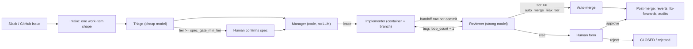

# Company software factory — one-page design

The design of the factory. Living document: change it when a decision changes.

## 1. Shape

## 2. Work item (one shape, all sources)

`source{type, link}`, `requester_id`, `problem`, `resources` (pointers), `done_criteria` (frozen after confirm), `desired_output`, `scope` + *`allowed_paths`*, `tier 1–5`, `stage NEW|READY|RUNNING|REVIEW|CLOSED`, `blocked_on none|human|upstream|ci|budget` + `blocked_reason`, `close_reason completed|duplicate|wont_do|failed|rejected`, `loop_count`, `restart_count`, `token_cost`, `project`, `pr_number`, `merge_sha`, *`fixes_pr`*. Every change → `state_changes` row (IDs only, never names).

## 3. Risk

- **Tier** = max(agent judgment, human floor directories). Rechecked at review; never lowered.
- Tier ≥ 3: human approval. Tier 5: rollout plan.
- `spec_gate_min_tier`, `auto_merge_max_tier` start fully gated (auto-merge at 0).
- **Ratchet:** moving a dial toward safety is automatic + notify. Loosening or any structural change is a human decision backed by a number.

## 4. Agents

| Role | Reads | Writes | Model |
|---|---|---|---|
| Triage | Slack thread, issues, code (API, no clone) | its fields, `READY` / `CLOSED` | cheap |
| Manager | `READY` queue | lease, assignment | none (code) |
| Implementer | work item + pointers + previous mistakes | code on its branch, TDD tests, handoff row per commit | — |
| Reviewer | pass 1: work item + diff + `worked_on` (no transcript); pass 2: intent, how_to_test | acceptance tests (blind, hidden from implementer), verdict, cumulative mistakes, tier recheck | strong, different if measured to help |

Instructions are soft; tools and permissions are hard. Credentials live only inside tool wrappers.

## 5. Coordination

- Judgment calls default to humans (form + reason). Recurring decisions → proposed rules → human approves.
- Isolation: container + branch per worker; ports and test DB per worker; shared pool mounted read-only with one updater.
- Lease + heartbeat; expired leases released by code. Crash → resume from branch + latest handoff, `restart_count` (not `loop_count`).
- Restarts: exponential backoff; infra-caused (host lost) vs task-caused (same failure on a fresh host) kept apart; at `max_restart` (e.g. 3) → `blocked_on: human`, `blocked_reason: max_restart`, with the last failure logs attached (dead-letter pattern).
- **Sandbox** interface: `create(spec) -> handle`, `exec(handle, cmd)`, `copy_in/out`, `destroy(handle)`. Impls: `NoOpSandbox` (local dev, now: runs in a git worktree on the host, no isolation), Docker, gVisor, Kata / Firecracker, hosted sandboxes. Swapping never touches agents.
  - *With `NoOpSandbox`, an agent has the host user's access. Keep the local factory on the test environment only (prod connections refused) and per-worker ports / test DB via the interfaces.*
- Merge conflict → `READY` / `blocked_on: human` / `merge_conflict_pending`; human instructs, factory resolves.

## 6. Measurement

- Raise auto-merge: severity-weighted human feedback rate < per-tier threshold over a per-tier min sample.
- Keep it raised: revert rate (webhook), fix-forward links, *sampled human audits*. Lower automatically when escapes cross the threshold.
- Compare agents: golden PRs (bad + good) → catch rate up without false-alarm rate up → shadow mode → human decides on cost.
- Per-tier budget → `blocked_on: budget`.

## 7. Self-improvement

- Behavior changes only through what agents read or may do: all files in the factory-definition repo.
- Additive learnings: automatic. Prompt / gate / permission / tool changes: improver PR with replay evidence → human.
- Recurring failure class → hard fix (gate, permission), not a softer prompt.
- Progressive disclosure: index → body → references; `CapabilitySearch` (BM25, vector, hybrid) finds skills/tools/MCP. Finding ≠ permission.

## 8. Enterprise

- Every infra layer is an interface with local + cloud backends: store, **sandbox**, secrets, shared storage, search, **auth**, **LLM provider** (`LLMProvider`; first impl: Anthropic, transports: Claude Code CLI on subscription locally → API / company ML gateway; other vendors or self-hosted later) and **agent runner** (`AgentRunner`; first impl: `claude -p`). Local first.
- Environments labeled by humans: test → DB data may reach the model; prod → blocked at the model interface.
- Tools/MCP: users can add them; automated credential-leak check + human approval; rules scoped to the tool.
- AuthN/Z behind an `AuthProvider` interface (`resolve`, `authorize`; impls: no-auth, SSO/OIDC, GitHub permissions, policy engine), called by intake, tool wrappers and the human gate. Factory acts on behalf of `requester_id`; effective permission = requester ∩ agent. Classes: local dev (no-auth), internal low risk, team-owned, restricted data, critical (two-person rule).
- Audit: IDs for requester, agent role, approver on every record.
- GitHub identity: one bot identity per agent role (triage / implementer / reviewer); requester ID in the PR; approver from the PR review.
- User attributes: `user_id : key : value` (e.g. `u_123 : role : payments`). Domain-class policies require attributes; `AuthProvider.authorize` checks them.
- Auth best practices applied: deny by default; least privilege; attributes come from the identity provider (agents can't edit them); delegated tokens short-lived and scoped; periodic access review; a logged break-glass path for incidents. Resource classes follow the common public / internal / confidential / restricted scale, mapped onto the five classes above.

## First build (local)

*Suggested order:* store + work item + `state_changes` → intake (one source) → triage → manager + lease → implementer in a container → reviewer → human form. Everything gated at day one; turn dials only when the Step 5 numbers say so.
