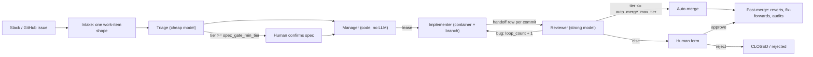

# Company software factory — one-page design

The design of the factory. Living document: change it when a decision changes.

## 1. Shape

## 2. Work item (one shape, all sources)

`source{type, link}`, `requester_id`, `problem`, `resources` (pointers), `done_criteria` (frozen after confirm), `desired_output`, `scope` + *`allowed_paths`*, `tier 1–5`, `stage NEW|READY|RUNNING|REVIEW|CLOSED`, `blocked_on none|human|upstream|ci|budget` + `blocked_reason`, `close_reason completed|duplicate|wont_do|failed|rejected`, `loop_count`, `restart_count`, `token_cost`, `project`, `pr_number`, `merge_sha`, *`fixes_pr`*, `issue_text` (the issue as received at intake; triage overwrites `problem`, so a revision reads this), `revision_count` (`/revise` commands that started a triage run; not `loop_count`, which counts review loops), `spec_feedback` (text of the latest `/revise` or `/reject`; untrusted). Every change → `state_changes` row (IDs only, never names).

## 3. Risk

- **Tier** = max(agent judgment, human floor directories). Rechecked at review; never lowered.
- Tier ≥ 3: human approval. Tier 5: rollout plan.
- `spec_gate_min_tier`, `auto_merge_max_tier` start fully gated (auto-merge at 0).
- **Ratchet:** moving a dial toward safety is automatic + notify. Loosening or any structural change is a human decision backed by a number.

## 4. Agents

| Role | Reads | Writes | Model |
|---|---|---|---|
| Triage | Slack thread, issues, code (API, no clone) | its fields, `READY` / `CLOSED` | cheap |
| Manager | `READY` queue | lease, assignment | none (code) |
| Implementer | work item + pointers + previous mistakes | code on its branch, TDD tests, handoff row per commit | — |
| Reviewer | pass 1: work item + diff + `worked_on` (no transcript); pass 2: intent, how_to_test | acceptance tests (blind, hidden from implementer), verdict, cumulative mistakes, tier recheck | strong, different if measured to help |

Instructions are soft; tools and permissions are hard. Credentials live only inside tool wrappers: agents never read secrets, only tools do, enforced by guards G1–G6 (architecture §5).

Phase 1 human gate on GitHub (D5): the triage spec is an issue comment; a user with **write** permission replies `/approve` or `/reject <reason>`; `/retry` re-runs a failed run that the factory stopped retrying (§5 Restarts). Merging the PR is the merge gate. The factory marks each handled command (and each issue it takes in) with a 👀 reaction, and explains a refused command (no write permission, or a state that cannot take it) in one reply comment (decided 2026-11-01). Agents get no broker tools yet: the worker pushes, opens the PR and posts the review through the `ToolBroker` after the agent exits (decided 2026-10-31).

**Gate commands (decision changed 2026-11-01; before: the spec gate took only `/approve` and `/reject <reason>`, a reject dropped its reason and left the issue open, and PR titles were the spec's first line cut at 80 characters).** On a spec waiting for approval (`READY` / `spec_pending`), a user with write permission replies one of:
- `/approve`: implementation starts, as before.
- `/reject <reason>`: the item closes (`close_reason: rejected`). It is recorded first, as `CLOSED` with `blocked_on: upstream` / `blocked_reason: source_close_pending` and the reason in `spec_feedback`; then the controller posts one comment quoting the reason (marker `rejected:<item id>`, so never twice), closes the GitHub issue as "not planned" (`SourceAdapter.closeIssue`), and clears the mark (`source_closed`). If the factory stops in between, every intake tick finishes items still marked. With no reason, the item and the issue still close.
- `/revise <feedback>`: the item stays open and goes back to `NEW` (`spec_revision_requested`, actor: that user) with a new triage run keyed `<item>:triage:l<loop>:r<restart>:v<n>`, which differs from the intake key and from every earlier revision. The run's prompt has the original issue text (`issue_text`), the previous spec, and the feedback under a heading that labels it untrusted, in a fence it cannot close. The new spec is a new comment and waits for the same three commands. With no feedback text the command is refused with a reply and nothing changes. The first `max_loops` revisions each run triage; the next `/revise` sets `blocked_on: human` / `blocked_reason: max_revisions`, posts one comment, and starts no run. `/approve` and `/reject` still apply there, so a human always has a way out; a further `/revise` is refused.

All three need write permission, and on an item in any other state they are refused with a reply naming the stage, like `/retry`. A new item's PR is titled `factory: <issue title>` in full; items with no stored title (from before titles were kept) keep the old rule. Schema: migration 5 adds `issue_text`, `revision_count` and `spec_feedback` (SQLite and MySQL); old rows have `issue_text` null, and their revision prompt points at the source link instead.

**Verdict command (new decision, 2026-11-01; before: the gate commands were only `/approve`, `/reject` and `/retry`, read only on the issue, and human feedback on a PR was free-form text):** a user with write permission (auth action `record_verdict`, separate from `approve_spec`) records a structured verdict with `/verdict accept|changes|reject <severity> <reason>`, on the work item's issue or on its PR. Severity is one of `none`, `minor`, `major`, `critical`. The reason is the text after the severity, following lines included; `accept` may omit it, `changes` and `reject` may not. **A verdict does not change `stage`, `blocked_on` or `blocked_reason`:** it bumps the version and stores a `state_changes` row (reason `human_verdict`, actor = the user's id, `changes` = {}) plus a linked `verdicts` row (verdict, severity, reason, comment id, target `issue`/`pr`). `verdicts.comment_id` is unique, so a redelivered comment stores nothing and gets no second reply. A bad format, an unknown severity, a missing reason, no write permission, a `CLOSED` item, or an item with no PR yet is refused with one reply on the issue, keyed on the comment id, and nothing is stored. A PR comment maps to its item by the PR's head branch. Verdicts are the input for the weighted human-feedback rate that gates auto-merge (§6); computing it is not built yet.

**Scope gate (new decision, 2026-11-01):** before every push, the worker checks the files the branch changes against the item's `allowed_paths` with the same coverage rule triage uses for `files_to_change` (exact match, or under an allowed path ending in `/`; `isCovered` in `src/core/policy.ts`). The diff is cumulative: `git diff --name-only -z --no-renames <base-sha>...HEAD`, where `<base-sha>` is `origin/<base_branch>` resolved before the implementer starts (its writable git dir includes refs). `--no-renames` makes a rename a delete plus an add, so both paths are checked; the three-dot range leaves out files only base changed, so merging base in is fine, and merge commits are not skipped. A violation fails the run with `scope_violation` (a task failure, not infra: retried with backoff up to `max_attempts`, §5 Restarts), writes no handoffs, makes no push or PR, and posts the full file list on the issue. It is a gate, not a dial: no config turns it off. Any future push path (e.g. merge-conflict resolution) must call the same check.

**Pre-push gates (decision changed 2026-11-01: the pre-push step now holds three checks, not only the scope gate, and the floor check now also looks at the files a branch really changes, not only at the `allowed_paths` triage listed).** The worker's one pre-push step (`prePush` in `src/core/worker.ts`) runs after the implementer exits and before any handoff row or push, in this order:

1. **Scope gate**, as above.
2. **Size gate.** `git diff --numstat -z -M <base-sha>...HEAD` gives added plus deleted lines and the changed file count (`diffStat` in `src/core/diff-gate.ts`; a binary file is one file and zero lines, a rename is one file). Over `max_diff_lines` (default 1500) or `max_diff_files` (default 40) the run fails with `diff_too_large`, its detail giving both counts and both limits; exactly at a limit passes. Nothing is pushed and no handoff is written. This failure is not retried automatically (the same spec would likely overreach again): the controller comments the numbers and limits on the issue and blocks the item on a human with `run_failed:implement:diff_too_large`, so `/retry` reruns the implementer, which must make a smaller change. Both limits are positive integers in `factory.config.json`; a zero or non-integer value fails at startup.
3. **Floor check on the real diff.** Every path the diff touches (both paths of a rename) is matched against the floor list (`floorHits`); a path under a floor whose tier is above the item's tier is a hit. Hits are not a failure: the run succeeds with the hits as data, nothing is pushed, no PR is opened, and the controller sets `blocked_on: human`, `blocked_reason: floor_tier` (stage stays `RUNNING`), records a `floor_blocked` row with the required tier, and comments each floor path with the tier it needs. `/approve` from a user with write permission raises the tier to the required tier (never lowers it), clears the block, adds one to `restart_count` so the new implement run has a new key, and records `floor_tier_approved` with the approver's user ID. `/reject` closes the item. `/retry` is refused: a floor block is not a failed run. An item already at or above the floor's tier pushes as before. The floor list itself is unchanged.

## 5. Coordination

- Judgment calls default to humans (form + reason). Recurring decisions → proposed rules → human approves.
- Isolation: container + branch per worker; ports and test DB per worker; shared pool mounted read-only with one updater.
- Lease + heartbeat; expired leases released by code. Each claim bumps a **fencing token**; heartbeats, completions, handoff rows and broker calls carry it, so a worker that lost its lease can't write (decided 2026-10-31).
  - Host sleep (fencing rule changed 2026-11-01; before, `lease_expires_at` was also a hard deadline for every write): **status and token decide whether a lease is held, not the clock.** Heartbeat, completion, handoffs and broker calls are accepted while the run is `running` with the caller's token, even after `lease_expires_at` passed. So a worker that wakes from a sleep renews its unreclaimed lease and finishes on the same attempt. Expiry only makes a run eligible for the reaper. Once the reaper requeues or fails it, or another worker reclaims it (token + 1), the old token is refused everywhere. The reaper keeps its previous tick time in memory (per process, not shared between replicas). If more than `lease_ms` passed since then, it skips expiring leases for one `heartbeat_ms`, so workers that slept on the same host can renew first. Residual gap: a reaper on a host that did not sleep still requeues a sleeping worker's run once `lease_ms` passes. Closing that needs a human decision (longer lease, or host liveness in the store).
- **Budget checkpoints (new, 2026-11-01; §6):** the controller checks an item's token budget only where it queues an implement or review run, in the same conditional transition as the outcome it applies, never mid-run. At the budget the run is held on a `budget_checkpoints` row instead of queued, and `/budget` queues it later under the same key.
- Runs: the controller enqueues, workers claim. A transition can **ack a finished run and enqueue the next one in the same transaction**, so a crash between "decide" and "enqueue" can't strand an item (decided 2026-10-31).
- Store backend (D3 changed 2026-10-31): **MySQL** by default, because several workers and machines are planned. SQLite stays for tests and single-machine use. `factory.config.json` → `store.type` picks one (a plugin name, D6; `docs/plugins.md`). The store logic exists once (`SqlFactoryStore`); a backend is only a `SqlDriver` (transactions, statements, lock syntax), and both pass the same store contract tests. MySQL claims runs with `FOR UPDATE SKIP LOCKED` in READ COMMITTED transactions.
- Time is injected through a `Clock` interface: `SystemClock` in prod, `FakeClock` in tests (decided 2026-10-31). Crash → resume from branch + latest handoff, `restart_count` (not `loop_count`).
- **Restarts (decision changed 2026-11-01; before: any failed run set `blocked_on: human` / `run_failed:<kind>:<code>` at once and waited for `/retry`, and the reaper requeued an expired lease with no wait).** Now a failed triage, implement or review run is retried by the factory. Update runs keep the old rule (block, `/retry`).
  - Each retry is a **new run row** enqueued by the controller in the same conditional transition that acks the failed run. Its key is the failed run's key plus `:a<n>` (`retryKey` in `src/core/policy.ts`), derived from the failed run alone, so applying the same run twice asks for the same key and the ack fences the second apply: one retry, never two. The item stays `blocked_on: none` while it waits.
  - **Backoff:** the retry's earliest start, `runs.not_before`, is `finished_at + retry_base_ms × 2^(n−1)` where n counts the step's failed attempts, capped at `retry_max_ms`. Every claim checks it in the store, so every worker and replica waits. The reaper gives an expired lease the same wait: it requeues the run with `not_before` set (by its claim count), not at once.
  - **Infra vs task:** a lease loss, a timeout, an exception or an expired lease is an infra failure: it counts toward `max_restart` and adds one to `restart_count`. Anything else (agent error, invalid output, no commits, scope violation, egress block) is a task failure and counts toward `max_attempts`; `restart_count` stays. Counts are per step (the first run and its automatic retries), read from the run history.
  - **Rate limits:** a runner that reports `rate_limited` (claude-code: a result with `api_error_status: 429`) spends no attempt and no restart. The worker stores a claim pause in the store (`claim_pauses`, only ever moved later) before it stores the outcome, so **no worker claims any run, for any item, until the reset time**, or for `retry_max_ms` when the runner gave none. The worker whose call moved the pause logs one line saying when work resumes. The retry run's `not_before` is the reset time.
  - **Dead letter:** when a step's task failures reach `max_attempts` or its infra failures reach `max_restart`, the item goes to `blocked_on: human` with `blocked_reason` `max_attempts` or `max_restart`. One comment says in plain words what failed, the error code, and the tail of the last run's output. It goes through the `EgressScanner` first; if the scan blocks it, nothing is posted, a warning is logged, and the item still blocks.
  - `/retry` on an item blocked by a failed run (`max_attempts`, `max_restart`, or an older `run_failed:*`) enqueues the run at once (`not_before` null) with `restart_count + 1`, which starts a new step and a fresh budget. It does not lift a rate-limit pause. On an item with no failed run it is refused as before.
  - Config: `max_attempts` (default 3, unchanged), `max_restart` (default 3), `retry_base_ms` (default 60000), `retry_max_ms` (default 1800000) in `factory.config.json`. Schema: migration 4 adds `runs.not_before` and the `claim_pauses` table (SQLite and MySQL).
  - Rollout: an old worker ignores `not_before` and the pause, so stop every worker before the first new controller starts, then migrate and start the new code everywhere.
- **Sandbox** interface: `create(spec) -> handle`, `exec(handle, cmd)`, `copy_in/out`, `destroy(handle)`. Impls: `NoOpSandbox` (local dev, now: runs in a git worktree on the host, no isolation), Docker, gVisor, Kata / Firecracker, hosted sandboxes. Swapping never touches agents.
  - *With `NoOpSandbox`, an agent has the host user's access. Keep the local factory on the test environment only (prod connections refused) and per-worker ports / test DB via the interfaces.*
- Merge conflict (decision changed 2026-11-01; before: "→ `READY` / `blocked_on: human` / `merge_conflict_pending`; human instructs, factory resolves"): when GitHub reports an open factory PR as unmergeable (`mergeable === false`, the source's `pr_unmergeable` event) and its item waits for a human merge (`REVIEW` / `merge_pending`), the controller enqueues one **`update` run** per (head sha, base sha). The worker runs no agent for it: it merges `origin/<base_branch>` into the PR branch in a fresh worktree (merge only, never a rebase or force push), runs `repo.test_command` (argv in `factory.config.json`, default `["npm","test"]`) with the worker's tool env, and **pushes only if the merge is clean and the tests pass** (`update_pushed`; the item stays `merge_pending`). Otherwise it pushes nothing, comments on the PR (the conflicting files one per line, or that the tests failed on the updated branch), and the controller sets `blocked_on: human` / `merge_conflict_pending` (`update_conflict` or `update_tests_failed`); the stage stays `REVIEW`. A base already contained in the branch is a no-op. A git or push error fails the run (`run_failed:update:<code>`), and `/retry` re-enqueues it. **Resolving conflicts with an agent is still open.**
- **Status labels (new decision, 2026-11-01):** before this, a work item's state was visible only in the store and in comments. Now a pure mapping (`src/core/status-label.ts`) turns `stage`, `blocked_on`, `blocked_reason` and `close_reason` into exactly one of eight statuses: `NEW` → triaging; `READY`/`spec_pending` → needs approval; `RUNNING` → implementing; `REVIEW` → in review; `REVIEW`/`merge_pending` → ready to merge; `CLOSED`/`completed` → done; `CLOSED` with any other `close_reason` → rejected (`duplicate` and `failed` have no producer today); anything else blocked (failed runs, `max_loops`, `merge_conflict_pending`, an unknown reason, or a `blocked_on` other than `human`) → needs human. The source shows it through a new `SourceAdapter.setStatus(source, status, pr_number)`: on GitHub, one label `<status_label_prefix><name>` (default prefix `sf: `). The PR is addressed through the same call with a non-null `pr_number`, not a separate PR `SourceRef`, because PRs share the issue labels API. Only the eight fixed names under the current prefix are ever removed, so a human-made `sf: …` label survives. The controller calls it after each committed transition whose patch touches `stage`, `blocked_on`, `blocked_reason`, `close_reason` or `pr_number` (issue, then PR once `pr_number` is set), after an intake that created the item, and for every non-`CLOSED` item when `Controller.run` starts (catch-up via `listWorkItems(1000)`, a warning when the cap is hit; no new store method). Ack-only transitions (empty patch) write nothing. Every call is best effort, like the 👀: a failure is a warning and the transition stands. Labels are output only; the factory never reads them. **Known limitation:** with several controller replicas, two near-simultaneous transitions of one item can write labels in the wrong order; the next transition or the next start-up catch-up corrects it.

## 6. Measurement

- Raise auto-merge: severity-weighted human feedback rate < per-tier threshold over a per-tier min sample.
- Keep it raised: revert rate, fix-forward links, *sampled human audits*. Lower automatically when escapes cross the threshold.
- **Revert and fix-forward tracking (new decision, 2026-11-01; replaces "revert rate (webhook)"):** reverts are found by polling base-branch commits, not by webhook. The `github-issues` source reads `origin/<base_branch>` commits (cursor: commit date, `since` inclusive; the first poll reads at most the newest 500, and a window over 500 drops the oldest) and emits `base_commit` {sha, message}. The controller (matchers in `src/core/links.ts`) records a `reverted` state_changes row on a factory item when a commit body says `This reverts commit <merge_sha>`, or when a subject starting with `Revert` names its PR `#N` (the squash suffix `(#M)` at the end is the reverting PR, not a candidate). A new issue whose title or body says `Fixes #N` or `Follow-up to #N`, N a factory PR, gets `fixes_pr = N` (row reason `fixes_pr_linked`) and the item with PR N gets a `fixed_forward` row. Only factory PRs are linked; other numbers are ignored. These rows change no field: `reverted` and `fixed_forward` are state_changes reasons only, not stages or close reasons, and nothing about gates or auto-merge changes. What the reason code cannot hold goes in the new nullable `state_changes.detail` (JSON, IDs and shas only): `reverted` → `{reverting_commit, reverting_pr}`, `fixed_forward` → `{fix_work_item_id}`, `fixes_pr_linked` → `{original_work_item_id}`. Dedupe key (checked inside the conditional transition, so a conflict re-reads): (item, `reverted`, reverting commit), so two commits that revert the same merge are two rows; (original item, `fixed_forward`, fix item). Rows written before the column existed have `detail` NULL. Stats over these rows are not built yet.
- Compare agents: golden PRs (bad + good) → catch rate up without false-alarm rate up → shadow mode → human decides on cost.
- **Golden set for the reviewer (decision changed 2026-11-01: measurement now has a golden-set step; before, "golden PRs" above was a plan with no cases, no runner and no numbers).** `src/golden.ts`, two CLI commands:
  - `factory golden add <pr> [--expect should_flag|should_pass] [--force]` writes `golden/cases/<pr>/` in the repo: `diff.patch` (the PR's unified diff from GitHub, one read-only GET), `spec.md` (the work item spec, in the worker's review layout) and `case.json` (`expect`, `outcome`, `human_verdict` {reason, actor_id, record_id}, `revert_reason` {reason, record_id, detail}, `source_record_ids`; IDs only). The outcome is read through the store APIs (`getWorkItemByPr`, `listStateChanges`): `rejected` (closed with `close_reason: rejected`), `reverted` / `fixed_forward` (merged, then the §6 revert-tracking row), `clean_merge` (merged, neither row), `held` (anything else). A `should_pass` case comes only from a clean merge and only with an explicit `--expect should_pass`; a clean merge is never `should_flag`. Without `--expect`, rejected, reverted and fixed-forward PRs default to `should_flag`; a held PR must say which. An existing case directory is refused without `--force`. Every file is G5-scanned (channel `commit`) before anything is written; any finding writes nothing and prints rule names only. The human verdict form (severity + reason, BACKLOG #3) is not built yet: `human_verdict` is the human's merge or close row until it is. Choosing which PRs become cases is a human decision; none are seeded.
  - `factory golden run --agent reviewer` (only `reviewer` is accepted) replays every case through the `runner` plugin in a fresh detached sandbox (`branch: null`) with the worker's review system prompt, `REVIEW_SCHEMA`, the same harness tools, and the stored spec plus diff as the prompt (no doc index, so a replay does not depend on the docs). It builds no `ToolBroker`, opens no store, pushes nothing and posts nothing. With the `noop` sandbox the agent has the host user's access, so run it in the test environment only (§5).
  - **Rates:** a case is flagged when the parsed review has `verdict: "bug"`. `catch_rate` = flagged / completed `should_flag` runs; `false_alarm_rate` = flagged / completed `should_pass` runs; each is printed with numerator and denominator, and a zero denominator prints `n/a`. **Errored runs** (any runner status other than `completed`, or output that fails `parseReview`) are counted and shown separately and excluded from both rates.
  - **Results** go to `<state_dir>/golden/results/<timestamp>.json`, not the store: case IDs, expect, verdicts, findings, counts and rates only. The file is G5-scanned (channel `run_outcome`) first; a finding writes nothing. Not yet: comparing two agents automatically, shadow mode.
- **Per-tier token budget (decision changed 2026-11-01; before: "Per-tier budget → `blocked_on: budget`" was a plan with no limit, no check and no human answer, so an item could spend tokens with no human check).** A checkpoint, not a hard stop: all work is kept and a human decides whether to go on.
  - **Config:** `budgets` in `factory.config.json` maps a tier (`"1"`–`"5"`) to a token budget, a positive integer. A tier with no entry, or no `budgets` key at all, has no limit and never gets a checkpoint. `budget_min_sample` (integer ≥ 1, default 10) is how many finished items a tier needs before suggestions come from its history. Any other value fails at startup (`budgetConfig` in `src/core/budget.ts`). `factory.config.json` ships with no budgets.
  - **Where the check runs:** where the controller queues the next implement or review run, never while a run is in progress (once an item is blocked, the controller ignores the outcome of any run still on it, so a block set mid-run would lose that run's result). There is one check, in the controller's `decide`, so it covers the first implement run (auto-approved triage), spec approval, a floor `/approve`, the review after an implement run, the review loop, automatic retries and `/retry`. Triage runs are never held; their tokens count toward the item. A run already in progress when the budget is reached finishes and its outcome is applied as usual.
  - **Checkpoint:** when the item's `token_cost` after the decision is at or over its current budget, the decision's patch and run ack still apply, but its run is **not queued**: the item gets `blocked_on: budget`, `blocked_reason: budget_checkpoint` (status label: needs human), and the held run's kind, key and `not_before` go on a new `budget_checkpoints` row, written in the same store transaction as the block and its one `budget_checkpoint` state_changes row (detail: the decision's own reason as `held_reason`, the held run, tokens, budget, suggestion). The branch, the PR, the handoffs and the run history are not touched. One comment, keyed on the held run's key, gives the stage, the PR number if any, runs and tokens spent, the current budget, the suggested budget with its method and the number of merged records it used, and how to answer.
  - **Current budget:** the budget granted by the item's latest continued checkpoint, else the tier's configured budget, and never below the configured budget of the item's tier now (so a tier raised after a grant keeps its own budget; the spec said only "the latest granted", and this is the one deviation).
  - **Answers** (same write-permission check as `/approve`; a refusal gets the usual one reply and changes nothing): `/budget` continues with the suggested budget; `/budget <tokens>` with a whole number greater than the current budget (it may still be below what is spent: the held run then starts once and the next run is checked again). Either queues the held run once, with the kind, key and `not_before` it was held with, on the same branch, clears the block and records `budget_continued`. `/reject <reason>` closes the item (`close_reason: rejected`, `budget_rejected`) and leaves the branch and the PR as they are; the reason text is not stored, as with every `/reject`. `/approve` and `/retry` at a checkpoint are refused with how to answer. The answer and its state change are one store transaction, and a checkpoint is answered at most once.
  - **Suggestion** (`suggestBudget`): base rule = current budget + the tier's configured budget. Before `budget_min_sample` finished (`CLOSED`) items exist in the tier, or when none of them merged (`close_reason: completed`), the base rule. Otherwise the nearest-rank 90th percentile of the merged items' `token_cost`, rounded up to the next 100000 tokens; a history suggestion that is not above the current budget is replaced by the base rule, and the comment says so. History is read per project and tier.
  - **Records:** every checkpoint row keeps item id, tier, tokens spent, budget, suggested budget, answer (`pending`, `continued_suggested`, `continued_custom`, `rejected`), granted budget, held run kind, key and `not_before`, and `outcome`. When the item closes, the store sets `outcome` on its checkpoints that have none, in the closing transition: `merged`, `rejected` or `failed` from `close_reason` `completed`, `rejected` or `failed` (`failed` has no producer today). These rows are what future suggestions can learn from.
  - **Schema:** migration 7 adds `budget_checkpoints` and an index on `work_items (project, tier, stage)`, SQLite and MySQL (the spec said migration 5; 5 had already shipped with verdicts). Additive: run `migrate` before starting the new controller. Until every controller runs this code, an old controller does not enforce budgets.
  - Not built: changing a budget without a human answer, budgets for triage runs, a status page view of checkpoints.

## 7. Self-improvement

- Behavior changes only through what agents read or may do: all files in the factory-definition repo.
- Additive learnings: automatic. Prompt / gate / permission / tool changes: improver PR with replay evidence → human.
- Recurring failure class → hard fix (gate, permission), not a softer prompt.
- Progressive disclosure: index → body → references; `CapabilitySearch` (BM25, vector, hybrid) finds skills/tools/MCP. Finding ≠ permission.
  - **Doc index in the prompt (new decision, 2026-11-01):** before this, no agent received any capability list (`list-all` existed but nothing built it). Now the worker takes an optional `CapabilitySearch` and appends the top 8 results to the triage, implement and review prompts as a short index (path, name, ≤200-character snippet); agents read full text on demand with `Read`, which they already have. The index grants nothing: tools, `deny_paths` and grants are unchanged. BM25 comes first (`bm25` plugin: `*.md` under `docs/` and `skills/`, headings boosted, rebuilt from files when they change, per process); vector and hybrid stay later. `Capability.kind` gains `doc` for markdown docs (`skill` for `skills/`). The default stays `list-all`, which finds nothing, so prompts do not change until config selects `bm25`.

## 8. Enterprise

- **Plugins (D6, decided 2026-11-01):** every implementation of an infra interface is a named plugin, selected by name in `factory.config.json` and built only through the registry in `src/plugins.ts`; `build()`, setup/doctor and the G6 canary all resolve through it. Unknown names fail at startup. The guards (`SecretStore`, `EgressScanner`, `ToolBroker`; architecture §5) can be switched to another plugin but never disabled: config that selects none fails at startup. No external plugin loading. This changes how D3's store choice and the `auth` key are described: `store.type` and `auth` are now the plugin names for `FactoryStore` and `AuthProvider` (same keys, same values); the other interfaces are under `plugins`. Catalogue: `docs/plugins.md`.
- **Self-update (D7, decided 2026-11-01):** the factory runs from a runtime copy of `origin/<base_branch>` (`<state_dir>/runtime`, a detached git worktree), not from the checkout it was started in. State stays in the main checkout: `state_dir`, `worktrees_dir`, `repo.path`, the database, shared storage and the secret file; only code, `factory.config.json` and `prompts/` come from the runtime copy (`loadConfig` takes the code root explicitly; the supervisor passes it as `SOFTWARE_FACTORY_CODE_ROOT`). `dev` is a supervisor behind a new `Updater` plugin (`git-worktree` default, `none` = run in place as before). Order on a code change: build the new commit beside the running child first, then drain (IPC; the worker stops claiming and finishes its in-flight run), fast-forward, swap in the build, restart. This deliberately differs from "drain, update, build, restart": a failed build must leave the old version running. Consequence: under `git-worktree`, uncommitted local edits, local branches and unpushed merges no longer affect `dev`. The main checkout is only fast-forwarded, and only when it is on the base branch and clean.
- **Declared secret names (decision changed 2026-11-01; before: `SecretName` was a closed union in the guarded `SecretStore` interface, repeated as a fixed list in the `env-file` plugin, so a new secret meant editing guarded code).** Secret names are declared by plugins, not a closed union. `SecretName` is a branded string built only by `secretName()` (upper-case letters, digits, `_`, starting with a letter). Each registry entry in `src/plugins.ts` lists, per plugin, the names it reads with a one-line purpose; the secret set is the union for the selected plugins, and the `env-file` store loads, returns and scans only that set. Plain settings in the same file (`MYSQL_HOST`) and undeclared keys stay out of `get` and out of the G5 scan set. A declared secret missing from the file does not fail startup; `doctor` reports it and `setup` asks for it. Guards G1–G6 are unchanged. Catalogue: `docs/plugins.md`.
- **Keep awake (decided 2026-11-01):** a new `KeepAwake` interface (`hold` / `release`, plugin kind `awake`, config key `plugins.awake`, not a guard). The worker holds it only while a claimed run executes, never while idle. Plugins: `caffeinate` (macOS, `caffeinate -i -s -w <pid>`) and `none`. **The default depends on the platform:** `caffeinate` on `darwin`, `none` everywhere else, so the checked-in config leaves `awake` out. Selecting `caffeinate` on a host without the executable fails at startup. A failed hold only logs a warning; the job still runs. Lid close still sleeps a Mac; the host-sleep lease rules (§5) cover that case. Catalogue: `docs/plugins.md`.
- Every infra layer is an interface with local + cloud backends: store, **sandbox**, secrets, shared storage, search, **auth**, **LLM provider** (`LLMProvider`; first impl: Anthropic, transports: Claude Code CLI on subscription locally → API / company ML gateway; other vendors or self-hosted later) and **agent runner** (`AgentRunner`; first impl: `claude -p`). Local first.
- Environments labeled by humans: test → DB data may reach the model; prod → blocked at the model interface.
- Tools/MCP: users can add them; automated credential-leak check + human approval; rules scoped to the tool.
- AuthN/Z behind an `AuthProvider` interface (`resolve`, `authorize`; impls: no-auth, SSO/OIDC, GitHub permissions, policy engine), called by intake, tool wrappers and the human gate. Factory acts on behalf of `requester_id`; effective permission = requester ∩ agent. Classes: local dev (no-auth), internal low risk, team-owned, restricted data, critical (two-person rule).
- Audit: IDs for requester, agent role, approver on every record.
- GitHub identity: one bot identity per agent role (triage / implementer / reviewer); requester ID in the PR; approver from the PR review.
- User attributes: `user_id : key : value` (e.g. `u_123 : role : payments`). Domain-class policies require attributes; `AuthProvider.authorize` checks them.
- Auth best practices applied: deny by default; least privilege; attributes come from the identity provider (agents can't edit them); delegated tokens short-lived and scoped; periodic access review; a logged break-glass path for incidents. Resource classes follow the common public / internal / confidential / restricted scale, mapped onto the five classes above.

## 9. Status page

**Read-only status page (new decision, 2026-11-01).** `npm run factory -- ui` serves two pages from `node:http` on `127.0.0.1:<ui.port>` (`factory.config.json`, default 4310; there is no host option): `/` (Waiting for you, grouped by `blocked_reason`; Running now, highlighted when the last heartbeat is older than `lease_ms`; Queue, oldest first; All work items, `?stage=` filter, CLOSED hidden unless `?closed=1`; Totals: items per stage, runs succeeded and failed and tokens in the last 24 h) and `/items/<id>` (state_changes timeline and runs). Meta refresh every 5 s, no JavaScript, no front-end dependency. No actions (approve, retry, merge stay on GitHub), no login, no remote access.
- **A surface, not a plugin.** Like the CLI it reads `FactoryStore` and has no plugin interface or `docs/plugins.md` entry. It is built through `Plugins` (store, secrets, scanner), not `build()`, so it runs no controller or worker.
- **Withhold, not mask.** Free text from the store (titles, blocked reasons, state-change values and reasons, run errors) is egress-scanned before rendering. `EgressScanner.scan` returns rules, not spans, so a field with any finding is replaced whole by `[withheld: <rule>]`. Span-level masking would need a new `EgressScanner` method; that is a separate tier-4 change if wanted.
- **Request guards.** GET and HEAD only (405 with `Allow: GET, HEAD` otherwise), unknown paths 404, and a Host header other than `127.0.0.1` or `localhost` (any port) gets 403, against DNS rebinding: the page exposes store data to any local browser tab. Responses carry a CSP with `default-src 'none'`.
- **New nullable columns** (migration 3, SQLite and MySQL): `work_items.title` (written at intake; `problem` is unchanged, since triage overwrites `problem` with the spec), `runs.started_at` (set on every claim, so it is the latest attempt's start) and `runs.finished_at` (set when a run succeeds or fails, by the worker or the reaper; a reaper requeue leaves it null). Rows from before the migration read as null: an item without a title shows its source id, a run without `started_at` shows an unknown duration. `title` is store-owned, not in `WorkItemPatch`.
- **New read methods** on `FactoryStore`, implemented once in `SqlFactoryStore`: `listWorkItemsWhere` (stage, blocked_on, exclude closed), `countWorkItemsByStage`, `listRunsByStatus`, `listRunsFinishedWithin(window_ms)` (the window is measured on the store's clock, so no "now" argument).
- **"Last 24 h"** counts runs by `finished_at`. Tokens are summed in app code from succeeded runs' `outcome.data.tokens`, the same source the controller adds to `token_cost`; failed runs report no tokens.

## First build (local)

*Suggested order:* store + work item + `state_changes` → intake (one source) → triage → manager + lease → implementer in a container → reviewer → human form. Everything gated at day one; turn dials only when the Step 5 numbers say so.
