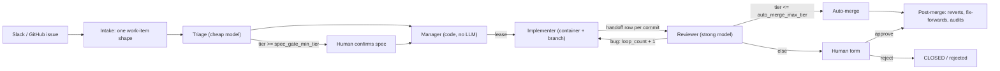

# Company software factory — one-page design

The design of the factory. Living document: change it when a decision changes.

## 1. Shape

## 2. Work item (one shape, all sources)

`source{type, link}`, `requester_id`, `problem`, `resources` (pointers), `done_criteria` (frozen after confirm), `desired_output`, `scope` + *`allowed_paths`*, `tier 1–5`, `stage NEW|READY|RUNNING|REVIEW|CLOSED`, `blocked_on none|human|upstream|ci|budget` + `blocked_reason`, `close_reason completed|duplicate|wont_do|failed|rejected`, `loop_count`, `restart_count`, `token_cost`, `project`, `pr_number`, `merge_sha`, *`fixes_pr`*, `issue_text` (the issue as received at intake; triage overwrites `problem`, so a revision reads this), `revision_count` (`/revise` commands that started a triage run; not `loop_count`, which counts review loops), `spec_feedback` (text of the latest `/revise` or `/reject`; untrusted). Every change → `state_changes` row (IDs only, never names).

## 3. Risk

- **Tier** = max(agent judgment, human floor directories). Rechecked at review; never lowered.
- Tier ≥ 3: human approval. Tier 5: rollout plan.
- `spec_gate_min_tier`, `auto_merge_max_tier` start fully gated (auto-merge at 0).
- **Ratchet:** moving a dial toward safety is automatic + notify. Loosening or any structural change is a human decision backed by a number.

## 4. Agents

| Role | Reads | Writes | Model |
|---|---|---|---|
| Triage | Slack thread, issues, code (API, no clone) | its fields, `READY` / `CLOSED` | cheap |
| Manager | `READY` queue | lease, assignment | none (code) |
| Implementer | work item + pointers + previous mistakes | code on its branch, TDD tests, handoff row per commit | — |
| Reviewer | pass 1: work item + diff + `worked_on` (no transcript); pass 2: intent, how_to_test | acceptance tests (blind, hidden from implementer), verdict, cumulative mistakes, tier recheck | strong, different if measured to help |

Instructions are soft; tools and permissions are hard. Credentials live only inside tool wrappers: agents never read secrets, only tools do, enforced by guards G1–G6 (architecture §5).

Phase 1 human gate on GitHub (D5): the triage spec is an issue comment; a user with **write** permission replies `/approve` or `/reject <reason>`; `/retry` re-runs a failed run that the factory stopped retrying (§5 Restarts); `/resolve [notes]` starts an agent resolve of a merge conflict (§5 Merge conflict; on the issue or on the PR's conversation). Merging the PR is the merge gate. The factory marks each handled command (and each issue it takes in) with a 👀 reaction, and explains a refused command (no write permission, or a state that cannot take it) in one reply comment (decided 2026-11-01). Agents get no broker tools yet: the worker pushes, opens the PR and posts the review through the `ToolBroker` after the agent exits (decided 2026-10-31).

**In short opening (decision changed 2026-11-01; before: the spec comment opened with the first one or two sentences of the problem, and the PR description was the implementer's summary with no plain statement of the change at the top).** Triage returns a required `in_short` text field: "AS-IS:" in one plain sentence or two, then "TO-BE:" in one, with no file-level detail. The spec comment is `## Factory spec`, then `### In short (AS-IS → TO-BE)` and that text; nothing comes before it, and the "Please check" tier note follows it. The problem no longer opens the comment: it stays on the work item and appears as a `### Problem` section after "Not included". `prompts/implement.md` and `prompts/resolve.md` tell the agent that its summary (the PR description, the resolution summary) starts with the same section, before any file-level detail; the PR body is still summary, `Closes #<issue>`, work item line. `in_short` is not stored; a revised spec gets a new one from its triage run. Only the prompt text is tested; nothing checks that a model's reply starts with the section (a reviewer check would need a tool that reads the PR description, an open question).

**Closing the source issue (decision changed 2026-11-01; before: intake read only open issues, so closing a factory issue did not stop its work item, and a human had to `/reject` a closed issue by hand).** Intake now also reads closed factory-labelled issues on every poll (`issues?state=closed&labels=<intake_label>`, its own `closed` cursor inside the same intake cursor, `since` inclusive, the issue numbers at the boundary time skipped; pull requests in the list are skipped). Each becomes a `source_closed` event carrying the closer from the single-issue endpoint's `closed_by`, or null, and GitHub's `state_reason` (`completed`, `not_planned`, or null for none or any other value). The rule: **closing the issue stops the item.** If the item exists and is not already `CLOSED`, one conditional transition sets `CLOSED` with `close_reason` `completed` when the state_reason is `completed` and `wont_do` otherwise (no `merge_sha` is written), writes one `state_changes` row with reason `source_closed` and the closer's user id as actor, and in the same transaction cancels the item's `queued` runs (triage, or a retry waiting on backoff; `TransitionInput.cancel_queued_runs`) and stops its `running` runs of any kind (`TransitionInput.cancel_running_runs`: status `cancelled`, lease cleared, no outcome). A stopped run's worker gets `lease_lost` on its next heartbeat, its handoff writes and its completion are refused (its outcome is not stored), and the tool broker refuses its calls with `lease_lost`, so nothing is pushed after the close. Cancelled runs go through the normal ack path and are recorded as `run_ignored`; the controller posts nothing for them. The reaper cancels, rather than requeues, an expired run whose item is `CLOSED`. Store first, no login check: an item already `CLOSED` (by `/reject`, a merge, or an earlier delivery of the same close) gets no row, so repeats and the factory's own close are no-ops. A closer GitHub does not name, or who maps to no user, is recorded as the system actor (`system:intake`) with a warning. No comment is posted on the closed issue; its status label moves to `done` for `completed` and `rejected` for `wont_do`. **The item's PR:** an item with a `pr_number` is closed as `CLOSED` with `blocked_on: upstream` / `blocked_reason: pr_close_pending` in the same transition. The controller then asks the source to close that PR without merging (`SourceAdapter.closePr`), after one comment on it, keyed on marker `pr-closed:<item id>`: "Closed because the issue was closed by @<login>.", or "Closed because the issue was closed." when GitHub names no closer (the source reads `closed_by` again, so no login is stored). A PR already merged or closed is left alone, with no comment. Then the mark is cleared (`pr_closed_for_source`). If the comment or the close fails, the item stays `CLOSED` and marked, a warning is logged, and every intake tick tries again; the comment goes first and carries its marker, so it is never posted twice. The `pr_closed` event GitHub then sends finds the item `CLOSED` and changes nothing. Closes are delivered after the poll's PR events, so a merged PR whose `Closes #N` closed the issue is recorded as `completed` first. Reopening the issue or re-adding the label does not restart a closed item: intake returns the existing item, so a human files a new issue. Known gaps: an issue whose factory label was removed before it closed is not seen; an item closed as `completed` with no merge still counts as merged in budget stats (§6), left for its own item. **Decision changed 2026-11-02 (issue #104):** before, every source close was recorded as `wont_do`, a running run finished and its result was ignored (an implement run could still push a PR), and the item's open PR stayed open with no note. Now the close reason follows GitHub's, running runs stop in the same write as the close, and the open PR is closed with a comment naming the closer. `/reject` still leaves the PR open.

**Gate commands (decision changed 2026-11-01; before: the spec gate took only `/approve` and `/reject <reason>`, a reject dropped its reason and left the issue open, and PR titles were the spec's first line cut at 80 characters).** On a spec waiting for approval (`READY` / `spec_pending`), a user with write permission replies one of:
- `/approve`: implementation starts, as before.
- `/reject <reason>`: the item closes (`close_reason: rejected`). It is recorded first, as `CLOSED` with `blocked_on: upstream` / `blocked_reason: source_close_pending` and the reason in `spec_feedback`; then the controller posts one comment quoting the reason (marker `rejected:<item id>`, so never twice), closes the GitHub issue as "not planned" (`SourceAdapter.closeIssue`), and clears the mark (`source_closed`). If the factory stops in between, every intake tick finishes items still marked. With no reason, the item and the issue still close.
- `/revise <feedback>`: the item stays open and goes back to `NEW` (`spec_revision_requested`, actor: that user) with a new triage run keyed `<item>:triage:l<loop>:r<restart>:v<n>`, which differs from the intake key and from every earlier revision. The run's prompt has the original issue text (`issue_text`), the previous spec, and the feedback under a heading that labels it untrusted, in a fence it cannot close. The new spec is a new comment and waits for the same three commands. With no feedback text the command is refused with a reply and nothing changes. The first `max_loops` revisions each run triage; the next `/revise` sets `blocked_on: human` / `blocked_reason: max_revisions`, posts one comment, and starts no run. `/approve` and `/reject` still apply there, so a human always has a way out; a further `/revise` is refused.

**`/revise` after a failed implement run (decision changed 2026-11-01, issue #91; before: a failed implement run or a `diff_too_large` block took only `/retry`, which runs the same spec again, so an owner whose change was too big could not change the spec).** Two command phases split out of "blocked by a failed run": `too_large` (the `run_failed:implement:diff_too_large` block, label "blocked: the change was too large") and `failed_implement` (any other implement failure blocked on a human: `max_attempts` or `max_restart` at `RUNNING`, or `run_failed:implement:*`; label "blocked by a failed implement run"). `failed_run` ("blocked by a failed run") keeps failed triage, review and update runs. At both new phases `/retry` applies as before, and `/revise <feedback>` sends the item back to `NEW` (`spec_revision_requested`, detail `previous_blocked_reason`), clears the block, adds one to `revision_count` and to `restart_count`, stores the feedback and clears `failure_comment_url`, and queues triage under the spec-gate revision key (`…:v<n>`, the restart count before the bump). Triage writes a new spec with the feedback, which waits at the spec gate; because `restart_count` moved, the next `/approve` queues an implement run under a new key (without the bump it would match the failed run's key and never start). An existing remote branch from the failed attempt is resumed, as `/retry` does. The revision counter and `max_loops` apply as at the spec gate, but at the limit nothing changes: the reply names the limit and offers `/retry` or `/reject <reason>`, and the item keeps its block. `/reject <reason>` also applies at both phases (same close as at the spec gate), so that offer always works. An empty `/revise` gets the same refusal as at the spec gate. `/revise` stays refused at a floor block, a budget checkpoint and a failed triage, review or update run. The size-check comment names `/revise <feedback>` next to `/retry`.

All three need write permission, and on an item in any other state they are refused with one reply. **Refusals name the state by its label (decision changed 2026-11-01, issue #91; before: refusals printed the raw stage, and the `/resolve` refusal also printed `blocked_on` and `blocked_reason`, which the owner cannot act on).** Every refusal and every `/help` reply describes the item's state with the same label as the command table (`phaseLabel` in `src/core/commands.ts`, e.g. "implementing", "waiting for a human merge"), never `NEW`, `READY`, `RUNNING`, `REVIEW` or `CLOSED` and never a `blocked_on` / `blocked_reason` value; a test checks every state. A new item's PR is titled `factory: <issue title>` in full; items with no stored title (from before titles were kept) keep the old rule. Schema: migration 6 adds `issue_text`, `revision_count` and `spec_feedback` (SQLite and MySQL); old rows have `issue_text` null, and their revision prompt points at the source link instead.

**Approval notes, `/help`, unknown commands and footers (decision changed 2026-11-01; before: a note after `/approve` was dropped, `/approve some note` was not even an approval, a mistyped command such as `/aprove` got no reply, and no comment listed the commands that work on an item).** One table in `src/core/commands.ts` lists every command (name, usage, one-line description, the item states where it applies, whether it needs a PR) and holds the parser. A command is the comment's first line: `/` plus letters (any case), then whitespace, the end of the line or one of `.,:;!?`; anything else (`/`, `/ x`, `/src/x.ts`, `/approve2`) is not a command, and `/rejectfoo` is an unknown command, not `/reject`. The text after the command word, same line and following lines joined by a newline and trimmed, is the command's text.
- `/approve [notes]` on a spec or a floor block: the note is untrusted. After the permission check (a non-writer's note is never stored), the whole note goes through the `EgressScanner`; a finding refuses the approval with one reply naming the rule, stores nothing and leaves the stage. Otherwise the note, capped at 2000 characters, goes on the approval's `state_changes` row as `detail.note` (`spec_approved` or `floor_tier_approved`; no schema change). The implement and review prompts get a "Notes from the approver" section, labelled untrusted and fenced, holding the note of the item's latest approval that has one; with none the section is absent. Prompt files are unchanged; the section is added in code.
- An unknown command on a work item gets 👀 and one reply (`Unknown command "/xyz".`, then the commands for the item's current state, then `/help`), keyed on the comment id. `/help` gets one reply listing every command and marking the ones that apply now; it names the current state by its label, not the phase id. On an issue that is not a work item, both get no reply and no 👀. Neither needs write permission: they change nothing.
- Every comment that waits for a human (spec, max revisions, floor block, failed run, dead letter, diff too large, failed update, max loops, merge waiting) ends with a footer built from the same table, for the state the item will be in after the transition (these comments are posted before it). Where no listed command changes the state (max loops, merge waiting), a last line says so. A test runs every command in every state through the controller and checks that the footer lists exactly the accepted ones; another fails when the command table in `SET_UP.md` differs from the code. A known command in the wrong state keeps its existing refusal reply.

**Command suggestions for plain-language replies (decision changed 2026-11-01; before: the GitHub source dropped every comment that was not a command before the controller saw it, so "ship it" on a spec got no answer and the person could not tell whether the factory understood).** The GitHub source now emits a `plain_comment` event (author, comment id, whole body) for each non-bot issue comment that is not a command; PR conversation comments are left alone. The controller, in this order: finds the work item (none: ignored); checks the commenter's write permission with the action the gate commands use (`approve_spec`), and without it makes no model call and posts nothing; skips comments over 300 characters, empty ones and `CLOSED` items; then calls `suggestCommand(text, state, llm)` (`src/core/suggest.ts`). That is one `LLMProvider` call, `model_class: "cheap"`, `data_env: "test"` (the comment is factory input of the same kind as the issue text triage reads). The prompt lists only the commands `commandsFor` allows in the item's state, with their usage lines, never `/verdict` (structured args), and holds the person's text once, in a fenced section labelled untrusted that the text cannot close; the model answers JSON `{command, args, confidence}` with one command name from the list or `none`. Malformed output, any stop reason but `end`, a confidence below 0.7, `none`, extra keys, a command not in the list, or one that does not apply in the state gives no suggestion. Args: `/revise` carries the feedback and `/reject` the reason (the person's text when the model gives none), `/approve` no note, `/budget` only a whole number. Non-empty args go through the `EgressScanner`; a finding drops the suggestion. The reply is one comment keyed on the comment id (`factory:suggest:<comment id>`, so a redelivery posts nothing new): the suggested command in a code block to type, or, with no suggestion, the command list for the state. **The rule: a suggestion never changes state** (no `state_changes` row, no stage or block change, no run, no stored pending suggestion); the person confirms by typing the command, which goes through the normal command path and its permission check. The controller takes the LLM as an optional dependency (`compose.ts` wires the configured one); without it plain comments get no reply. Not built: Slack Confirm/Cancel buttons, suggestions on PR conversations, a per-command permission model (#107 would replace the `approve_spec` check).

**Verdict command (new decision, 2026-11-01; before: the gate commands were only `/approve`, `/reject` and `/retry`, read only on the issue, and human feedback on a PR was free-form text):** a user with write permission (auth action `record_verdict`, separate from `approve_spec`) records a structured verdict with `/verdict accept|changes|reject <severity> <reason>`, on the work item's issue or on its PR. Severity is one of `none`, `minor`, `major`, `critical`. The reason is the text after the severity, following lines included; `accept` may omit it, `changes` and `reject` may not. **A verdict does not change `stage`, `blocked_on` or `blocked_reason`:** it bumps the version and stores a `state_changes` row (reason `human_verdict`, actor = the user's id, `changes` = {}) plus a linked `verdicts` row (verdict, severity, reason, comment id, target `issue`/`pr`). `verdicts.comment_id` is unique, so a redelivered comment stores nothing and gets no second reply. A bad format, an unknown severity, a missing reason, no write permission, a `CLOSED` item, or an item with no PR yet is refused with one reply on the issue, keyed on the comment id, and nothing is stored. A PR comment maps to its item by the PR's head branch. Verdicts are the input for the weighted human-feedback rate that gates auto-merge (§6); computing it is not built yet.

**Scope gate (new decision, 2026-11-01):** before every push, the worker checks the files the branch changes against the item's `allowed_paths` with the same coverage rule triage uses for `files_to_change` (exact match, or under an allowed path ending in `/`; `isCovered` in `src/core/policy.ts`). The diff is cumulative: `git diff --name-only -z --no-renames <base-sha>...HEAD`, where `<base-sha>` is the factory repo's `origin/<base_branch>`, resolved by the sandbox before the implementer starts (`SandboxHandle.base_sha`; since 2026-11-01 not the run folder's ref, which the agent can move). `--no-renames` makes a rename a delete plus an add, so both paths are checked; the three-dot range leaves out files only base changed, so merging base in is fine, and merge commits are not skipped. A violation fails the run with `scope_violation` (a task failure, not infra: retried with backoff up to `max_attempts`, §5 Restarts), writes no handoffs, makes no push or PR, and posts the full file list on the issue. It is a gate, not a dial: no config turns it off. Any future push path (e.g. merge-conflict resolution) must call the same check. Since sync before push (below), `<base-sha>` is the base commit fetched and merged in after the implementer exits, not the one resolved before it started. That fetched base must contain the base the sandbox resolved before any agent ran (`untrusted_base` otherwise).

**Pre-push gates (decision changed 2026-11-01: the pre-push step now holds three checks, not only the scope gate, and the floor check now also looks at the files a branch really changes, not only at the `allowed_paths` triage listed).** The worker's one pre-push step (`prePush` in `src/core/worker.ts`) runs after the implementer exits and before any handoff row or push, in this order:

1. **Scope gate**, as above.
2. **Size gate.** `git diff --numstat -z -M <base-sha>...HEAD` gives added plus deleted lines and the changed file count (`diffStat` in `src/core/diff-gate.ts`; a binary file is one file and zero lines, a rename is one file). Over `max_diff_lines` (default 1500) or `max_diff_files` (default 40) the run fails with `diff_too_large`, its detail giving both counts and both limits; exactly at a limit passes. Nothing is pushed and no handoff is written. This failure is not retried automatically (the same spec would likely overreach again): the controller comments the numbers and limits on the issue and blocks the item on a human with `run_failed:implement:diff_too_large`, so `/retry` reruns the implementer, which must make a smaller change. Both limits are positive integers in `factory.config.json`; a zero or non-integer value fails at startup.
3. **Floor check on the real diff.** Every path the diff touches (both paths of a rename) is matched against the floor list (`floorHits`); a path under a floor whose tier is above the item's tier is a hit. Hits are not a failure: the run succeeds with the hits as data, nothing is pushed, no PR is opened, and the controller sets `blocked_on: human`, `blocked_reason: floor_tier` (stage stays `RUNNING`), records a `floor_blocked` row with the required tier, and comments each floor path with the tier it needs. `/approve` from a user with write permission raises the tier to the required tier (never lowers it), clears the block, adds one to `restart_count` so the new implement run has a new key, and records `floor_tier_approved` with the approver's user ID. `/reject` closes the item. `/retry` is refused: a floor block is not a failed run. An item already at or above the floor's tier pushes as before. The floor list itself is unchanged.

**Sync before push (decision changed 2026-11-01; before: an implement run pushed its branch as it was built on the base resolved when the run started, so a base that moved during the run could open a PR that already conflicted, as #66 and #70 did; and the scope gate's `<base-sha>` was resolved before the implementer started).** Every implement run, including a review fix on an open PR, now syncs with the base after the implementer exits and before the pre-push step (`syncBase` in `src/core/worker.ts`):

1. Fetch `origin/<base_branch>` and resolve it to a commit. That commit is the merged-in base: the scope gate, the size gate and the floor check all diff against it (`<base-sha>...HEAD`), so files only the base changed are not counted against the item.
2. A base already in the branch: nothing to do. Otherwise merge it with a merge commit (`git merge --no-ff`), never a rebase and never a force push. Git hooks are off for the worker's merge and commit (the agent's writable git dir could hold one).
3. On a conflict, the same run gets **one** agent step (the implement prompt and tools, same writable git dir) whose prompt lists the conflicting files and the base commits since the fork that touched them. The agent resolves and stages; **the worker decides**: no unmerged paths left, then `repo.test_command` passes, then the worker commits the merge.
4. Unmerged paths left, the merge aborted, or failing tests: the run fails with `merge_conflict`, a task failure (not infra) that counts toward `max_attempts` like `scope_violation`. Nothing is pushed, no handoff is written, and the worker posts the conflicting files on the issue saying nothing was pushed; the controller's failure table labels the code. A retry is a new run, which syncs again.

The scope gate covers the conflict resolution, as this section already required of any push path: a resolution that changes a file outside `allowed_paths` fails with `scope_violation`, and so does a conflicting file outside `allowed_paths` (no exception; the scope gate's rules are unchanged). Unchanged: the update run (an open PR that becomes conflicting later is still reported and waits for a human, §5), the floor list, the size limits and the tiers. The implement prompt states the migration rule: when both sides add a migration with the same number, the base keeps its number and ours is renumbered to the next free number in every schema file.
**Gate commands and the resolve run's gates (new decision, 2026-11-01; before: the only command gate was `repo.test_command` in the update run, and no gate ran the repo's install).** Two argv config keys in `factory.config.json` (no shell): `repo.install_command` (default `["npm","ci"]`) and `repo.test_command` (default `["npm","test"]`, unchanged). A value that is not a non-empty array of non-empty strings fails at startup. They run in the sandbox's run folder with the worker's tool env (no credential) and `run_timeout_ms`. Who runs what:

- **Update run** (§5): `test_command` only, as before. A failure is `update_tests_failed` (no push, `merge_conflict_pending`).
- **Resolve run** (§5 Merge conflict): after the agent exits and before any push, the worker runs these checks in order. Each failure throws, nothing is pushed, and the controller re-blocks the item on `merge_conflict_pending`:
  1. **Scope gate (hard, worker-side; decision changed 2026-11-01 after review: the gate now measures the tree that is pushed, not two working-tree snapshots with the agent's own commit pushed after them).** The worker trusts none of the agent's index, refs or commits. Before the agent starts it copies the merge's index (written by the worker, so every tracked path is in it, `.gitignore`d or not) to a separate index file, runs `git add -A` into it and `write-tree`: the *before* tree. After the agent exits it reseeds that index from the *before* tree (`read-tree`, so no skip-worktree or assume-unchanged bit the agent set survives), runs `git add -A` again and `write-tree`: the *after* tree. Every path in `git diff --name-only -z --no-renames <before> <after>` must be one of the conflicting files or covered by `allowed_paths` (`isCovered`). Any other path fails the run with `out_of_scope`, and its detail names the files (`resolveScopeViolations` in `src/core/resolve.ts`). Scope is measured against the pre-agent merge state, not the branch against base, so files only the base changed come in with the merge without counting against the run. Untracked files that `.gitignore` matches are not in either tree, so they are never pushed.
  2. **Conflicts resolved.** Conflict markers (`<<<<<<<` / `>>>>>>>` at a line start) left in a conflicting file of the *after* tree fail with `unresolved_conflicts`.
  3. **The worker makes the commit.** `git commit-tree <after> -p <branch tip> -p <base sha>` (both resolved before the agent ran; no index, no hooks), so the pushed commit's tree is exactly the checked tree and the agent's own commits are dropped. The worker then resets the real index from that commit, checks the branch out on it with `-f` and runs `git clean -ffdx`, so the gate commands test what is pushed. Every git command the worker runs after the agent has `core.hooksPath=/dev/null` (the agent can write hooks into the shared git dir). If the base was already in the branch and nothing changed, the branch tip is kept.
  4. **Install, then test.** If `install_command` or `test_command` exits non-zero, times out or cannot start, the run fails with `tests_failed`; its detail names the command.
  5. **HEAD unchanged.** The gate commands run repo code; if HEAD is no longer the worker's commit afterwards, the run fails with `head_moved`.
  6. Push through the broker's `github.push_branch` (same branch, same PR, never a force push). A push error fails with its broker code.

  The implement run's pre-push step (scope against base, size, floor) does not run for a resolve, and the implement path keeps its own gate; a separate hard CI scope gate is still open (Phase 2 backlog item 2 below; BACKLOG.md #1). **Known gap:** a resolve that touches a floor path inside `allowed_paths` is not floor-checked again. The review that follows rechecks the tier.

## 5. Coordination

- Judgment calls default to humans (form + reason). Recurring decisions → proposed rules → human approves.
- Isolation: a worktree + branch per run (container later); ports and test DB per worker, chosen from `SF_WORKER_INDEX` (unique within one process only); shared pool mounted read-only with one updater. An item never has two implement-type runs at once; items with overlapping paths do (Parallel workers, below).
- **Parallel workers (new decision, 2026-11-01; before: one worker loop per process, so approved items were built one at a time).** `workers` in `factory.config.json` (integer ≥ 1, default 1, anything else fails at startup) sets how many worker loops `factory dev` and `factory worker` run in one process (`WorkerPool`). Each has its id `<host>:<pid>:<n>` and passes `SF_WORKER_INDEX=n` to the agent and to the update run's test command. They share one counted `KeepAwake` (held while any run is in progress) and one drain (no claims after it, acknowledged after the last in-flight run). **One branch writer per item (decision changed 2026-11-01; before: the overlap rule skipped an implement-type run while any item with overlapping `allowed_paths` had one running, later with shared docs exempted; nearly every spec lists a whole folder, so one implement run ran at a time whatever `workers` said):** a claim skips an implement-type run (`implement`, including a review fix, and `update`) only while the same item has one running. Overlapping paths no longer hold runs back; their conflicts are handled at merge (sync before push, the update run, `/resolve`). Triage and review are never skipped. The check and the claim are one store transaction that first takes the lock row in `claim_locks` (migration 7), so two claimers on MySQL cannot both start one item's run; a skipped run stays queued and is claimed after its item's run completes. **Claim order (decision changed 2026-11-01; before: FIFO, the oldest queued run first whatever its kind, so a short triage or review run that a person waits on could sit behind older implement runs for about 45 minutes while every worker was busy):** a claim takes queued runs by kind rank, then `created_at`, then insertion order. The rank is review, triage, update, implement, resolve: runs that lead to a human decision first (review takes a PR toward ready-to-merge, triage gives the owner a spec to approve), then the branch writers, and `resolve`, a long branch-writing agent run, last. Within one kind the oldest run still goes first. A held run (its item has a branch writer running, or its `not_before` has not passed) blocks nothing behind it. Retry backoff, the rate-limit pause and the one-branch-writer rule are unchanged. Not in this change: aging or fairness, so a steady stream of review and triage runs can delay implement runs. Not in this decision: pausing every worker on a usage limit across processes (after #41), showing which worker runs what on the status page, splitting one item across workers, automatic scaling, and an index unique across processes or hosts.
- Lease + heartbeat; expired leases released by code. Each claim bumps a **fencing token**; heartbeats, completions, handoff rows and broker calls carry it, so a worker that lost its lease can't write (decided 2026-10-31).
  - Host sleep (fencing rule changed 2026-11-01; before, `lease_expires_at` was also a hard deadline for every write): **status and token decide whether a lease is held, not the clock.** Heartbeat, completion, handoffs and broker calls are accepted while the run is `running` with the caller's token, even after `lease_expires_at` passed. So a worker that wakes from a sleep renews its unreclaimed lease and finishes on the same attempt. Expiry only makes a run eligible for the reaper. Once the reaper requeues or fails it, or another worker reclaims it (token + 1), the old token is refused everywhere. The reaper keeps its previous tick time in memory (per process, not shared between replicas). If more than `lease_ms` passed since then, it skips expiring leases for one `heartbeat_ms`, so workers that slept on the same host can renew first. Residual gap: a reaper on a host that did not sleep still requeues a sleeping worker's run once `lease_ms` passes. Closing that needs a human decision (longer lease, or host liveness in the store).
- **Budget checkpoints (new, 2026-11-01; §6):** the controller checks an item's token budget only where it queues an implement or review run, in the same conditional transition as the outcome it applies, never mid-run. At the budget the run is held on a `budget_checkpoints` row instead of queued, and `/budget` queues it later under the same key.
- Runs: the controller enqueues, workers claim. A transition can **ack a finished run and enqueue the next one in the same transaction**, so a crash between "decide" and "enqueue" can't strand an item (decided 2026-10-31).
- Store backend (D3 changed 2026-10-31): **MySQL** by default, because several workers and machines are planned. SQLite stays for tests and single-machine use. `factory.config.json` → `store.type` picks one (a plugin name, D6; `docs/plugins.md`). The store logic exists once (`SqlFactoryStore`); a backend is only a `SqlDriver` (transactions, statements, lock syntax), and both pass the same store contract tests. MySQL claims runs in READ COMMITTED transactions; since parallel workers (2026-11-01, below) every claim first locks the `claim_locks` row instead of using `FOR UPDATE SKIP LOCKED`, so the same-item check cannot race.
- **MySQL schema steps (decision changed 2026-11-01, issue #97; before: the MySQL schema was a positional array of statement groups in `src/impl/store/mysql/schema.ts`, applied silently by `store.migrate()` on every store open, so nobody could see or check pending changes, a data change could not run on its own, and parallel PRs collided on the same array position).** Now each schema or data change is one numbered file in `migrations/mysql/` (`NNNN-<name>.sql` or `NNNN-<name>.ts`, contiguous, never edited once shipped; README there), run only by `npm run migrate` (`src/impl/store/mysql/migrations.ts`). The state is one number in `schema_state`; step `NNNN` moves it from `NNNN-1` to `NNNN`, and the runner refuses, changing nothing, when the recorded state is not the next step's starting state (e.g. ahead of the newest file). The eleven old groups stay in code as a frozen baseline (state 11): they build an empty database; an existing database (legacy `schema_migrations` at 11) is only stamped 11, with no schema or data statement. `npm run migrate -- --status` lists the state and pending steps; `-- --dry-run` prints each `.sql` step's statements and the rows a `.ts` step's `plan` would change (READ ONLY transaction), changing nothing; the plain run prints a backup reminder, then applies steps in order under a named lock, recording the state after each. A `.sql` step is not atomic (MySQL DDL commits on its own; a failure leaves the previous state and the next run starts that step again, so steps must be safe to rerun); a `.ts` step's `apply` runs in one transaction with its state update. `.ts` steps are compiled by `npm run build` through `tsconfig.migrations.json` into `dist/migrations/mysql/`. `MysqlDriver.migrate()` (the `FactoryStore.migrate()` callers in `build()`, `buildUiParts()` and `golden add`) is now a check: it throws "… run `npm run migrate`" while steps are pending and applies nothing, so `dev`, `worker`, `controller`, `status`, `ui` and `golden add` refuse to start; a database ahead of the code still starts. `schemaVersion()` throws the same message, so doctor's MySQL check (and the Health panel) shows pending steps as a FAIL line, not the warn of the 2026-11-01 read-only probe decision (§9). Steps load from the code root, so the updater's runtime copy carries `migrations/`. SQLite is unchanged: it builds the latest schema on open, and `npm run migrate` on SQLite exits non-zero ("SQLite has no migration scripts"). No down-migrations. Rollout: every existing MySQL install runs `npm run migrate` once (it only stamps 11) before the factory starts again.
- Time is injected through a `Clock` interface: `SystemClock` in prod, `FakeClock` in tests (decided 2026-10-31). Crash → resume from branch + latest handoff, `restart_count` (not `loop_count`).
- **Restarts (decision changed 2026-11-01; before: any failed run set `blocked_on: human` / `run_failed:<kind>:<code>` at once and waited for `/retry`, and the reaper requeued an expired lease with no wait).** Now a failed triage, implement or review run is retried by the factory. Update runs keep the old rule (block, `/retry`).
  - Each retry is a **new run row** enqueued by the controller in the same conditional transition that acks the failed run. Its key is the failed run's key plus `:a<n>` (`retryKey` in `src/core/policy.ts`), derived from the failed run alone, so applying the same run twice asks for the same key and the ack fences the second apply: one retry, never two. The item stays `blocked_on: none` while it waits.
  - **Backoff:** the retry's earliest start, `runs.not_before`, is `finished_at + retry_base_ms × 2^(n−1)` where n counts the step's failed attempts, capped at `retry_max_ms`. Every claim checks it in the store, so every worker and replica waits. The reaper gives an expired lease the same wait: it requeues the run with `not_before` set (by its claim count), not at once.
  - **Infra vs task:** a lease loss, a timeout, an exception or an expired lease is an infra failure: it counts toward `max_restart` and adds one to `restart_count`. Anything else (agent error, invalid output, no commits, scope violation, egress block) is a task failure and counts toward `max_attempts`; `restart_count` stays. Counts are per step (the first run and its automatic retries), read from the run history.
  - **Rate limits:** a runner that reports `rate_limited` (claude-code: a result with `api_error_status: 429`) spends no attempt and no restart. The worker stores a claim pause in the store (`claim_pauses`, only ever moved later) before it stores the outcome, so **no worker claims any run, for any item, until the reset time**, or for `retry_max_ms` when the runner gave none. The worker whose call moved the pause logs one line saying when work resumes. The retry run's `not_before` is the reset time.
  - **Dead letter:** when a step's task failures reach `max_attempts` or its infra failures reach `max_restart`, the item goes to `blocked_on: human` with `blocked_reason` `max_attempts` or `max_restart`. One comment says in plain words what failed, the error code, and the tail of the last run's output. It goes through the `EgressScanner` first; if the scan blocks it, nothing is posted, a warning is logged, and the item still blocks.
  - `/retry` on an item blocked by a failed run (`max_attempts`, `max_restart`, or an older `run_failed:*`) enqueues the run at once (`not_before` null) with `restart_count + 1`, which starts a new step and a fresh budget. It does not lift a rate-limit pause. On an item with no failed run it is refused as before.
  - Config: `max_attempts` (default 3, unchanged), `max_restart` (default 3), `retry_base_ms` (default 60000), `retry_max_ms` (default 1800000) in `factory.config.json`. Schema: migration 4 adds `runs.not_before` and the `claim_pauses` table (SQLite and MySQL).
  - Rollout: an old worker ignores `not_before` and the pause, so stop every worker before the first new controller starts, then migrate and start the new code everywhere.
- **Sandbox** interface: `create(spec) -> handle`, `exec(handle, cmd)`, `copy_in/out`, `destroy(handle)`. Impls: `NoOpSandbox` (local dev, now: runs in its own clone on the host, no isolation), Docker, gVisor, Kata / Firecracker, hosted sandboxes. Swapping never touches agents.
  - *With `NoOpSandbox`, an agent has the host user's access. Keep the local factory on the test environment only (prod connections refused) and per-worker ports / test DB via the interfaces.*
  - **Own git folder per run (decision changed 2026-11-01; before: worktrees shared the owner's git folder and agents could write to it).** Every run's worktree was a `git worktree` of the owner's checkout, and implement runs got the owner's `.git` as a writable path, so an agent could change the owner's branches, index and config, or plant a hook that later ran outside the sandbox (on 2026-11-01 an agent created a local branch and staged the owner's files). Now `NoOpSandbox` gives each run its own clone: its git folder is inside the run folder, objects are borrowed from the factory repo through an alternates link, `core.hooksPath` points to an empty read-only folder outside every run folder, and destroy removes the folder. Implement runs get no writable path outside the run folder. The worker's and the broker's git calls in a run folder ignore agent-written config: they run with `TRUSTED_GIT_ENV` (hooks, fsmonitor and signing off, no replace refs or grafts), the worker strips every non-data config key and checks the git folder after the agent exits, and the broker refuses a folder that still has such a key. The base commit for the scope gate, size gate, floor check and the broker's diff and egress scan comes from the factory repo's `origin/<base>` (`SandboxHandle.base_sha`), and the broker pushes to the factory repo's `origin` URL, not to the run folder's `origin`. Rule: architecture §5. Not changed: what the agent may read (it can read the factory's objects), the updater's own worktree in the state dir, and old worktree entries left in the factory `.git` by earlier runs.
  - **File and shell tools carry their own guards (new decision, 2026-11-01; part 1 of 3 for #58; before: the guards existed only as Claude Code settings strings built by the runner).** `src/core/tools/` defines `Read`, `Glob`, `Grep`, `Write`, `Edit` and `Bash` once, as `ToolSpec`s that reach the run folder only through `Sandbox.exec` (paths are argv entries, never spliced into a shell string). One pure function, `guardPolicy(workdir, deny_paths, writable_paths, env_allowlist)`, gives the policy they enforce: the file tools refuse any path whose written or symlink-resolved form is under a `deny_paths` entry or a `.env`/`.env.*` file, or whose resolved form is outside the workdir and `writable_paths` (reads too); Glob and Grep list only regular files and drop denied ones; Bash gets only `PATH` plus `env_allowlist` and refuses a secret-looking key. Results are `{ok:true, content, truncated?} | {ok:false, error}`, cut at 64 KiB; no tool throws. The guards do not depend on the runner, so any runner can reuse them. Wired in by part 2 (#89) and part 3 (#90) below. Not covered: Bash is not path-checked (only an OS-level sandbox can stop a shell from reading a denied file), and a symlink swapped in between the check and the operation is not caught. Egress scanning of tool output stays with the caller (G5).
  - **The run spec carries tool specs; the runner shares the guard policy (new decision, 2026-11-01; part 2 of 3 for #58, issue #89; before: `AgentRunSpec.harness_tools` was a bare list of names copied by hand in the worker, and the Claude Code runner built its allow list and path deny rules on its own, so nothing tied a role's tools to the rules that limit them).** `AgentRunSpec.tools` holds `ToolSpec`s from `src/core/tools`, each with its capability. The worker picks `READ_TOOLS` (Read, Glob, Grep: read only) for triage and `WRITE_TOOLS` (Bash, Read, Edit, Write, Glob, Grep) for the other roles; canary and golden keep their own name lists, resolved with `toolsNamed`. The Claude Code runner passes exactly `spec.tools` names to `--tools` and `--allowedTools` and adds none, takes `deny_paths`/`writable_paths` through `guardPolicy` (the same policy the tools enforce) and the env pattern from `FORBIDDEN_ENV`. Its output for the same input is unchanged (`tests/claude-runner-tools.test.ts` pins it). Still runner-only: the Bash command and web denies (`gh`, `git push`, `printenv`, `mysql`, WebFetch, WebSearch), because the shared Bash tool checks no commands. Rule: architecture §5.
  - **Runners reuse the shared tools for their guards (new decision, 2026-11-01; part 3 of 3 for #58, issue #90; before: each runner implemented its own tools and guards, so a runner with no built-in harness would have had to rebuild them).** A runner without a harness builds `guardPolicy` from its `AgentRunSpec` and calls every file tool through `ToolSpec.run` from `src/core/tools`; a refusal reaches the model as a tool result, and the run goes on. A test-only runner (`tests/helpers/scripted-runner.ts`, driven by a scripted fake LLM, selected only through `withPlugin` in tests, not in `src/impl/` or `REGISTRY`) shows it: a Grep-then-Read task completes, and a Read of a `deny_paths` file is refused without its contents reaching the output or the transcript. Not in this decision: a production API-based runner, and path checks for Bash (G3 still needs an OS-level sandbox). Rule: architecture §5.
- Merge conflict (decision changed 2026-11-01; before: "→ `READY` / `blocked_on: human` / `merge_conflict_pending`; human instructs, factory resolves"): when GitHub reports an open factory PR as unmergeable (`mergeable === false`, the source's `pr_unmergeable` event) and its item waits for a human merge (`REVIEW` / `merge_pending`), the controller enqueues one **`update` run** per (head sha, base sha). The worker runs no agent for it: it merges `origin/<base_branch>` into the PR branch in a fresh run folder (merge only, never a rebase or force push), runs `repo.test_command` (argv in `factory.config.json`, default `["npm","test"]`) with the worker's tool env, and **pushes only if the merge is clean and the tests pass** (`update_pushed`; the item stays `merge_pending`). Otherwise it pushes nothing, comments on the PR (the conflicting files one per line, or that the tests failed on the updated branch), and the controller sets `blocked_on: human` / `merge_conflict_pending` (`update_conflict` or `update_tests_failed`); the stage stays `REVIEW`. A base already contained in the branch is a no-op. A git or push error fails the run (`run_failed:update:<code>`), and `/retry` re-enqueues it.
  - **Agent resolve via `/resolve` (decision changed 2026-11-01; before: "Resolving conflicts with an agent is still open").** Only a human starts it: a user with write permission comments `/resolve [notes]` (first line `/resolve`; the notes are the rest of the comment, trimmed) on the issue, or on the factory PR's conversation. The source maps a PR comment to the work item by the head branch `factory/<id>`, as `pr_merged` does, and the 👀 and any refusal go to the PR. The permission check reuses the `approve_spec` action (no new `AuthAction`). A non-writer, or an item that is not `REVIEW` / `blocked_on: human` / `merge_conflict_pending`, gets the usual refusal reply (it names the state by its label, §4 Gate commands), and nothing changes.
    - **Accepted:** the item goes to `RUNNING` / `blocked_on: none` / `blocked_reason: null` and a `resolve` run is enqueued in the same transition (`resolve_requested`, actor = the commenter's user ID). Its key is `runKey` after `restart_count + 1`, bumped like `/retry`, so every `/resolve` gets a key no earlier run of the item has. The notes are stored on the run (`runs.input`, migration 11, SQLite and MySQL) for the worker. They are untrusted: the prompt puts them in a marked section, below the conflicts and the spec.
    - **The run:** the sandbox starts from the factory branch (it must exist on origin) and runs `git merge --no-ff --no-commit origin/<base_branch>`, leaving the conflicts in the tree. The agent (`prompts/resolve.md`, strong model, write tools, the git dir writable; it does not need to commit, the worker commits the checked tree) gets each conflicting file's conflict hunks with both sides, the item's problem, done criteria, scope and `allowed_paths`, the notes, and the instruction to keep both sides' intent and add no new features. **What it may touch:** the conflicting files and `allowed_paths`, nothing else, enforced by the resolve gates in §4. A clean merge (no conflicts) runs no agent and goes straight to the gates.
    - **Success:** the worker pushes the merge to the same branch (no new PR). The controller moves the item to `REVIEW` (`resolved`; `pr_number` unchanged, block cleared) and enqueues a review whose key is `<id>:review:after-resolve:<resolve run id>`, so it never collides with an earlier review key. The usual review outcomes follow (`merge_pending`, or a bug loop), and `pr_merged` closes the item as before.
    - **Failure** (any code: agent, `out_of_scope`, `unresolved_conflicts`, `tests_failed`, `head_moved`, push, egress, rate limit, lease loss): the run is not retried automatically. The item goes back to `REVIEW` / `blocked_on: human` / `merge_conflict_pending` (`resolve_failed`, detail = run id and error code), not `run_failed:*`. One comment, marked `run-failed:<run id>`, names the code and its detail (the detail is dropped if the egress scan flags it) and says `/resolve` can be sent again. The next `/resolve` is accepted under a new key.
- **CI gate (new decision, 2026-11-01; before: a PR that passed review went straight to `merge_pending`, and GitHub ran no tests on PRs, so PR #51 merged with a failing test and nothing showed it).** Two parts:
  - **Workflow:** `.github/workflows/test.yml` runs on every pull request and every push to `main`: job `test` (`npm ci`, `npm run typecheck`, `npm test`) and job `test-mysql` (a `mysql:8` service, `npm test` with `SF_TEST_MYSQL_URL`). No secrets, `contents: read`. Branch protection on `main` requires the `test` check (SET_UP.md); that is a manual repository setting.
  - **Check gate in the controller:** when a review passes, the controller reads the PR's checks through the new optional `SourceAdapter.prChecks(pr_number)` → `pending` | `passed` | `failed` (with the failed names) before it decides. GitHub (`GitHubIssueSource`): the head commit's check runs (latest per name) and commit statuses; a conclusion other than success / neutral / skipped, or a status `failure` / `error`, is failed; anything unfinished is pending; no checks at all is passed, so a repository without CI is not held. A source without `prChecks` counts as passed.
    - **Passed:** `merge_pending` as before (`review_passed`, the merge comment keyed on the review run).
    - **Pending, or the source failed to answer:** the item stays in `REVIEW` with `blocked_on: ci`, `blocked_reason: checks_pending` (`checks_pending`; no new stage). `tickChecks` runs every `poll_interval_ms` on any replica, re-reads each waiting item and applies the gate again with the latest succeeded review run's id; still pending changes nothing.
    - **Failed:** treated like a review bug: `loop_count + 1`, `RUNNING`, an implement run keyed by `runKey` (`checks_failed`, detail `failed_checks` = JSON array of up to 20 names, each up to 100 characters, and `review_run_id`). At `max_loops` the item blocks on a human with `max_loops` instead. One comment, keyed on the review run, names the checks (G5-scanned; the names are dropped if the scan flags them). The next implement prompt gets a "Failing CI checks to fix" section, fenced as untrusted text, when the item's latest loop-starting change is `checks_failed`.
  - **Known gaps:** the status label for `blocked_on: ci` is `needs human` until `status-label.ts` maps it to `in review`; `setup` does not yet ask for the token's Checks and Commit statuses read permissions (SET_UP.md says to add them by hand). A push after the item reached `merge_pending` is not re-gated; branch protection covers it.
- **Stream intake (new decision, 2026-11-01; before: every source was polled on a timer, so a source that pushes events, like Slack Socket Mode, had to be forced into polling).** `SourceAdapter` is now a union on `intake`: `"poll"` sources keep `poll(cursor)` (GitHub, unchanged); `"stream"` sources have `subscribe(signal)` yielding `PushedEvent`s (event, `dedupe_key` unique within the source, `ack()`). A pushed event is written to a store inbox (`source_inbox`, migration 10) before it is acked, and a duplicate `dedupe_key` is a no-op that is still acked; a failed write is not acked. Controllers read the inbox through the cursor `inbox:<source type>` and the same `handleEvent` as polled events, so any replica handles them. One listener per stream source across replicas, decided by a store lease (`listener_leases`, migration 10: owner, token, expiry; conditional updates only; the inbox write checks the token in its transaction). It reuses `lease_ms` / `heartbeat_ms`, runs inside the controller process (started by `Controller.run`), reconnects with backoff and logs on state changes only. Cleanup on the poll interval deletes rows older than `inbox_retention_days` (optional, default 14) that are at or below the cursor; no cursor, no deletion. What it changes: a new intake path and two tables; GitHub intake, `SourceType` and the registry are unchanged (the only stream source is the test-only `fake-stream`). Not built: a Slack plugin, webhook endpoints. Details: architecture §4 Intake.
- **Several sources (decision changed 2026-11-01; before: `plugins.source` named one plugin and the controller sent every comment, 👀, status and close through that one adapter, so a second source such as Slack could not run next to GitHub, and its items would have been answered through GitHub).** The decision that changed: **one source becomes a list of sources.** `plugins.source` takes a string (unchanged: a list of one, the same selection as before) or a list of registered names; an empty list, an unknown name, or the same name twice fails at startup naming `plugins.source`. `build()` makes one adapter per name and hands them all to the controller, which refuses at startup two adapters of one source type, or several with none of type `github_issue` (PR merge, close and unmergeable events come only from GitHub, so without it factory PRs would never close their items). Routing: each item's `postComment`, `markSeen`, `setStatus` and `closeIssue` go to the adapter whose `type` matches the item's `source.type`; `setStatus` for a PR (non-null `pr_number`) goes to the `github_issue` adapter whatever the item's source, because PRs live on GitHub (a single non-GitHub source alone keeps the old behaviour: everything to it). An item whose source type has no configured adapter keeps its state; its calls log a warning and are skipped. Intake: every poll source has its own cursor `intake:<type>` and every stream source its own listener (the lease was already per type) and inbox cursor; each source's step runs under its own guard, so one source failing does not stop the others in the same tick. Commands from any source go through the same command table, the same `AuthProvider` check and the same replies; resolving non-GitHub identities is left to the provider work (#107, #109). Not built: a Slack or local adapter (#109, #112), new `SourceType` values. Details: docs/plugins.md, SourceAdapter.
- **Status labels (new decision, 2026-11-01):** before this, a work item's state was visible only in the store and in comments. Now a pure mapping (`src/core/status-label.ts`) turns `stage`, `blocked_on`, `blocked_reason` and `close_reason` into exactly one of eight statuses: `NEW` → triaging; `READY`/`spec_pending` → needs approval; `RUNNING` → implementing; `REVIEW` → in review; `REVIEW`/`merge_pending` → ready to merge; `CLOSED`/`completed` → done; `CLOSED` with any other `close_reason` → rejected (`duplicate` and `failed` have no producer today); anything else blocked (failed runs, `max_loops`, `merge_conflict_pending`, an unknown reason, or a `blocked_on` other than `human`) → needs human. The source shows it through a new `SourceAdapter.setStatus(source, status, pr_number)`: on GitHub, one label `<status_label_prefix><name>` (default prefix `sf: `). The PR is addressed through the same call with a non-null `pr_number`, not a separate PR `SourceRef`, because PRs share the issue labels API. Only the eight fixed names under the current prefix are ever removed, so a human-made `sf: …` label survives. The controller calls it after each committed transition whose patch touches `stage`, `blocked_on`, `blocked_reason`, `close_reason` or `pr_number` (issue, then PR once `pr_number` is set), after an intake that created the item, and for every non-`CLOSED` item when `Controller.run` starts (catch-up via `listWorkItems(1000)`, a warning when the cap is hit; no new store method). Ack-only transitions (empty patch) write nothing. Every call is best effort, like the 👀: a failure is a warning and the transition stands. Labels are output only; the factory never reads them. **Known limitation:** with several controller replicas, two near-simultaneous transitions of one item can write labels in the wrong order; the next transition or the next start-up catch-up corrects it.

## 6. Measurement

- Raise auto-merge: severity-weighted human feedback rate < per-tier threshold over a per-tier min sample.
- Keep it raised: revert rate, fix-forward links, *sampled human audits*. Lower automatically when escapes cross the threshold.
- **Revert and fix-forward tracking (new decision, 2026-11-01; replaces "revert rate (webhook)"):** reverts are found by polling base-branch commits, not by webhook. The `github-issues` source reads `origin/<base_branch>` commits (cursor: commit date, `since` inclusive; the first poll reads at most the newest 500, and a window over 500 drops the oldest) and emits `base_commit` {sha, message}. The controller (matchers in `src/core/links.ts`) records a `reverted` state_changes row on a factory item when a commit body says `This reverts commit <merge_sha>`, or when a subject starting with `Revert` names its PR `#N` (the squash suffix `(#M)` at the end is the reverting PR, not a candidate). A new issue whose title or body says `Fixes #N` or `Follow-up to #N`, N a factory PR, gets `fixes_pr = N` (row reason `fixes_pr_linked`) and the item with PR N gets a `fixed_forward` row. Only factory PRs are linked; other numbers are ignored. These rows change no field: `reverted` and `fixed_forward` are state_changes reasons only, not stages or close reasons, and nothing about gates or auto-merge changes. What the reason code cannot hold goes in the new nullable `state_changes.detail` (JSON, IDs and shas only): `reverted` → `{reverting_commit, reverting_pr}`, `fixed_forward` → `{fix_work_item_id}`, `fixes_pr_linked` → `{original_work_item_id}`. Dedupe key (checked inside the conditional transition, so a conflict re-reads): (item, `reverted`, reverting commit), so two commits that revert the same merge are two rows; (original item, `fixed_forward`, fix item). Rows written before the column existed have `detail` NULL. Stats over these rows are not built yet.
- **`factory stats` (new decision, 2026-11-01; before: the feedback rate above had no read path, and `factory status` lists only the 50 newest items):** `npm run factory -- stats` prints one row per tier 1–5 plus `untiered` (`tier` null) over **CLOSED** items (merged, rejected or otherwise closed; the item's current tier): `items`, the feedback weight sum (the configured weight of every `/verdict` severity on those items), `rate` = weight sum ÷ items, `/reject` (applied `spec_rejected` state changes), `/retry` (applied `retry_requested` state changes) and total `token_cost`. A refused command writes no state change, so it is not counted; a `/reject` on a floor block (`floor_rejected`) is not counted as `/reject` either. `--json` prints the same numbers plus the config used as one object, with no IDs or display names. Config: a required `stats` key in `factory.config.json`, `weights` {`none`, `minor`, `major`, `critical`} (each a number ≥ 0; checked-in 0 / 1 / 3 / 10) and `min_sample` (integer ≥ 1, default 10); anything else fails startup. There are no weights in code. A tier with fewer than `min_sample` items shows `not enough data` instead of the rate (JSON: `rate` null, `sufficient` false); its counts still print. **Read-only:** it reads through one new store method, `listStatsRecords(reasons)` (every item's tier, stage and `token_cost`, its state-change reasons from that list and its verdict severities, with no cap), and is built through `buildStatsStore`, which never calls `migrate()` (unlike `build()`) and never calls `transition`. **Stats changes no dial:** `auto_merge_max_tier` stays 0, and moving a dial on these numbers stays a human decision.
- Compare agents: golden PRs (bad + good) → catch rate up without false-alarm rate up → shadow mode → human decides on cost.
- **Golden set for the reviewer (decision changed 2026-11-01: measurement now has a golden-set step; before, "golden PRs" above was a plan with no cases, no runner and no numbers).** `src/golden.ts`, two CLI commands:
  - `factory golden add <pr> [--expect should_flag|should_pass] [--force]` writes `golden/cases/<pr>/` in the repo: `diff.patch` (the PR's unified diff from GitHub, one read-only GET), `spec.md` (the work item spec, in the worker's review layout) and `case.json` (`expect`, `outcome`, `human_verdict` {reason, actor_id, record_id}, `revert_reason` {reason, record_id, detail}, `source_record_ids`; IDs only). The outcome is read through the store APIs (`getWorkItemByPr`, `listStateChanges`): `rejected` (closed with `close_reason: rejected`), `reverted` / `fixed_forward` (merged, then the §6 revert-tracking row), `clean_merge` (merged, neither row), `held` (anything else). A `should_pass` case comes only from a clean merge and only with an explicit `--expect should_pass`; a clean merge is never `should_flag`. Without `--expect`, rejected, reverted and fixed-forward PRs default to `should_flag`; a held PR must say which. An existing case directory is refused without `--force`. Every file is G5-scanned (channel `commit`) before anything is written; any finding writes nothing and prints rule names only. The human verdict form (severity + reason, BACKLOG #3) is not built yet: `human_verdict` is the human's merge or close row until it is. Choosing which PRs become cases is a human decision; none are seeded.
  - `factory golden run --agent reviewer` (only `reviewer` is accepted) replays every case through the `runner` plugin in a fresh detached sandbox (`branch: null`) with the worker's review system prompt, `REVIEW_SCHEMA`, the same harness tools, and the stored spec plus diff as the prompt (no doc index, so a replay does not depend on the docs). It builds no `ToolBroker`, opens no store, pushes nothing and posts nothing. With the `noop` sandbox the agent has the host user's access, so run it in the test environment only (§5).
  - **Rates:** a case is flagged when the parsed review has `verdict: "bug"`. `catch_rate` = flagged / completed `should_flag` runs; `false_alarm_rate` = flagged / completed `should_pass` runs; each is printed with numerator and denominator, and a zero denominator prints `n/a`. **Errored runs** (any runner status other than `completed`, or output that fails `parseReview`) are counted and shown separately and excluded from both rates.
  - **Results** go to `<state_dir>/golden/results/<timestamp>.json`, not the store: case IDs, expect, verdicts, findings, counts and rates only. The file is G5-scanned (channel `run_outcome`) first; a finding writes nothing. Not yet: comparing two agents automatically, shadow mode.
- **Per-tier token budget (decision changed 2026-11-01; before: "Per-tier budget → `blocked_on: budget`" was a plan with no limit, no check and no human answer, so an item could spend tokens with no human check).** A checkpoint, not a hard stop: all work is kept and a human decides whether to go on.
  - **Config:** `budgets` in `factory.config.json` maps a tier (`"1"`–`"5"`) to a token budget, a positive integer. A tier with no entry, or no `budgets` key at all, has no limit and never gets a checkpoint. `budget_min_sample` (integer ≥ 1, default 10) is how many finished items a tier needs before suggestions come from its history. Any other value fails at startup (`budgetConfig` in `src/core/budget.ts`). `factory.config.json` ships with no budgets.
  - **Where the check runs:** where the controller queues the next implement or review run, never while a run is in progress (once an item is blocked, the controller ignores the outcome of any run still on it, so a block set mid-run would lose that run's result). There is one check, in the controller's `decide`, so it covers the first implement run (auto-approved triage), spec approval, a floor `/approve`, the review after an implement run, the review loop, automatic retries and `/retry`. Triage runs are never held; their tokens count toward the item. A run already in progress when the budget is reached finishes and its outcome is applied as usual.
  - **Checkpoint:** when the item's `token_cost` after the decision is at or over its current budget, the decision's patch and run ack still apply, but its run is **not queued**: the item gets `blocked_on: budget`, `blocked_reason: budget_checkpoint` (status label: needs human), and the held run's kind, key and `not_before` go on a new `budget_checkpoints` row, written in the same store transaction as the block and its one `budget_checkpoint` state_changes row (detail: the decision's own reason as `held_reason`, the held run, tokens, budget, suggestion). The branch, the PR, the handoffs and the run history are not touched. One comment, keyed on the held run's key, gives the stage, the PR number if any, runs and tokens spent, the current budget, the suggested budget with its method and the number of merged records it used, and how to answer.
  - **Current budget:** the budget granted by the item's latest continued checkpoint, else the tier's configured budget, and never below the configured budget of the item's tier now (so a tier raised after a grant keeps its own budget; the spec said only "the latest granted", and this is the one deviation).
  - **Answers** (same write-permission check as `/approve`; a refusal gets the usual one reply and changes nothing): `/budget` continues with the suggested budget; `/budget <tokens>` with a whole number greater than the current budget (it may still be below what is spent: the held run then starts once and the next run is checked again). Either queues the held run once, with the kind, key and `not_before` it was held with, on the same branch, clears the block and records `budget_continued`. `/reject <reason>` closes the item (`close_reason: rejected`, `budget_rejected`) and leaves the branch and the PR as they are; the reason text is not stored, as with every `/reject`. `/approve` and `/retry` at a checkpoint are refused with how to answer. The answer and its state change are one store transaction, and a checkpoint is answered at most once.
  - **Suggestion** (`suggestBudget`): base rule = current budget + the tier's configured budget. Before `budget_min_sample` finished (`CLOSED`) items exist in the tier, or when none of them merged (`close_reason: completed`), the base rule. Otherwise the nearest-rank 90th percentile of the merged items' `token_cost`, rounded up to the next 100000 tokens; a history suggestion that is not above the current budget is replaced by the base rule, and the comment says so. History is read per project and tier.
  - **Records:** every checkpoint row keeps item id, tier, tokens spent, budget, suggested budget, answer (`pending`, `continued_suggested`, `continued_custom`, `rejected`), granted budget, held run kind, key and `not_before`, and `outcome`. When the item closes, the store sets `outcome` on its checkpoints that have none, in the closing transition: `merged`, `rejected` or `failed` from `close_reason` `completed`, `rejected` or `failed` (`failed` has no producer today). These rows are what future suggestions can learn from.
  - **Schema:** migration 9 adds `budget_checkpoints` and an index on `work_items (project, tier, stage)`, SQLite and MySQL (the spec said migration 5; 5 had already shipped with verdicts). Additive: run `migrate` before starting the new controller. Until every controller runs this code, an old controller does not enforce budgets.
  - Not built: changing a budget without a human answer, budgets for triage runs, a status page view of checkpoints.

## 7. Self-improvement

- Behavior changes only through what agents read or may do: all files in the factory-definition repo.
- Additive learnings: automatic. Prompt / gate / permission / tool changes: improver PR with replay evidence → human.
- Recurring failure class → hard fix (gate, permission), not a softer prompt.
- Progressive disclosure: index → body → references; `CapabilitySearch` (BM25, vector, hybrid) finds skills/tools/MCP. Finding ≠ permission.
  - **Doc index in the prompt (new decision, 2026-11-01):** before this, no agent received any capability list (`list-all` existed but nothing built it). Now the worker takes an optional `CapabilitySearch` and appends the top 8 results to the triage, implement and review prompts as a short index (path, name, ≤200-character snippet); agents read full text on demand with `Read`, which they already have. The index grants nothing: tools, `deny_paths` and grants are unchanged. BM25 comes first (`bm25` plugin: `*.md` under `docs/` and `skills/`, headings boosted, rebuilt from files when they change, per process); vector and hybrid stay later. `Capability.kind` gains `doc` for markdown docs (`skill` for `skills/`). The default stays `list-all`, which finds nothing, so prompts do not change until config selects `bm25`.

## 8. Enterprise

- **Plugins (D6, decided 2026-11-01):** every implementation of an infra interface is a named plugin, selected by name in `factory.config.json` and built only through the registry in `src/plugins.ts`; `build()`, setup/doctor and the G6 canary all resolve through it. Unknown names fail at startup. The guards (`SecretStore`, `EgressScanner`, `ToolBroker`; architecture §5) can be switched to another plugin but never disabled: config that selects none fails at startup. No external plugin loading. This changes how D3's store choice and the `auth` key are described: `store.type` and `auth` are now the plugin names for `FactoryStore` and `AuthProvider` (same keys, same values); the other interfaces are under `plugins`. Catalogue: `docs/plugins.md`.
  - **Discovered registry (D6 changed 2026-11-01; before: `src/plugins.ts` imported every implementation and listed every plugin name, and `tests/plugins.test.ts` repeated the list with a fixed count, so every plugin PR conflicted on the same lines).** Each plugin is now a `*.plugin.ts` descriptor beside its implementation, built with `definePlugin` (`src/plugin-api.ts`, kept out of `src/plugins.ts` so descriptors do not import the module that is importing them). At startup the loader in `src/plugins.ts` finds every `*.plugin.js` under the built `impl/` (`*.plugin.ts` in the source tree, never `*.d.ts`), sorts by path, imports and registers each; `REGISTRY` is filled by top-level await. Defaults and declared secrets moved into the descriptors. Startup fails on an unknown kind, a duplicate name within a kind, a non-guard `plugins` kind without exactly one default per platform, or a guard kind with no plugin; errors name the files. `src/plugins.ts` names no plugin; only a new interface edits it. Discovery is in-repo only (no npm packages, no hot-loading). `npm run build` empties `dist/` first so a deleted descriptor cannot stay registered.
- **GitHub login is a plugin (new decision, 2026-11-01; before: every GitHub call read `GITHUB_TOKEN` directly, so everything the factory wrote showed the owner as author).** `GitHubCredentials` (`plugins.github_auth`) supplies the token to the shared REST client and the broker's push, the only two callers. `token` keeps the personal token; `app` signs a JWT with the GitHub App's key (`github-app.pem` next to the secret file, `GITHUB_APP_ID` in it) and uses an installation token limited to the one repository, cached until 5 minutes before expiry. The checked-in config selects `app`. `doctor` checks an App's permissions from the mint response, since GitHub's repo `permissions` field does not describe installation tokens. `factory issue` (create / comment / title / sub-issue, each egress-scanned) lets the owner's terminal post as the bot too; closing and merging stay human.
- **Self-update (D7, decided 2026-11-01):** the factory runs from a runtime copy of `origin/<base_branch>` (`<state_dir>/runtime`, a detached git worktree), not from the checkout it was started in. State stays in the main checkout: `state_dir`, `worktrees_dir`, `repo.path`, the database, shared storage and the secret file; only code, `factory.config.json` and `prompts/` come from the runtime copy (`loadConfig` takes the code root explicitly; the supervisor passes it as `SOFTWARE_FACTORY_CODE_ROOT`). `dev` is a supervisor behind a new `Updater` plugin (`git-worktree` default, `none` = run in place as before). Order on a code change: build the new commit beside the running child first, then drain (IPC; the worker stops claiming and finishes its in-flight run), fast-forward, swap in the build, restart. This deliberately differs from "drain, update, build, restart": a failed build must leave the old version running. Consequence: under `git-worktree`, uncommitted local edits, local branches and unpushed merges no longer affect `dev`. The main checkout is only fast-forwarded, and only when it is on the base branch and clean. (The drain-then-start order and the single `runtime` copy were replaced the same day; see Self-update below.)
  - **Self-update: start-then-drain (D7 changed 2026-11-01, issue #120; before: drain-then-start. After a successful build the supervisor drained the running child and waited for it to exit before fast-forwarding `<state_dir>/runtime` and starting the new version, so one long run, up to `run_timeout_ms` (45 minutes), held every other worker idle after each merge).** Now the new child starts in the same poll step as its successful build, and only then is every older child asked to drain (the same IPC message). The old child stops claiming, finishes its in-flight runs from its own folder and exits by itself; poll never waits for it. It is hard-stopped (SIGKILL, logged as an error) only if it has not exited `run_timeout_ms` plus 60 s after the drain request, each child on its own timer. A draining child that exits is not a crash. This is safe because claims and state changes already go through the store with leases: during the overlap the old child's controller keeps running intake and the reaper until its worker drains, and both versions' workers claim through the same conditional updates.
    - **Folders:** each version runs from its own detached worktree, `<state_dir>/versions/<short-rev>` (12 characters; `-2`, `-3`... if that name is still held). The child's entry and `SOFTWARE_FACTORY_CODE_ROOT` point at its folder for its whole life, so a new version never changes files under a running one. A docs-only change fast-forwards only the newest folder. When a child starts, the supervisor writes its pid to `.factory-pid` in the folder.
    - **Installs:** `node_modules` lives in `<state_dir>/deps/<hash of package-lock.json>/node_modules`; each folder's `node_modules` is a link to the install for its lock file. A new lock hash runs `npm ci` in the new folder and moves the result into `deps/` through a temp name, so `deps/` only holds complete installs and a failed `npm ci` leaves nothing there. Old folders keep their install.
    - **Worker index ranges:** each child gets `SF_WORKER_INDEX_BASE`, the lowest block of `workers` indexes (read from the new folder's `factory.config.json`, the file the child reads) that no live child uses; the worker pool numbers its workers from it, so `SF_WORKER_INDEX` never collides between an old and a new child. Blocks are kept in supervisor memory: one supervisor per state directory is assumed and not guarded.
    - **Cleanup:** kept folders are those with a live child, plus the newest folder (or, while the newest has a live child, the newest built folder not already kept). Others are removed once their process has exited and no kept folder links into them: `git worktree remove --force`, then plain deletion if needed, then `git worktree prune`. An install is removed when no kept folder links to it. A failed build's folder is removed at once. On supervisor start, every folder whose pid file is missing or names a dead process is removed, except the newest one when its build matches `origin/<base_branch>` (a restart does not rebuild); a live pid keeps its folder. A reused pid makes an orphan look alive, so its folder stays until a later start (accepted). The first start under this layout removes the legacy `runtime/` and `runtime-next/` worktrees, once the sweep finds no live child.
    - **Shutdown:** SIGINT/SIGTERM to the supervisor sends SIGTERM to every live child, old and new (SIGKILL after the drain timeout), and returns only after all have exited.
    - **Rollout:** this change ships through the drain-based supervisor; start-then-drain takes effect from the next merge after it.
- **Declared secret names (decision changed 2026-11-01; before: `SecretName` was a closed union in the guarded `SecretStore` interface, repeated as a fixed list in the `env-file` plugin, so a new secret meant editing guarded code).** Secret names are declared by plugins, not a closed union. `SecretName` is a branded string built only by `secretName()` (upper-case letters, digits, `_`, starting with a letter). Each plugin's descriptor (`*.plugin.ts`, since the discovered registry above) lists the names it reads with a one-line purpose; the secret set is the union for the selected plugins, and the `env-file` store loads, returns and scans only that set. Plain settings in the same file (`MYSQL_HOST`) and undeclared keys stay out of `get` and out of the G5 scan set. A declared secret missing from the file does not fail startup; `doctor` reports it and `setup` asks for it. Guards G1–G6 are unchanged. Catalogue: `docs/plugins.md`.
- **Keep awake (decided 2026-11-01):** a new `KeepAwake` interface (`hold` / `release`, plugin kind `awake`, config key `plugins.awake`, not a guard). The worker holds it only while a claimed run executes, never while idle. Plugins: `caffeinate` (macOS, `caffeinate -i -s -w <pid>`) and `none`. **The default depends on the platform:** `caffeinate` on `darwin`, `none` everywhere else, so the checked-in config leaves `awake` out. Selecting `caffeinate` on a host without the executable fails at startup. A failed hold only logs a warning; the job still runs. Lid close still sleeps a Mac; the host-sleep lease rules (§5) cover that case. Catalogue: `docs/plugins.md`.
- **Settings resolve in layers (decision changed 2026-11-01, issue #99; before: every setting had one top-level value in `factory.config.json` for the whole factory, read straight from config by the controller, worker and budget code. This changes the single-value config of the §3 floors, the §4 size gate (`max_diff_lines`, `max_diff_files`), §5 Restarts (`max_attempts`) and the §6 Budgets "Config" decision).** The per-project keys are exactly `max_attempts`, `max_diff_lines`, `max_diff_files`, `budgets` and `floors`. Each resolves in this order, first hit wins: learned value → project override (`projects["owner/name"]`) → `defaults` → built-in default (3, 1500, 40, no budgets, no floors). `settingsFor(project, layers, learned?)` in `src/core/settings.ts` is pure and returns each key's value and the layer it came from; the controller and worker read these keys only through it (`tests/settings.test.ts` fails on any other read of them from a config object).
  - **Config shape.** `defaults` holds the global values; the same keys at top level still load as before (the checked-in config is unchanged), and setting one key in both places fails at startup. `projects` is keyed by project ID in the store's form, `owner/name` (`WorkItem.project`), not `github.com/owner/repo`: #98 (project IDs) has not landed, so this uses the ID the store already has. A project ID other than the configured repo's fails at startup; running several repositories at once is a separate issue.
  - **Tighten only.** Every per-project key is a gate, so a project may not loosen it past the global value (`defaults`, else built-in): a number above it fails at startup; `budgets` is the whole map, so a tier above the global value, or a global tier left out (no limit), fails; `floors` is the whole list, so it may add entries and raise a tier, but leaving out a global prefix or lowering its tier fails. Equal or tighter passes.
  - **Unknown keys.** `defaults` and each project accept only the per-project keys. `auto_merge_max_tier`, `dials`, `plugins`, `repo` (so `test_command` and `install_command`: a no-op command would loosen the test gate and two commands cannot be compared), `budget_min_sample` (not a gate) and every guard setting are unknown keys there, reported in the same format as top-level unknown keys (#84), with the project in the path (`projects["owner/name"].key`) and a suggestion when one is close.
  - **Learned layer.** `LearnedSettingsSource` is an optional dependency of the controller and worker. Nothing writes learned values yet and the composition root passes none. A learned value that would loosen a gate past the global value is ignored, so the layer can never weaken a human check.
  - **Display.** `factory doctor` prints one `ok` line per project and per-project key with its effective value and layer (`setting for owner/name: max_attempts = 3 (defaults)`). The status page's Health panel shows the same lines, since it runs the same `doctorChecks`. No store change and no migration.
- Every infra layer is an interface with local + cloud backends: store, **sandbox**, secrets, shared storage, search, **auth**, **LLM provider** (`LLMProvider`; first impl: Anthropic, transports: Claude Code CLI on subscription locally → API / company ML gateway; other vendors or self-hosted later) and **agent runner** (`AgentRunner`; first impl: `claude -p`). Local first.
- Environments labeled by humans: test → DB data may reach the model; prod → blocked at the model interface.
- Tools/MCP: users can add them; automated credential-leak check + human approval; rules scoped to the tool.
- AuthN/Z behind an `AuthProvider` interface (`resolve`, `authorize`; impls: no-auth, SSO/OIDC, GitHub permissions, policy engine), called by intake, tool wrappers and the human gate. Factory acts on behalf of `requester_id`; effective permission = requester ∩ agent. Classes: local dev (no-auth), internal low risk, team-owned, restricted data, critical (two-person rule).
- Audit: IDs for requester, agent role, approver on every record.
- GitHub identity: one bot identity per agent role (triage / implementer / reviewer); requester ID in the PR; approver from the PR review.
- User attributes: `user_id : key : value` (e.g. `u_123 : role : payments`). Domain-class policies require attributes; `AuthProvider.authorize` checks them.
- Auth best practices applied: deny by default; least privilege; attributes come from the identity provider (agents can't edit them); delegated tokens short-lived and scoped; periodic access review; a logged break-glass path for incidents. Resource classes follow the common public / internal / confidential / restricted scale, mapped onto the five classes above.

## 9. Status page

**Read-only status page (new decision, 2026-11-01).** `npm run factory -- ui` serves two pages from `node:http` on `127.0.0.1:<ui.port>` (`factory.config.json`, default 4310; there is no host option): `/` (Needs you, see below; Running now, highlighted when the last heartbeat is older than `lease_ms`; Queue, oldest first; All work items, `?stage=` filter, CLOSED hidden unless `?closed=1`; Totals: items per stage, runs succeeded and failed and tokens in the last 24 h) and `/items/<id>` (state_changes timeline and runs). Meta refresh every 5 s, no JavaScript, no front-end dependency. No actions (approve, retry, merge stay on GitHub), no login, no remote access.
- **A surface, not a plugin.** Like the CLI it reads `FactoryStore` and has no plugin interface or `docs/plugins.md` entry. It is built through `Plugins` (store, secrets, scanner), not `build()`, so it runs no controller or worker.
- **Withhold, not mask.** Free text from the store (titles, blocked reasons, state-change values and reasons, run errors) is egress-scanned before rendering. `EgressScanner.scan` returns rules, not spans, so a field with any finding is replaced whole by `[withheld: <rule>]`. Span-level masking would need a new `EgressScanner` method; that is a separate tier-4 change if wanted.
- **Request guards.** GET and HEAD only (405 with `Allow: GET, HEAD` otherwise), unknown paths 404, and a Host header other than `127.0.0.1` or `localhost` (any port) gets 403, against DNS rebinding: the page exposes store data to any local browser tab. Responses carry a CSP with `default-src 'none'`.
- **New nullable columns** (migration 3, SQLite and MySQL): `work_items.title` (written at intake; `problem` is unchanged, since triage overwrites `problem` with the spec), `runs.started_at` (set on every claim, so it is the latest attempt's start) and `runs.finished_at` (set when a run succeeds or fails, by the worker or the reaper; a reaper requeue leaves it null). Rows from before the migration read as null: an item without a title shows its source id, a run without `started_at` shows an unknown duration. `title` is store-owned, not in `WorkItemPatch`.
- **New read methods** on `FactoryStore`, implemented once in `SqlFactoryStore`: `listWorkItemsWhere` (stage, blocked_on, exclude closed), `countWorkItemsWhere` (the same filter, no limit), `countWorkItemsByStage`, `listRunsByStatus`, `listRunsFinishedWithin(window_ms)` (the window is measured on the store's clock, so no "now" argument).
- **Needs you (no decision changed, 2026-11-01).** The top of `/` is "Needs you (N)", and the page `<title>` carries the same N. N is `countWorkItemsWhere({ blocked_on: "human", exclude_closed: true })`, an exact count however many there are; the rows are at most 200 of them (the most recently updated). One row per item, oldest wait first, where the wait starts at the latest state change that set the current `blocked_on` or `blocked_reason` (not `updated_at`). A row shows the issue number, the title, how long it has waited, the reason in plain words, a link to where to act and the command to type: `spec_pending` → "spec ready", the spec comment, `/approve or /reject <reason>`; `merge_pending` → "ready to merge", the PR, "merge the PR"; `run_failed:<kind>:<code>` → "failed: <code>", the failure comment, `/retry`; `max_attempts` and `max_restart` → "failed: <code>" with the code of the item's latest failed run, the failure comment, `/retry`; anything else (`max_loops`, `merge_conflict_pending`, unknown reasons) → the reason in plain words, the issue, no command. A missing stored link falls back to the issue. It replaces the "Waiting for you" list. Still no forms or buttons.
- **Comment links** (migration 8, SQLite and MySQL): nullable `work_items.spec_comment_url` and `work_items.failure_comment_url`, in `WorkItemPatch`. `SourceAdapter.postComment` and `GitHubClient.commentOnce` return the comment's URL, also when the marker comment already exists, so a re-applied decision stores the same link. The controller stores the spec URL in the transition that sets READY + `spec_pending`, and the failure URL in the transition that blocks on a failed run (`run_failed:*`, `max_attempts`, `max_restart`); when the egress scan withholds the last-attempt comment, or no comment is posted, it stores null. The tool broker's `github.comment` result gains `url` unchanged. Older items read null and link to the issue.
- **Health panel (new decision, 2026-11-01).** `/` has a Health section and `GET /api/health` returns `{ checked_at, checks: [{ status: "ok" | "warn" | "fail", msg }] }`: the same checks, order, results and messages as `factory doctor`, because both call the one `doctorChecks` (`src/setup.ts`); the UI holds no check logic, and `main.ts` hands `doctorChecks` to the UI's `HealthMonitor`. The `--llm` line is not on the panel, so opening the page makes no model call. Checks run at most once per 60 s per UI process, measured between run starts; page loads (including the 5 s meta refresh), the panel's refresh link (`/?health=refresh`) and the API all count, the refresh link never bypasses the limit, and requests that arrive during a run wait for that run. The limit is in-process state on purpose: it throttles a read-only probe per process and nothing else depends on it. Every message goes through the `Withholder` before the API or the page (MySQL and GitHub error text can carry a secret), so a flagged message shows `[withheld: <rule>]`. A run that throws (doctor would stop) shows as one FAIL. Same request guards as every other path: GET and HEAD only, Host check.
- **Read-only schema probe (decision changed, 2026-11-01; before: doctor's MySQL check ran `store.migrate()`, so doctor, and `setup` through it, created or upgraded the schema).** `FactoryStore.schemaVersion()` returns `{ applied, latest }` with one read and no lock, table creation or migration (SQLite reads `sqlite_master` first; MySQL treats a missing `schema_migrations` as version 0). doctor's MySQL check and the health path both use it (option (a) of issue #106): up to date stays "reachable, schema up to date"; a schema behind the code is a warn ("schema at version X of Y (the factory migrates it when it starts)"), not a FAIL, because `build()` migrates on start; a schema newer than the code is a warn too. No check on the health path writes to the store.
- **"Last 24 h"** counts runs by `finished_at`. Tokens are summed in app code from succeeded runs' `outcome.data.tokens`, the same source the controller adds to `token_cost`; failed runs report no tokens.
- **Dashboard UX (decision changed 2026-11-01, issue #64; supersedes "no JavaScript, meta refresh" and the fixed Needs you / All work items sections).** `/` is one list in priority order (`src/ui/priority.ts`, pure): ready to merge, needs approval, needs a human for another reason, stuck (a running run past `lease_ms`, or an open item nobody moves), running, queued, waiting on another issue, closed (hidden by default). Within a level: more dependents first, then the oldest wait, then the higher tier. Each row has fixed-word reason badges; rows that wait on a person show the old Needs-you reason, link and command in a "next step" column. The `<title>` count is unchanged (exact human-blocked count). Filters (`src/ui/filters.ts`, pure) come from the query string on the server render, so they work without JavaScript: `state` (`needs` or one level), `stage`, `tier`, `kind`, `unblocks=1`, `closed=1`, `q`; any unknown value is a 400. Each option shows how many rows it would give with the other filters kept. Choices: (a) "oldest wait" is when the current block was set (the latest state change that set `blocked_on`/`blocked_reason`) for human- or budget-blocked items, else `updated_at`; no new store method. (b) Run kind is the kind named in a `run_failed:<kind>:` reason, else the kind of the item's running (or else queued) run. (c) Dependency input is empty until #49: the waiting level and `unblocks` stay empty. (d) Search covers the issue number and the title as the page shows it, after withholding, so a withheld title can't be found (and gets no `title` attribute).
- **Refresh and CSP (decision changed 2026-11-01).** No meta refresh. One constant inline script fetches the same URL every 5 s while the tab is visible (`visibilitychange` stops and restarts it), parses it with `DOMParser`, and replaces only the `<main>` sections whose HTML changed, restoring scroll, open `
`, form values, focus and selection; rows whose `data-sig` (version, level, run status) changed get an opacity flash of 180 ms, none under `prefers-reduced-motion`. A manual refresh button (`aria-label`) shows only with JavaScript; `<noscript>` has a Refresh link. The CSP is now `default-src 'none'; script-src '<sha256 of the script>'; style-src '<sha256 of the style>'; connect-src 'self'; form-action 'self'; base-uri 'none'; frame-ancestors 'none'` (before: `style-src 'unsafe-inline'`, `form-action 'none'`, no script). Both hashes are computed from the constants in `src/ui/html.ts`; there is no `style=` attribute and nothing loads from another origin. Styling: colour, spacing and radius tokens on `:root` with a dark theme via `prefers-color-scheme`, tabular numbers, titles cut with an ellipsis (full text in `title`), tables in their own horizontal scroll box so the page fits 375 px.
- **Factory status banner (new decision, 2026-11-01; before: the page could not tell an update drain from idle workers, so with `workers: 10` and two runs going it looked like the setting was ignored).** The git-worktree updater writes `<state_dir>/supervisor.json` (`SupervisorStatus`: running, building, draining, restarting, build_failed, crashed or stopped; the running and target revision; the child pid; since when) on every change, atomically. `factory ui` reads it and shows a banner at the top: while draining, that new runs are paused until the old process's N in-flight runs finish (counted from the running runs whose lease owner carries that pid), that the new revision then starts with `workers` from the config, and that code and settings changes apply when it starts. A child pid that is no longer alive reads as stopped; no file reads as stopped. A child that exits on its own is `crashed`: before exiting on an error it sends the message it prints (e.g. "schema step pending: run `npm run migrate`") over IPC, the banner shows it, and a crash loop keeps the time of its first crash (2026-11-02; before: a pending migration kept the factory down for 77 min with no sign outside the log). A drained child also handles finished runs once more before it exits, so the run the drain waited on is not left unhandled until the next process. The page stays read-only.

## Phase 2 backlog

Design-side order of the Phase 2 work; `BACKLOG.md` seeds the issues.

1. **CI gate** (§5 CI gate): the `test` workflow on PRs and pushes to `main`, `test` required by branch protection, and the controller's check gate before `merge_pending`. Built 2026-11-01.
2. CI scope gate: fail when the diff touches files outside the work item's `allowed_paths` (BACKLOG.md #1).

## First build (local)

*Suggested order:* store + work item + `state_changes` → intake (one source) → triage → manager + lease → implementer in a container → reviewer → human form. Everything gated at day one; turn dials only when the Step 5 numbers say so.
