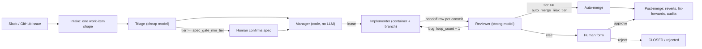

# Company software factory — one-page design

The design of the factory. Living document: change it when a decision changes.

## 1. Shape

## 2. Work item (one shape, all sources)

`source{type, link}`, `requester_id`, `problem`, `resources` (pointers), `done_criteria` (frozen after confirm), `desired_output`, `scope` + *`allowed_paths`*, `tier 1–5`, `stage NEW|READY|RUNNING|REVIEW|CLOSED`, `blocked_on none|human|upstream|ci|budget` + `blocked_reason`, `close_reason completed|duplicate|wont_do|failed|rejected`, `loop_count`, `restart_count`, `token_cost`, `project`, `pr_number`, `merge_sha`, *`fixes_pr`*. Every change → `state_changes` row (IDs only, never names).

## 3. Risk

- **Tier** = max(agent judgment, human floor directories). Rechecked at review; never lowered.
- Tier ≥ 3: human approval. Tier 5: rollout plan.
- `spec_gate_min_tier`, `auto_merge_max_tier` start fully gated (auto-merge at 0).
- **Ratchet:** moving a dial toward safety is automatic + notify. Loosening or any structural change is a human decision backed by a number.

## 4. Agents

| Role | Reads | Writes | Model |
|---|---|---|---|
| Triage | Slack thread, issues, code (API, no clone) | its fields, `READY` / `CLOSED` | cheap |
| Manager | `READY` queue | lease, assignment | none (code) |
| Implementer | work item + pointers + previous mistakes | code on its branch, TDD tests, handoff row per commit | — |
| Reviewer | pass 1: work item + diff + `worked_on` (no transcript); pass 2: intent, how_to_test | acceptance tests (blind, hidden from implementer), verdict, cumulative mistakes, tier recheck | strong, different if measured to help |

Instructions are soft; tools and permissions are hard. Credentials live only inside tool wrappers: agents never read secrets, only tools do, enforced by guards G1–G6 (architecture §5).

Phase 1 human gate on GitHub (D5): the triage spec is an issue comment; a user with **write** permission replies `/approve` or `/reject <reason>`; `/retry` re-runs a failed run. Merging the PR is the merge gate. The factory marks each handled command (and each issue it takes in) with a 👀 reaction, and explains a refused command (no write permission, or a state that cannot take it) in one reply comment (decided 2026-11-01). Agents get no broker tools yet: the worker pushes, opens the PR and posts the review through the `ToolBroker` after the agent exits (decided 2026-10-31).

**Scope gate (new decision, 2026-11-01):** before every push, the worker checks the files the branch changes against the item's `allowed_paths` with the same coverage rule triage uses for `files_to_change` (exact match, or under an allowed path ending in `/`; `isCovered` in `src/core/policy.ts`). The diff is cumulative: `git diff --name-only -z --no-renames <base-sha>...HEAD`, where `<base-sha>` is `origin/<base_branch>` resolved before the implementer starts (its writable git dir includes refs). `--no-renames` makes a rename a delete plus an add, so both paths are checked; the three-dot range leaves out files only base changed, so merging base in is fine, and merge commits are not skipped. A violation fails the run with `scope_violation` (not infra, no automatic restart), writes no handoffs, makes no push or PR, and posts the full file list on the issue. It is a gate, not a dial: no config turns it off. Any future push path (e.g. merge-conflict resolution) must call the same check.

## 5. Coordination

- Judgment calls default to humans (form + reason). Recurring decisions → proposed rules → human approves.
- Isolation: container + branch per worker; ports and test DB per worker; shared pool mounted read-only with one updater.
- Lease + heartbeat; expired leases released by code. Each claim bumps a **fencing token**; heartbeats, completions, handoff rows and broker calls carry it, so a worker that lost its lease can't write (decided 2026-10-31).
  - Host sleep (fencing rule changed 2026-11-01; before, `lease_expires_at` was also a hard deadline for every write): **status and token decide whether a lease is held, not the clock.** Heartbeat, completion, handoffs and broker calls are accepted while the run is `running` with the caller's token, even after `lease_expires_at` passed. So a worker that wakes from a sleep renews its unreclaimed lease and finishes on the same attempt. Expiry only makes a run eligible for the reaper. Once the reaper requeues or fails it, or another worker reclaims it (token + 1), the old token is refused everywhere. The reaper keeps its previous tick time in memory (per process, not shared between replicas). If more than `lease_ms` passed since then, it skips expiring leases for one `heartbeat_ms`, so workers that slept on the same host can renew first. Residual gap: a reaper on a host that did not sleep still requeues a sleeping worker's run once `lease_ms` passes. Closing that needs a human decision (longer lease, or host liveness in the store).
- Runs: the controller enqueues, workers claim. A transition can **ack a finished run and enqueue the next one in the same transaction**, so a crash between "decide" and "enqueue" can't strand an item (decided 2026-10-31).
- Store backend (D3 changed 2026-10-31): **MySQL** by default, because several workers and machines are planned. SQLite stays for tests and single-machine use. `factory.config.json` → `store.type` picks one (a plugin name, D6; `docs/plugins.md`). The store logic exists once (`SqlFactoryStore`); a backend is only a `SqlDriver` (transactions, statements, lock syntax), and both pass the same store contract tests. MySQL claims runs with `FOR UPDATE SKIP LOCKED` in READ COMMITTED transactions.
- Time is injected through a `Clock` interface: `SystemClock` in prod, `FakeClock` in tests (decided 2026-10-31). Crash → resume from branch + latest handoff, `restart_count` (not `loop_count`).
- Restarts: exponential backoff; infra-caused (host lost) vs task-caused (same failure on a fresh host) kept apart; at `max_restart` (e.g. 3) → `blocked_on: human`, `blocked_reason: max_restart`, with the last failure logs attached (dead-letter pattern).
- **Sandbox** interface: `create(spec) -> handle`, `exec(handle, cmd)`, `copy_in/out`, `destroy(handle)`. Impls: `NoOpSandbox` (local dev, now: runs in a git worktree on the host, no isolation), Docker, gVisor, Kata / Firecracker, hosted sandboxes. Swapping never touches agents.
  - *With `NoOpSandbox`, an agent has the host user's access. Keep the local factory on the test environment only (prod connections refused) and per-worker ports / test DB via the interfaces.*
- Merge conflict (decision changed 2026-11-01; before: "→ `READY` / `blocked_on: human` / `merge_conflict_pending`; human instructs, factory resolves"): when GitHub reports an open factory PR as unmergeable (`mergeable === false`, the source's `pr_unmergeable` event) and its item waits for a human merge (`REVIEW` / `merge_pending`), the controller enqueues one **`update` run** per (head sha, base sha). The worker runs no agent for it: it merges `origin/<base_branch>` into the PR branch in a fresh worktree (merge only, never a rebase or force push), runs `repo.test_command` (argv in `factory.config.json`, default `["npm","test"]`) with the worker's tool env, and **pushes only if the merge is clean and the tests pass** (`update_pushed`; the item stays `merge_pending`). Otherwise it pushes nothing, comments on the PR (the conflicting files one per line, or that the tests failed on the updated branch), and the controller sets `blocked_on: human` / `merge_conflict_pending` (`update_conflict` or `update_tests_failed`); the stage stays `REVIEW`. A base already contained in the branch is a no-op. A git or push error fails the run (`run_failed:update:<code>`), and `/retry` re-enqueues it. **Resolving conflicts with an agent is still open.**

## 6. Measurement

- Raise auto-merge: severity-weighted human feedback rate < per-tier threshold over a per-tier min sample.
- Keep it raised: revert rate, fix-forward links, *sampled human audits*. Lower automatically when escapes cross the threshold.
- **Revert and fix-forward tracking (new decision, 2026-11-01; replaces "revert rate (webhook)"):** reverts are found by polling base-branch commits, not by webhook. The `github-issues` source reads `origin/<base_branch>` commits (cursor: commit date, `since` inclusive; the first poll reads at most the newest 500, and a window over 500 drops the oldest) and emits `base_commit` {sha, message}. The controller (matchers in `src/core/links.ts`) records a `reverted` state_changes row on a factory item when a commit body says `This reverts commit <merge_sha>`, or when a subject starting with `Revert` names its PR `#N` (the squash suffix `(#M)` at the end is the reverting PR, not a candidate). A new issue whose title or body says `Fixes #N` or `Follow-up to #N`, N a factory PR, gets `fixes_pr = N` (row reason `fixes_pr_linked`) and the item with PR N gets a `fixed_forward` row. Only factory PRs are linked; other numbers are ignored. These rows change no field: `reverted` and `fixed_forward` are state_changes reasons only, not stages or close reasons, and nothing about gates or auto-merge changes. What the reason code cannot hold goes in the new nullable `state_changes.detail` (JSON, IDs and shas only): `reverted` → `{reverting_commit, reverting_pr}`, `fixed_forward` → `{fix_work_item_id}`, `fixes_pr_linked` → `{original_work_item_id}`. Dedupe key (checked inside the conditional transition, so a conflict re-reads): (item, `reverted`, reverting commit), so two commits that revert the same merge are two rows; (original item, `fixed_forward`, fix item). Rows written before the column existed have `detail` NULL. Stats over these rows are not built yet.
- Compare agents: golden PRs (bad + good) → catch rate up without false-alarm rate up → shadow mode → human decides on cost.
- Per-tier budget → `blocked_on: budget`.

## 7. Self-improvement

- Behavior changes only through what agents read or may do: all files in the factory-definition repo.
- Additive learnings: automatic. Prompt / gate / permission / tool changes: improver PR with replay evidence → human.
- Recurring failure class → hard fix (gate, permission), not a softer prompt.
- Progressive disclosure: index → body → references; `CapabilitySearch` (BM25, vector, hybrid) finds skills/tools/MCP. Finding ≠ permission.

## 8. Enterprise

- **Plugins (D6, decided 2026-11-01):** every implementation of an infra interface is a named plugin, selected by name in `factory.config.json` and built only through the registry in `src/plugins.ts`; `build()`, setup/doctor and the G6 canary all resolve through it. Unknown names fail at startup. The guards (`SecretStore`, `EgressScanner`, `ToolBroker`; architecture §5) can be switched to another plugin but never disabled: config that selects none fails at startup. No external plugin loading. This changes how D3's store choice and the `auth` key are described: `store.type` and `auth` are now the plugin names for `FactoryStore` and `AuthProvider` (same keys, same values); the other interfaces are under `plugins`. Catalogue: `docs/plugins.md`.
- **Self-update (D7, decided 2026-11-01):** the factory runs from a runtime copy of `origin/<base_branch>` (`<state_dir>/runtime`, a detached git worktree), not from the checkout it was started in. State stays in the main checkout: `state_dir`, `worktrees_dir`, `repo.path`, the database, shared storage and the secret file; only code, `factory.config.json` and `prompts/` come from the runtime copy (`loadConfig` takes the code root explicitly; the supervisor passes it as `SOFTWARE_FACTORY_CODE_ROOT`). `dev` is a supervisor behind a new `Updater` plugin (`git-worktree` default, `none` = run in place as before). Order on a code change: build the new commit beside the running child first, then drain (IPC; the worker stops claiming and finishes its in-flight run), fast-forward, swap in the build, restart. This deliberately differs from "drain, update, build, restart": a failed build must leave the old version running. Consequence: under `git-worktree`, uncommitted local edits, local branches and unpushed merges no longer affect `dev`. The main checkout is only fast-forwarded, and only when it is on the base branch and clean.
- **Keep awake (decided 2026-11-01):** a new `KeepAwake` interface (`hold` / `release`, plugin kind `awake`, config key `plugins.awake`, not a guard). The worker holds it only while a claimed run executes, never while idle. Plugins: `caffeinate` (macOS, `caffeinate -i -s -w <pid>`) and `none`. **The default depends on the platform:** `caffeinate` on `darwin`, `none` everywhere else, so the checked-in config leaves `awake` out. Selecting `caffeinate` on a host without the executable fails at startup. A failed hold only logs a warning; the job still runs. Lid close still sleeps a Mac; the host-sleep lease rules (§5) cover that case. Catalogue: `docs/plugins.md`.
- Every infra layer is an interface with local + cloud backends: store, **sandbox**, secrets, shared storage, search, **auth**, **LLM provider** (`LLMProvider`; first impl: Anthropic, transports: Claude Code CLI on subscription locally → API / company ML gateway; other vendors or self-hosted later) and **agent runner** (`AgentRunner`; first impl: `claude -p`). Local first.
- Environments labeled by humans: test → DB data may reach the model; prod → blocked at the model interface.
- Tools/MCP: users can add them; automated credential-leak check + human approval; rules scoped to the tool.
- AuthN/Z behind an `AuthProvider` interface (`resolve`, `authorize`; impls: no-auth, SSO/OIDC, GitHub permissions, policy engine), called by intake, tool wrappers and the human gate. Factory acts on behalf of `requester_id`; effective permission = requester ∩ agent. Classes: local dev (no-auth), internal low risk, team-owned, restricted data, critical (two-person rule).
- Audit: IDs for requester, agent role, approver on every record.
- GitHub identity: one bot identity per agent role (triage / implementer / reviewer); requester ID in the PR; approver from the PR review.
- User attributes: `user_id : key : value` (e.g. `u_123 : role : payments`). Domain-class policies require attributes; `AuthProvider.authorize` checks them.
- Auth best practices applied: deny by default; least privilege; attributes come from the identity provider (agents can't edit them); delegated tokens short-lived and scoped; periodic access review; a logged break-glass path for incidents. Resource classes follow the common public / internal / confidential / restricted scale, mapped onto the five classes above.

## 9. Status page

**Read-only status page (new decision, 2026-11-01).** `npm run factory -- ui` serves two pages from `node:http` on `127.0.0.1:<ui.port>` (`factory.config.json`, default 4310; there is no host option): `/` (Waiting for you, grouped by `blocked_reason`; Running now, highlighted when the last heartbeat is older than `lease_ms`; Queue, oldest first; All work items, `?stage=` filter, CLOSED hidden unless `?closed=1`; Totals: items per stage, runs succeeded and failed and tokens in the last 24 h) and `/items/<id>` (state_changes timeline and runs). Meta refresh every 5 s, no JavaScript, no front-end dependency. No actions (approve, retry, merge stay on GitHub), no login, no remote access.
- **A surface, not a plugin.** Like the CLI it reads `FactoryStore` and has no plugin interface or `docs/plugins.md` entry. It is built through `Plugins` (store, secrets, scanner), not `build()`, so it runs no controller or worker.
- **Withhold, not mask.** Free text from the store (titles, blocked reasons, state-change values and reasons, run errors) is egress-scanned before rendering. `EgressScanner.scan` returns rules, not spans, so a field with any finding is replaced whole by `[withheld: <rule>]`. Span-level masking would need a new `EgressScanner` method; that is a separate tier-4 change if wanted.
- **Request guards.** GET and HEAD only (405 with `Allow: GET, HEAD` otherwise), unknown paths 404, and a Host header other than `127.0.0.1` or `localhost` (any port) gets 403, against DNS rebinding: the page exposes store data to any local browser tab. Responses carry a CSP with `default-src 'none'`.
- **New nullable columns** (migration 3, SQLite and MySQL): `work_items.title` (written at intake; `problem` is unchanged, since triage overwrites `problem` with the spec), `runs.started_at` (set on every claim, so it is the latest attempt's start) and `runs.finished_at` (set when a run succeeds or fails, by the worker or the reaper; a reaper requeue leaves it null). Rows from before the migration read as null: an item without a title shows its source id, a run without `started_at` shows an unknown duration. `title` is store-owned, not in `WorkItemPatch`.
- **New read methods** on `FactoryStore`, implemented once in `SqlFactoryStore`: `listWorkItemsWhere` (stage, blocked_on, exclude closed), `countWorkItemsByStage`, `listRunsByStatus`, `listRunsFinishedWithin(window_ms)` (the window is measured on the store's clock, so no "now" argument).
- **"Last 24 h"** counts runs by `finished_at`. Tokens are summed in app code from succeeded runs' `outcome.data.tokens`, the same source the controller adds to `token_cost`; failed runs report no tokens.

## First build (local)

*Suggested order:* store + work item + `state_changes` → intake (one source) → triage → manager + lease → implementer in a container → reviewer → human form. Everything gated at day one; turn dials only when the Step 5 numbers say so.
