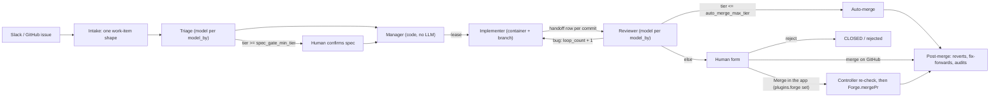

# 1. Shape

**The last human gate has a factory path** (decision changed 2026-11-08, issue #246). A ready PR is still merged only by a person, now either on GitHub or with the app's Merge button on a project that names its forge in `plugins.forge`. The button sends the `merge` command; the controller checks again that the item is ready (review passed, checks green, no commits after the reviewed head, merges cleanly) and merges through the forge: the `github` forge through the bot, the `local` forge into the base branch of the factory repo with no GitHub call (design 04-gate-commands, merge command; docs/plugins/forge.md). Auto-merge stays off (`auto_merge_max_tier` 0).

## History

- **The last human gate has a factory path** (decision changed 2026-11-08, issue #246). Before: only a person on GitHub merged a ready PR ("approve" on the human form meant merging it there); the factory only read the merge.
